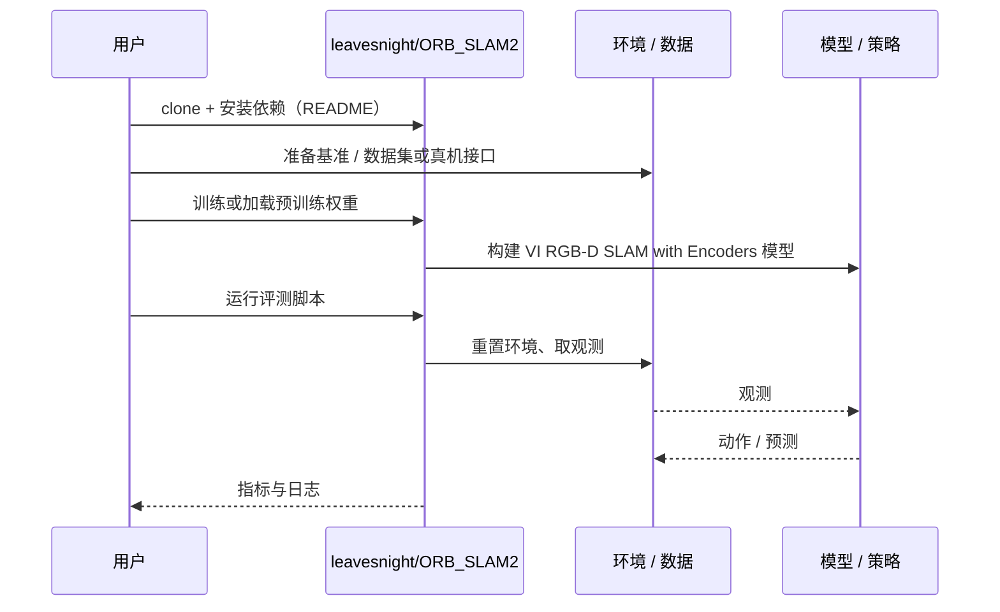

# VI RGB-D SLAM with Encoders（arXiv:2610.41768）

**VI RGB-D SLAM with Encoders**（*Visual-Inertial RGB-D SLAM with Encoders for a Differential Wheeled Robot*，[arXiv:2610.41768](https://arxiv.org/abs/2610.41768)，[代码](https://github.com/leavesnight/ORB_SLAM2)）来自 [具身智能小站 2026-11-03 盘点](../../sources/blogs/wechat_embodied_station_49_papers_sacq_action_aware_quantization_2026-11-03.md)，属「规划、优化与感知基础」组。

## 一句话定义

**紧耦合视觉、惯性、编码器与深度观测，改善差速轮式机器人的定位鲁棒性。**

## 英文缩写速查

| 缩写 | 英文全称 | 简要说明 |
|------|----------|----------|
| VI RGB-D SLAM with Encoders | Visual-Inertial RGB-D SLAM with Encoders for a Differential Wheeled Robot | 本文方法 / 基准的简称 |

## 为什么重要

- 用编码器补足视觉短时失效。正文注明其已发表于 2022 年，本期作为新增索引中的历史工作补充阅读。
- 开源结论：**部分开源**（步骤 2.5，2026-11-03）。公众号代码入口为 leavesnight/ORB_SLAM2（git ls-remote 可达），是否为论文官方实现未核对。
- 同期同组工作见 [动作感知量化、失败定位与可验证自主：具身智能小站 11-03 期 49 篇阅读坐标](../overview/embodied-station-2026-11-03-49-papers-technology-map.md)。

## 核心机制

| 项 | 内容 |
|----|------|
| **arXiv** | [2610.41768](https://arxiv.org/abs/2610.41768) |
| **开源** | **部分开源** |
| **要点** | 紧耦合视觉、惯性、编码器与深度观测，改善差速轮式机器人的定位鲁棒性。 |
| **文内指标** | 公众号转述：正文注明其已发表于 2022 年，本期作为新增索引中的历史工作补充阅读。 |

## 源码运行时序图

以下为按仓库入口（`leavesnight/ORB_SLAM2`）推断的通用运行链路；入库日仅核实仓库可达，未逐文件阅读，具体脚本名以 README 为准。

## 实验与评测

- 公众号转述：正文注明其已发表于 2022 年，本期作为新增索引中的历史工作补充阅读。
- **读法：** 本页为索引级摘要，依据公众号转述的官方摘要与仓库信息整理；逐项数字与 baseline 以原文 PDF 为准。

## 与其他工作对比

- 横向索引见 [动作感知量化、失败定位与可验证自主：具身智能小站 11-03 期 49 篇阅读坐标](../overview/embodied-station-2026-11-03-49-papers-technology-map.md)；同 arXiv 不重复造页。

## 结论

**用编码器补足视觉短时失效：正文注明其已发表于 2022 年，本期作为新增索引中的历史工作补充阅读。**

1. 开源边界：**部分开源** — 公众号代码入口为 leavesnight/ORB_SLAM2（git ls-remote 可达），是否为论文官方实现未核对。
2. 核心机制：紧耦合视觉、惯性、编码器与深度观测，改善差速轮式机器人的定位鲁棒性。
3. 复现与选型前核对任务协议、硬件与基准口径，勿直接横比公众号摘录数字。

## 关联页面

- [manipulation](../tasks/manipulation.md)
- [locomotion](../tasks/locomotion.md)
- [sim2real](../concepts/sim2real.md)
- [embodied-station-2026-11-03-49-papers-technology-map](../overview/embodied-station-2026-11-03-49-papers-technology-map.md)

## 参考来源

- [vi_rgb_d_slam_with_encoders_arxiv_2610_41768.md](../../sources/papers/vi_rgb_d_slam_with_encoders_arxiv_2610_41768.md)
- [wechat_embodied_station_49_papers_sacq_action_aware_quantization_2026-11-03.md](../../sources/blogs/wechat_embodied_station_49_papers_sacq_action_aware_quantization_2026-11-03.md)
- [arXiv:2610.41768](https://arxiv.org/abs/2610.41768)

## 推荐继续阅读

- [arXiv PDF](https://arxiv.org/pdf/2610.41768)
- [https://github.com/leavesnight/ORB_SLAM2](https://github.com/leavesnight/ORB_SLAM2)
