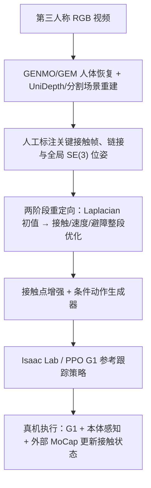

---

type: entity
tags: [paper, humanoid, loco-manipulation, video-imitation, motion-retargeting, contact-aware, reinforcement-learning, ppo, isaac-lab, sim2real, berkeley]
status: complete
updated: 2026-10-13
arxiv: "2610.13079"
project_id: vicar-video-imitation-contact-aware-retargeting
project: https://ember-center-berkeley.github.io/VICAR/
code: https://github.com/ember-center-berkeley/VICAR
related:
  - ../tasks/loco-manipulation.md
  - ../concepts/motion-retargeting-pipeline.md
  - ../concepts/contact-rich-manipulation.md
  - ./paper-notebook-visualmimic.md
  - ./paper-core.md
sources:
  - ../../sources/papers/vicar_arxiv_2610_13079.md
  - ../../sources/sites/vicar.md
  - ../../sources/repos/vicar.md
summary: "VICAR 从第三人称视频恢复人体动作与任务相关场景几何，以全局接触位姿、末端速度和避障代价重定向到 Unitree G1，再训练可接收可移动接触点的动作生成器与 PPO 跟踪策略；论文在 10 项技能上评测，4 类技能完成真机部署。"
---

# VICAR：面向人形交互技能的视频模仿与接触感知重定向

**VICAR: Video Imitation with Contact-Aware Retargeting for Humanoid Interactive Skills**（Dvij Kalaria、Bike Zhang、S. Shankar Sastry，University of California, Berkeley；[arXiv:2610.13079](https://arxiv.org/abs/2610.13079)；[项目页](https://ember-center-berkeley.github.io/VICAR/)）研究如何把第三人称人类视频变成能在真实人形机器人上执行的接触丰富技能。它的关键不是只让机器人“像人一样动”，而是把任务要求的**世界坐标接触位姿、接触时机、运动速度和障碍物间隙**保留在重定向后的参考动作里，再让接触条件生成器支持运行时改动球/物体/支撑点。

## 一句话定义

> VICAR = 单目视频中的人体与场景恢复 → 带全局接触与速度约束的两阶段重定向 → 可变接触点增强与动作生成 → PPO 学习参考跟踪 → G1 真机执行；其中接触目前仍需人工标注，运行时全局物体/球状态依赖外部 motion capture。

## 英文缩写速查

| 缩写 | 英文全称 | 简要说明 |
|---|---|---|
| VICAR | Video Imitation with Contact-Aware Retargeting | 论文方法名 |
| HOI | Human–Object Interaction | 人与物体的交互 |
| SE(3) | Special Euclidean Group in 3D | 同时描述三维位置与方向的刚体位姿 |
| PPO | Proximal Policy Optimization | 训练 G1 动作参考跟踪策略的强化学习算法 |
| G1 | Unitree G1 Humanoid Robot | 论文主要仿真和真机人形平台 |
| RL | Reinforcement Learning | 通过与环境交互优化动作策略 |
| Isaac Lab | Isaac Lab | 论文采用的机器人仿真与学习环境 |
| MoCap | Motion Capture | 运动捕捉；部署时用于提供全局球/物体状态 |

## 研究问题与定位

接触丰富的技能由稀疏但精确的事件定义：球拍必须在正确时刻击中球，手必须抓到物体，身体可能要用另一只手撑住桌沿，爬梯时手脚要落在特定横档。仅按人体骨架或局部人–物几何重定向，可能让轨迹外观相似，却把接触点挪到机器人够不到的位置；事后再做避碰修正也可能引入动作不连续。

VICAR 的重点在“参考生成层”：将需达成的接触显式写成世界坐标的目标位姿，使它们与障碍物避让和末端速度保存在同一个整段轨迹优化中。它与 [VideoMimic](./paper-notebook-visualmimic.md) 的共同点是从视频恢复运动/环境并为人形学习提供参考；VICAR 更集中处理任务指定的全局接触点与可变接触位置。

要注意，论文中的 contact 是**位姿目标**：指定机器人哪个链接在何时到达某个 $SE(3)$ 位姿；它没有直接建模接触力、摩擦状态、滑动或接触模式。因此“contact-aware”不能理解为已经解决了力控或完整接触动力学。

## 方法总览

### 1. 从单目视频恢复运动与场景

- 用 GENMO/GEM 从第三人称 RGB 视频恢复人体全局运动、root 轨迹与任务相关关键点。
- 用 UniDepth 估计逐帧深度、Semantic-SAM 分割语义区域，再让 GPT-4o mini 从分割区域中选出桌面、桌沿、地面或支撑面等任务相关区域。
- 将选区深度反投影到任务世界系，以人体估计身高和人体–场景对齐估算尺度；随后生成障碍点云/体素碰撞几何。论文使用 5 cm 体素，并以至少 5 个点判定占据。
- 关键接触帧、机器人对应部位、接触朝向及目标世界位姿由人工标注；论文称每项技能约需 20–30 分钟。

### 2. 两阶段重定向

**阶段 A：生成合理初值。** 采用 OmniRetarget 风格的 interaction-mesh/Laplacian keypoint 拟合，在关节位置、速度限制和时间平滑下得到 humanoid 轨迹初值，但先关闭障碍惩罚，避免在场景尺度或几何仍有偏差时过早把动作推向错误一侧。

**阶段 B：整段接触感知优化。** 对整段浮动基座与关节轨迹一起优化：

- $\mathcal{L}_{p}$：保持人体与机器人末端每步位移长度一致，以近似保留运动速度；
- $\mathcal{L}_{R}$：保持角速度/朝向变化幅度；
- $\mathcal{L}_{s}$：平滑轨迹；
- $\mathcal{L}_{col}$：惩罚与重建障碍物的穿透；
- $\mathcal{L}_{anchor}$：让指定机器人链接在标注帧达到目标全局接触位姿；
- 关节位置与速度边界作为可行性约束。

障碍与 anchor 项以高权重拉格朗日/KKT 风格 penalty 纳入目标，但它们并非严格等式约束：如果人工标注与几何/机器人可达性冲突，优化结果可能只是最近可行位姿，论文报告残差而不保证零误差。

### 3. 接触点增强、动作生成与策略跟踪

重定向后的 motion family 用于训练带 style 与 movable-contact 条件的动作生成器。六种乒乓球发球可改变抛球点/击球点；物体拾取可改 grasp pose；双手搬箱保持同步抓取；爬梯保留序列化手脚支撑。仿真策略跟踪生成的机器人/物体参考。

论文使用 Isaac Lab + Unitree G1，物理步长 5 ms、动作 decimation 4，对应名义策略频率 50 Hz；另测试 25 Hz 变体。每轮并行 4,096 个环境，PPO 最多训练 30,000 iterations；观测含参考命令、anchor 与身体相对姿态/速度、关节状态、前一动作。接触/摩擦、关节偏置、质心及随机推扰用于域随机化。

### 流程图

## 实验与结果

论文评测 10 个第三人称视频技能：6 种乒乓球发球、桌面拾取、桌下拾取（右手支撑桌沿、左手取物）、双手搬箱并放上桌，以及爬梯。对照 PHC、GMR、VideoMimic、OmniRetarget 和去除速度保持的消融；为隔离重定向效果，所有方法统一使用接触 penalty、anchor 增强及相同 PPO 超参数/训练步数/奖励/域随机化。仿真策略成功率基于每项 1,000 次试验。

| 任务 | VICAR 仿真成功率 | OmniRetarget | 观察 |
|---|---:|---:|---|
| 乒乓球发球 | 99.8% | 99.8% | 与强基线相当；GMR 为 97.2%，对接触点估计与增强敏感 |
| 桌面拾取 | 99.8% | 76.2% | 避免了重定向初值绕桌不同侧导致后续避碰修正不连续 |
| 桌下拾取 | 99.2% | 98.1% | 两者仿真成绩都高；VICAR 的速度误差更低 |
| 双手搬箱/放置 | 100% | 100% | 此项没有显示成功率增益 |
| 爬梯 | 95.5% | 56.0% | 明显改善仿真跟踪；真机爬梯仍失败 |

真机评测使用 Unitree G1，拾取使用 Dex3-1 手。**21/30** 次发球成功（70%）、桌面拾取 **10/10**（100%）、桌下拾取 **7/10**（70%）、双手搬箱 **6/10**（60%）。爬梯没有真机成功结果：盲跟踪策略会绊倒，尽管参考轨迹平滑。所谓 zero-shot sim-to-real 仅指训练未使用真机数据；不是纯视觉零样本部署——策略用本体感知和 projected gravity 跟踪，外部 motion-capture 系统仍提供球/物体的全局位置以更新接触条件。

### 与相邻路线的区别

| 路线 | 重点 | VICAR 的差别 |
|---|---|---|
| PHC / GMR | 人体姿态到机器人姿态重定向 | VICAR 显式保留全局任务接触位姿、速度和障碍间隙 |
| VideoMimic | 视频恢复人体与环境，生成 contextual humanoid skills | VICAR 将稀疏接触 anchor 放入重定向优化，并支持运行时改变接触位置 |
| OmniRetarget | interaction mesh 与硬关节/速度/碰撞/支撑约束 | VICAR 用世界系接触 pose penalty 和速度保持处理某些需要指定接触目标的任务 |
| VICAR | 视频 → 接触/速度保持重定向 → contact-conditioned generator → tracking policy | 提升主要出现在桌面拾取与仿真爬梯等障碍/接触敏感场景，而非所有任务均胜出 |

## 复现与开源边界

- **论文**：arXiv v1 已公开，论文标注 CC BY 4.0。
- **官方仓库**：公开项目网站、10 类视频、交互式 Viser 轨迹浏览器、可移植 motion 数据、静态导出/播放和测试工具。
- **完整研究算法**：官方仓库的 `docs/VISUALIZATION_SOURCES.md` 明确说原始训练、refinement 和 augmentation 代码仍在外部 **TT_PLayer** checkout；公开的 `visualization/` 主要负责数据导入、渲染、本地播放与静态导出。仅克隆 VICAR 项目网站仓库，不能完整复现论文的 retarget 优化器或 PPO 训练。
- **许可**：未发现 VICAR 根目录的统一项目 LICENSE；仓库明确保留 Viser MIT 许可、Unitree G1 模型 BSD 3-Clause 通知，研究轨迹和论文图仍由各自权利人持有。不要把依赖/资产许可误当作研究方法代码的整体许可。
- **硬件链路依赖**：部署时的全球球/物体位姿由 motion-capture 系统提供；G1 本体策略不是端到端从摄像头直接观测并估计全部状态。

## 局限与结论

**VICAR 的主要贡献是把“任务接触目标”前移到视频重定向优化，而不是只在策略层希望机器人自行补救接触漂移。** 对需要在桌沿支撑、球拍击球或梯级落脚等具体位置交互的技能，这能改善参考动作连续性与仿真可跟踪性；但整个系统仍依赖手工接触标注、外部全局跟踪和完整训练源代码所在的外部 checkout。

- 高权重 contact/collision penalty 不等于硬约束；不可达或冲突标注仍会产生残差。
- 人工标注和场景重建按技能进行；换任务家族不能直接免标注迁移。
- 仿真成功率不能替代真机成功率：爬梯的仿真–硬件差距尤其明显。
- motion-capture 提供球/物体全局位置，故不能宣传成“只靠普通单目相机即可真机执行”。
- 当前接触位姿目标没有显式力、滑动或接触模式；灵巧操作仍受手模型能力限制。
- 对场景深度误差、语义分割或 GPT-4o mini 选区幻觉的鲁棒性不在本文贡献范围内。

## 关联页面

- [动作重定向流水线](../concepts/motion-retargeting-pipeline.md) — 从视频/人体状态到可跟踪机器人参考。
- [Loco-Manipulation](../tasks/loco-manipulation.md) — 走动与全身交互技能语境。
- [Contact-Rich Manipulation](../concepts/contact-rich-manipulation.md) — 稀疏接触目标与接触状态的区别。
- [VisualMimic](./paper-notebook-visualmimic.md) — 同为视频驱动人形学习；场景重建/策略部署路线的相邻工作。
- [CoRe](./paper-core.md) — 另一类接触感知人形运动优化路线，方法目标不同。

## 参考来源

- [VICAR 论文摘录](../../sources/papers/vicar_arxiv_2610_13079.md)
- [VICAR 官方项目页归档](../../sources/sites/vicar.md)
- [VICAR 官方仓库归档](../../sources/repos/vicar.md)
- [arXiv HTML: 2610.13079v1](https://arxiv.org/html/2610.13079v1)

## 推荐继续阅读

- [VICAR 项目页与 10 类视频演示](https://ember-center-berkeley.github.io/VICAR/)
- [VICAR 官方仓库](https://github.com/ember-center-berkeley/VICAR)
- [arXiv 摘要与论文](https://arxiv.org/abs/2610.13079)
