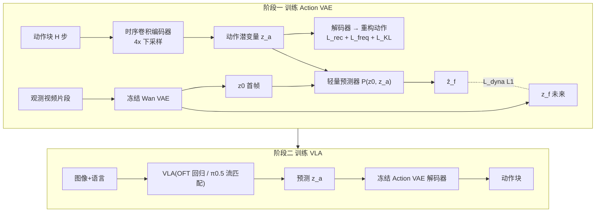

# ViDAL：视觉动力学锚定的 VLA 动作潜空间

**ViDAL**（[arXiv:2610.08150](https://arxiv.org/abs/2610.08150)）让 VLA 不再直接预测动作 token/块，而是预测一个**既能重构动作、又与「动作引起的未来视觉变化」对齐**的连续潜变量，再由冻结的 Action VAE 解码器还原动作块。

## 一句话定义

**训练一个动作 VAE，使其潜变量同时重构动作块并预测冻结视频 VAE 编码的未来场景潜变量，然后让 VLA 在这个潜空间里回归/流匹配。**

## 英文缩写速查

| 缩写 | 英文全称 | 简要说明 |
|------|----------|----------|
| ViDAL | Visual Dynamics-grounded Action Latent | 本文方法与动作潜空间 |
| VLA | Vision-Language-Action | 视觉语言动作模型 |
| VAE | Variational Autoencoder | 动作 VAE 与冻结的 Wan 视频 VAE |
| OFT | Optimized Fine-Tuning | OpenVLA-OFT / StarVLA-OFT 的回归式动作专家 |
| DCT | Discrete Cosine Transform | 频域重构损失（沿用 FAST） |
| KL | Kullback–Leibler divergence | 潜变量先验正则 |

## 为什么重要

- 动作表示决定 VLA 学到什么：纯轨迹拟合的潜空间没有动作的「物理效果」信息。
- ViDAL 的插入点是动作接口，不改 VLM 主干，可同时接回归式与流匹配式专家。
- 潜空间几何更分散：第一主成分方差占比 40.9%→15.6%，达 95% 方差需 40→14 维成分，说明动作信息被更均匀编码。

## 方法栈总览

## 方法

- **Action VAE：** 归一化动作块 → 高斯后验潜变量，时间 4× 下采样（T=H/4）；时序卷积 + 残差块编码、镜像解码。LIBERO/Franka：7 维动作、H=32、D=8、128×128、50k 步；RoboTwin/ARX：14 维、H=48、D=16、96×128、50k 步。
- **视觉动力学对齐：** 冻结 Wan VAE 取首帧 z₀ 与未来 z_f；预测器以交叉注意力由 (z₀, z_a) 预测 ẑ_f；训练后丢弃预测器。
- **总损失：** L_rec（L1）+ λ_freq L_freq（DCT，沿用 FAST，=1）+ λ_KL L_KL（=1e-4）+ λ_dyna L_dyna（L1 对 stop-gradient 的 z_f，=1）。
- **接入 VLA：** OpenVLA-OFT、StarVLA-OFT 回归潜变量；π0.5 把潜变量作为条件流终点；推理用冻结解码器；π0.5 动作专家学习率为 VLM 的 10 倍。
- **可选：** ẑ_f 经视频 VAE 解码可视化未来帧，仅分析用。

## 实验与评测

| 基准 | 方法 | 结果 |
|---|---|---|
| LIBERO 平均 | OpenVLA-OFT → +ViDAL | 96.8 → 97.1 |
| LIBERO 平均 | π0.5 → +ViDAL | 96.9 → **98.1**（Long 92.4→95.6） |
| RoboTwin 2.0 Clean/Random（50 任务） | π0.5 → +ViDAL | 54.3/33.2 → **65.5/43.1** |
| RoboTwin 2.0 | StarVLA-OFT → +ViDAL | 50.4/2.2 → 54.6/4.0 |
| RoboTwin 2.0 | π0（官方单任务） | 46.4/16.3 |

- LIBERO 其他基线均值：π0-FAST 94.2、FASTer 97.9、GR00T-N1.5 93.9、UniVLA 95.2。
- **真机：** Franka Research 3 四任务平均 +20.0%（每任务 10 次）；ARX 双臂三任务平均 +23.4%；逐任务数字仅在图中，原文文本未给。
- **消融（π0.5，Clean/Random）：** 朴素 VAE 57.4/38.3；去 L_dyna 62.2/40.1；去 L_freq 63.1/40.4；去 L_KL 63.2/39.7；完整 65.5/43.1。Wan VAE 目标优于 CogVideoX/SVD/V-JEPA；稠密 L1 优于 InfoNCE；只预测潜变量最佳；λ_KL 最敏感。

## 源码运行时序图

不适用：2026-10-12 核查 arXiv 页面与 HTML 均未给出官方代码、项目页或权重，无仓库可对齐。

## 工程实践

- 先单独训练并冻结 Action VAE（50k 步量级），再训练 VLA；换本体/动作维需重训 VAE。
- λ_KL 先调，其次 λ_dyna；视觉目标优先 Wan VAE。
- 只让 VLA 预测潜变量；同时回归 raw 动作的联合头效果介于两者之间。
- 开源状态：未发布。

## 结论

**把动作潜空间与未来视觉动力学对齐，是在不改 VLM 主干的前提下提升 VLA 的低成本接口；增益在困难基准上更清楚。**

1. LIBERO 近饱和（+0.3 / +1.2），RoboTwin 才显著（+11.2 / +9.9）。
2. L_dyna 贡献约 3.3 个 Clean 点（65.5 vs 62.2），不可省。
3. 目标视觉编码器的选择影响结果，Wan VAE 最好。
4. 只预测潜变量优于混合头。
5. 真机仅 3–4 任务，应视为方向性证据。

## 局限与风险

- LIBERO 增益小；RoboTwin Random 绝对值仍低，StarVLA-OFT 仅 4.0%。
- 真机任务少、每任务 10 次。
- 完整对比与消融主要基于 π0.5；π0.5 动作专家 10× 学习率是额外调参。
- 换本体需重训 Action VAE；人类第一视角视频利用留作未来工作。
- 无公开代码或权重（截至 2026-10-12）。

## 与其他工作对比

| 对照 | 差异读法 |
|---|---|
| [Latent Actions Matter](./paper-latent-actions-matter.md) | 讨论潜动作；ViDAL 的潜空间由未来视觉动力学显式监督 |
| FAST / FASTer | ViDAL 借用 FAST 的 DCT 频域损失，但用连续 VAE 潜变量而非离散 token |
| [π0.5 / 流匹配策略](../concepts/flow-matching-embodied-policy.md) | ViDAL 作为条件流终点接入，不改 VLM |
| DreamVLA / WorldVLA | 让 VLA 预测未来；ViDAL 只在训练期用预测器对齐，推理不需视频预测 |

## 关联页面

- [Manipulation 前沿周报 2026-10-05~10-09](../overview/frontier-manipulation-2026-10-05-10-09.md) — 本文所在汇总页
- [操作任务页](../tasks/manipulation.md)
- [VLA](../methods/vla.md) / [动作分块](../methods/action-chunking.md)
- [LIBERO](./libero-benchmark.md) / [RoboTwin](./robotwin.md)
- [Latent Actions Matter](./paper-latent-actions-matter.md)

## 参考来源

- [vidal_arxiv_2610_08150.md](../../sources/papers/vidal_arxiv_2610_08150.md) — 论文摘录
- [周报来源归档](../../sources/blogs/frontier_manipulation_2026_10_05_10_09.md)
- [arXiv:2610.08150](https://arxiv.org/abs/2610.08150)

## 推荐继续阅读

- [arXiv HTML 全文](https://arxiv.org/html/2610.08150v1)
- [FAST 动作 tokenizer](https://arxiv.org/abs/2501.09747)
