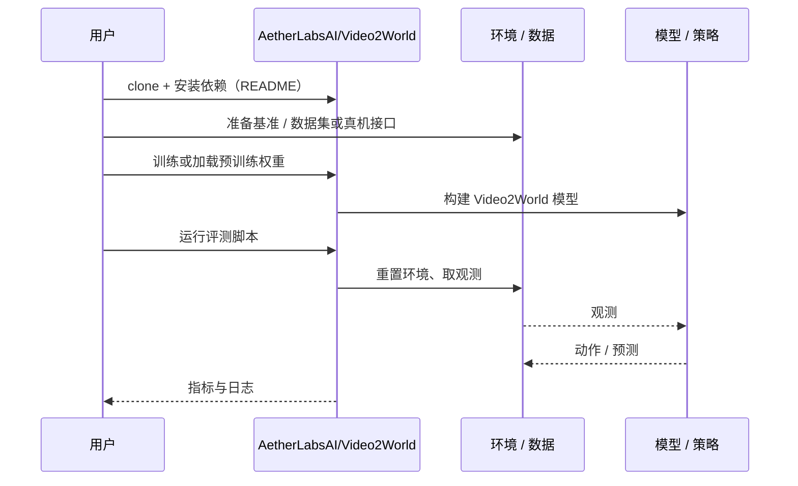

# Video2World（arXiv:2610.04432）

**Video2World**（*Video2World: Benchmarking Coding Agents for Interactive World Modeling from Embodied Videos*，[arXiv:2610.04432](https://arxiv.org/abs/2610.04432)，[项目页](https://aetherlabsai.github.io/Video2World)，[代码](https://github.com/AetherLabsAI/Video2World)）来自 [具身智能小站 2026-10-13 盘点](../../sources/blogs/wechat_embodied_station_34_papers_mulligan_2026-10-13.md)，属「世界模型与仿真」组。

## 一句话定义

**把视频到仿真视为可执行软件任务，同时检查几何、动力学与任务完成；视觉还原更好不保证交互更可靠。**

## 英文缩写速查

| 缩写 | 英文全称 | 简要说明 |
|------|----------|----------|
| V2W | Video-to-World | 视频到世界建模 |
| Agent | Coding Agent | 编码智能体 |
| Sim | Simulation | 仿真 |

## 为什么重要

- 评编码智能体建世界，必须跑交互。
- 开源结论：**已开源**（步骤 2.5，2026-10-14）。仓库可达。
- 同期同组工作见 [失败导向采集与可组合世界动作模型：具身智能小站 10-13 期 34 篇阅读坐标](../overview/embodied-station-2026-10-13-34-papers-technology-map.md)。

## 核心机制

| 项 | 内容 |
|----|------|
| **arXiv** | [2610.04432](https://arxiv.org/abs/2610.04432) |
| **开源** | **已开源** |
| **要点** | 基准 + 执行检查。 |
| **文内指标** | 以原文为准。 |

## 源码运行时序图

以下为按仓库入口（`AetherLabsAI/Video2World`）推断的通用运行链路；入库日仅核实仓库可达，未逐文件阅读，具体脚本名以 README 为准。

## 实验与评测

- 以原文为准。
- **读法：** 本页为索引级摘要，依据公众号转述的官方摘要与仓库信息整理；逐项数字与 baseline 以原文 PDF 为准。

## 与其他工作对比

- 横向索引见 [失败导向采集与可组合世界动作模型：具身智能小站 10-13 期 34 篇阅读坐标](../overview/embodied-station-2026-10-13-34-papers-technology-map.md)；同 arXiv 不重复造页。

## 结论

**视频→仿真评测的核心是可执行与可交互，而非画面相似。**

1. 开源边界：**已开源** — 仓库可达。
2. 核心机制：基准 + 执行检查。
3. 复现与选型前核对任务协议、硬件与基准口径，勿直接横比公众号摘录数字。

## 关联页面

- [video-as-simulation](../concepts/video-as-simulation.md)
- [simulation-evaluation-infrastructure](../concepts/simulation-evaluation-infrastructure.md)
- [paper-physimcode-physics-video-to-code](./paper-physimcode-physics-video-to-code.md)
- [embodied-station-2026-10-13-34-papers-technology-map](../overview/embodied-station-2026-10-13-34-papers-technology-map.md)

## 参考来源

- [video2world_coding_agents_benchmark_arxiv_2610_04432.md](../../sources/papers/video2world_coding_agents_benchmark_arxiv_2610_04432.md)
- [wechat_embodied_station_34_papers_mulligan_2026-10-13.md](../../sources/blogs/wechat_embodied_station_34_papers_mulligan_2026-10-13.md)
- [arXiv:2610.04432](https://arxiv.org/abs/2610.04432)

## 推荐继续阅读

- [arXiv PDF](https://arxiv.org/pdf/2610.04432)
- [项目页](https://aetherlabsai.github.io/Video2World)
- [https://github.com/AetherLabsAI/Video2World](https://github.com/AetherLabsAI/Video2World)
