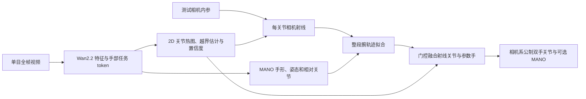
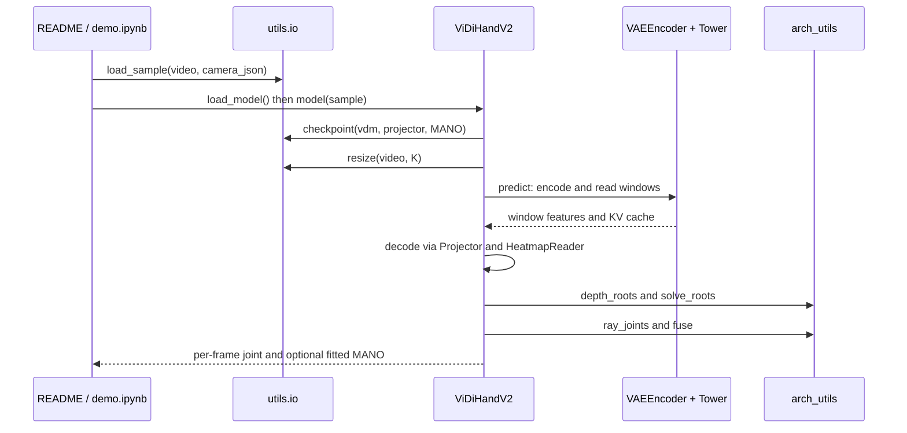

# ViDiHand2：融合视频扩散先验与手部几何的野外 3D 手部运动重建 | Unifying Video Diffusion Priors and Hand Geometry for 3D Hand Motion Reconstruction in the Wild

## 一句话定义

**ViDiHand2** 输入单目全帧第一视角视频及相机内参，利用视频扩散特征定位双手，再以 MANO 几何和跨帧约束恢复相机坐标系中的公制 3D 关节。

## 英文缩写速查

| 缩写 | 英文全称 | 简要说明 |
|---|---|---|
| VDM | Video Diffusion Model | 为遮挡和时序提供视频特征先验 |
| MANO | Mesh Model of the Human Hand | 参数手形、关节旋转和公制骨架先验 |
| AR | Autoregressive | 使用前一窗口的 KV 缓存辅助后续窗口 |
| MPJPE | Mean Per Joint Position Error | 关节平均位置误差；abs-p 为相机绝对误差且计漏检 |
| FPS | Frames Per Second | 这里是离线批处理吞吐，不是控制频率 |

## 为什么重要

第一视角视频中，手在图上对齐不等于放在正确的三维深度。直接从外观预测公制深度会记住训练相机的焦距分布；使用测试相机的投影几何和公制手形，可以把深度估计转换成约束求解。适合作为人类视频数据清洗与标注上游，而非用视频直接控制机器人。

| 字段 | 内容 |
|---|---|
| 机构 | 南洋理工大学、上海交通大学、武汉大学、香港中文大学 |
| 论文 | [arXiv:2611.30597v2](https://arxiv.org/abs/2611.30597v2)，2026-11-24 |
| 发布 | 官方推理代码、示例、模型权重和 Space；训练入口及独立许可证未核验 |

## 核心机制

1. **像素证据。** Wan2.2 的多层潜特征与手、关节任务 token 在窗口内交互；缓存前一窗口视觉 KV。关节热图把粗定位细化，分别保留越界预测、图内证据和置信度。
2. **细粒度几何提升。** 用内参和各自像素把关节变成射线，不假定全手关节共深度。MANO 给相对腕部深度及关节间公制距离，沿各关节射线拟合腕部深度。
3. **整段拟合与融合。** 联合考虑关节对距离、2D 重投影、腕轨迹时间约束；最后由学习门控在射线关节与平移后的 MANO 手间融合。遮挡或截断时允许几何先验承担更多权重，而非将低置信定位当真值。

## 流程总览

§3 与图 3 的数据流：

## 源码运行时序图

基于官方仓 commit `23cf80c` 的 README 快速入口及 v2 实现；未执行 GPU 复现。GitHub Gradio 另在 `reconstruct()` 里处理相机输入和结果压缩；HF Space 包装其 GPU 工作。

## 实验与评测

| 对照 | 结果 | 口径 |
|---|---|---|
| 六个同域数据集 | 19.62 mm MPJPE-abs-p，99.93% FAcc | ARCTIC、H2O、HOT3D、OakInk2、Ego-Pro、Ego-Std；表 1 |
| 野外 Gen-HumanEgo | 32.59 mm，优于该项最强重训基线 WiLoR 56.55 mm；FAcc 99.89% vs 该项最强前代 99.03% | 约降 42% 的绝对关节误差，漏检倍数不可套用到任一基线；指标含漏检惩罚 |
| 消融（表 6） | 野外直接深度回归 81.24 mm，除以焦距的回归 42.52 mm，整段射线拟合 32.59 mm | 不是每个接触阶段的独立成功率 |
| 运行时（补充 F） | A100 80 GB 57.23 FPS，峰值 14.79 GiB | 单段 400 帧、608×480、每帧双手；已解码帧和内参 → 关节，排除解码、加载、I/O 与外部相机估计 |

## 与其他工作对比

| 工作 | 关键差别 |
|---|---|
| [ViDiHand 第一代](./paper-vidihand.md) | Wan2.1-VACE 特征回归深度；2.0 以测试相机射线与 MANO 距离估计深度。 |
| [WiLoR](../methods/wilor.md) | 检测后单帧手部重建；ViDiHand2 从全帧视频取时序证据，不要求独立手检测。 |
| [MINT](./paper-mint-ego-world-space-camera-hand-motion.md) | 关注世界系里的相机与手部运动；ViDiHand2 的公开核心输出在输入相机坐标系。 |

## 结论

相机变化较大时，先检查手的绝对位置，再看腕对齐后的姿态指标；图像叠合单独不足以验收公制轨迹。

1. 评测同时记录含漏检惩罚的绝对误差、检测指标和段际抖动。
2. 把相机 JSON 与原视频尺寸、裁剪、逐帧对应关系一起版本化，避免放大误差来源。
3. 用于机器人前还要独立验证世界系变换、接触和本体重定向，不把离线 57 FPS 当实时控制预算。

## 工程实践

- `model(sample)` 默认 `autoregressive`、整段 `clip` 求解、短边 480、输出可选 MANO 拟合；支持 `fit_mano=False`。返回相机系米制 `[T,2,21,3]`，左手/右手顺序，另有有效掩码，无效位置为 NaN。
- Space 使用公开演示的输入限制和部署包装；它不是论文 A100 定时环境。权重首次由 `utils.io.checkpoint()` 下载；未在本次下载完整权重或运行 CUDA。

## 局限与风险

- 要准确或可估计的相机内参，默认整段后处理含窗口上下文，不是一个因果在线控制接口；移动相机的世界系轨迹还需要额外外参。
- 遮挡情况下的 MANO 约束是手形先验，不能直接重建机器人接触力。没有足够证据时仍应保留无效帧。
- 公开源码、模型文件的可见性不代表可商用许可已核验，亦不代表训练流水线已发布。

## 关联页面

- [ViDiHand](./paper-vidihand.md) · [WiLoR](../methods/wilor.md) · [第一视角手动作提取](../methods/macrodata-egocentric-hand-action.md) · [操作任务](../tasks/manipulation.md)
- [动作重定向纵深](../../roadmap/depth-motion-retargeting.md)

## 参考来源

- [论文全文与补充材料](../../sources/papers/vidihand2_arxiv_2611_30597.md)
- [官方项目页与在线演示](../../sources/sites/vidihand2-github-io.md) · [源码与权重边界](../../sources/repos/vidihand.md)

## 推荐继续阅读

- [论文 §3、表 6 和补充 F](https://arxiv.org/pdf/2611.30597v2)：分别追踪射线约束、消融与运行时。
- [官方 v2 快速入口](https://github.com/NTUYWANG103/ViDiHand/tree/23cf80c292f2fb2db20caa1dee96516a63ee30a7/vidihand_v2)。
