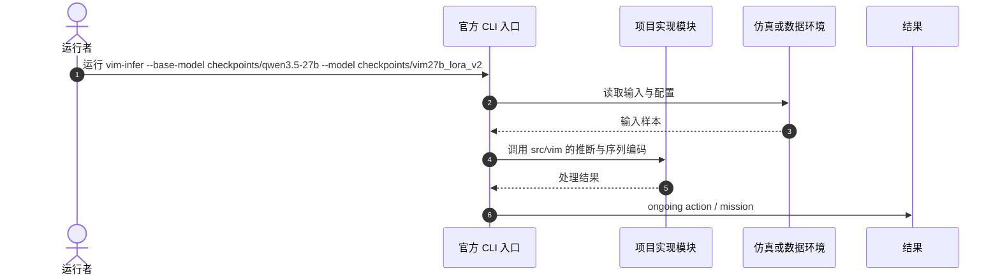

# I See What You Want: Decoding Hierarchical Operator Intent from Visual Teleoperation History｜VIM：视觉历史推断遥操作层级意图

## 一句话定义

**VIM：视觉历史推断遥操作层级意图**：用短时遥操作视觉历史同时预测当前原子动作 OA 和上层任务 OM，支持人机接力。

## 英文缩写速查

| 缩写 | 英文全称 | 简要说明 |
|---|---|---|
| VIM | Vision-Intention Model | 层级意图模型 |
| OA | Ongoing Action | 当前动作 |
| OM | Ongoing Mission | 当前任务 |

## 为什么重要

用短时遥操作视觉历史同时预测当前原子动作 OA 和上层任务 OM，支持人机接力。 本项目的机制、指标和开放边界需要分开理解，不能把单个结果推广到所有机器人平台。

## 核心信息

| 项 | 一手来源 |
|---|---|
| 论文 | [arXiv:2611.16419v1](https://arxiv.org/abs/2611.16419) |
| 项目 | [官方项目](https://see-want.github.io/) |
| 代码 | [官方仓库](https://github.com/see-want/VIM)；开放范围见源码归档 |

## 核心原理

对跨来源遥操作片段标注动作与任务两个层次及时间边界；Qwen3.5-27B 加 LoRA 利用四帧多视角历史与已完成动作预测 OA/OM；真机由人确认所推断意图，再交给已微调 VLA 执行。

### 流程总览

该图表示论文机制的主要数据或控制方向，不表示已经运行作者模型。

## 源码运行时序图

已核对 [官方代码归档](../../sources/repos/vim-operator-intent-2611-16419.md) 的 README 与公开运行入口（仅说明所发布组件，不代表实机复现）：

## 工程实践

1. 核实数据许可、训练/测试切分、时序观测和动作坐标系，建立与原文一致的对照协议。
2. 参照[官方源码归档](../../sources/repos/vim-operator-intent-2611-16419.md)核实入口、依赖及模型数据权限。
3. 分别统计训练预算、模拟指标、真机成功率与执行延迟，记录失败模式和软硬件约束。

## 实验与评测

VI AMO 6600 段 episode、13,653 个动作、9702 个 mission，VIM 在行动与任务语义指标上高于零样本对照；真机测试为有人工确认的接管。

## 结论

**用短时遥操作视觉历史同时预测当前原子动作 OA 和上层任务 OM，支持人机接力。**

1. 对照同数据与同测评协议，不混淆不同平台/样本统计口径。
2. 在复现前单列训练数据、预训练、控制接口和硬件依赖。
3. 验证边界是研究结论的必要组成，不能由示例直接推出可量产部署。

## 与其他工作对比

- **对比通用与具身 VLM 零样本基线（VI AMO 测试集，Table II & Fig. 4）：** 在 9 个动作进度截断时刻的平均评测下，VIM 在当前动作 OA 与上层任务 OM 上全面超越 6 个对照基线（`GPT-5.6 Luna`、`GPT-4o`、`Qwen Base 27B/9B`、`RynnBrain 1.1-9B`、`RoboBrain 2.5-8B`）：OA/OM SBERT 分别达 **0.825 / 0.821**（最强基线 `Qwen Base 27B` 为 0.581 / 0.564）、SigLIP 达 **0.879 / 0.872**（vs 0.744 / 0.722）、Top-10 召回达 **76.59% / 78.77%**（vs 39.14% / 39.33%）。即便在训练未出现的 386 条纯未见标签切片上，VIM 仍保持 0.726 / 0.717 SBERT（基线最高 0.570 / 0.564）；同时说明经过机器人感知微调的 `RynnBrain` 与 `RoboBrain` 并不自动胜任层级操作意图推断。
- **对比视角、上下文与时序历史消融（Table III）：** 去掉腕部视角（`Front-only` OA/OM SBERT 0.798/0.798）、去掉已完成动作文本（`No context` 0.767/0.788）或仅保留单帧起始图（`Single @ 0%` 0.793/0.792）均导致指标下降，证实多视角短时历史与执行上下文的互补性。

## 局限与风险

官方 VI AMO 数据需获得访问权限，模型训练需较大显存；不能把人工确认加微调的接管称为自主零样本接管。

## 关联页面

- [2026-11-16 具身研究论文阅读地图](../overview/embodied-frontier-29-papers-2026-11-16.md)
- [ActionCodec2：流式动作编解码](./paper-actioncodec2-streaming-action-tokenizer.md)

## 参考来源

- [论文原文核对归档](../../sources/papers/vim-operator-intent-2611-16419.md)
- [项目核查归档](../../sources/sites/vim-operator-intent-2611-16419.md)
- [源代码归档](../../sources/repos/vim-operator-intent-2611-16419.md)

## 推荐继续阅读

- [arXiv HTML v1](https://arxiv.org/html/2611.16419v1)
- [官方代码](https://github.com/see-want/VIM)
