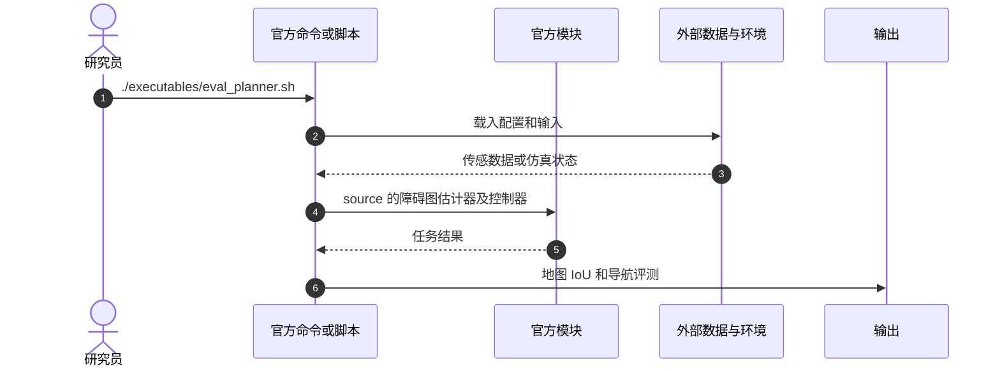

# Robot Navigation and Obstacle Avoidance from Randomly Positioned External Cameras｜VINE：任意外部摄像头视角下的机器人导航

## 一句话定义

**VINE：任意外部摄像头视角下的机器人导航**：从外部摄像头画面和相机位姿恢复统一障碍地图，再交给 PPO 或 A* 控制器规划。

## 英文缩写速查

| 缩写 | 英文全称 | 简要说明 |
|---|---|---|
| VINE | Viewpoint-Invariant Navigation from Exocentric Cameras | 外部视角无关导航 |
| FiLM | Feature-wise Linear Modulation | 条件调制特征 |
| PPO | Proximal Policy Optimization | 近端策略优化 |

## 为什么重要

从外部摄像头画面和相机位姿恢复统一障碍地图，再交给 PPO 或 A* 控制器规划。 比起单一 benchmark 排名，研究与工程落地需要分清楚是否具有动作控制闭环、是否能复现以及硬件/数据前提。

## 核心信息

| 条目 | 原始证据 |
|---|---|
| 论文 | [arXiv:2611.16282v1](https://arxiv.org/abs/2611.16282) |
| 开源入口 | [官方源码](https://github.com/raulsteinmetz/vine)（详见源码归档的部分/整体边界） |

## 核心原理

单/多个外部 RGB 视角与摄像头/房间几何送入带 FiLM 的障碍地图网络，得到 64×64 统一占据图；按机器人位姿变换成 ego 地图，独立于视觉网络的 PPO 或 A* 做动作决策。

### 流程总览

流程图来自一手论文方法链；与实际源码包之间的映射如下。

## 源码运行时序图

源码运行入口按 [README 和脚本核对归档](../../sources/repos/vine-exocentric-nav-2611-16282.md) 标注，以下只代表已发布模块的调用范围。

## 工程实践

1. 依据原文方法核对输入传感器、控制/评估接口、样本分布及实验硬件。
2. 执行前检查[源码归档](../../sources/repos/vine-exocentric-nav-2611-16282.md)提到的实际可运行入口、外部依赖与许可。
3. 将论文成绩、真机误差、系统延迟与安全要求分开验收，复现前明确失败标准。

## 实验与评测

Isaac Lab 随机相机位姿布局、多个相机与近照片级场景测试；障碍地图 IoU 与导航成功率须分别汇报。

## 结论

**从外部摄像头画面和相机位姿恢复统一障碍地图，再交给 PPO 或 A* 控制器规划。**

1. 保留相同模型与数据预算下的可比口径，不跨基准简单求平均。
2. 优先复核最可能出现数据泄漏、接触失败或部署延迟的环节。
3. 对论文未检验的部署条件单列验证计划。

## 与其他工作对比

- **对比几何映射基线与网络条件消融（§IV-A）：** 在四类相机布置（固定/随机 × 单/双外部相机）的障碍图预测上，VINE 取得 **0.909–0.919 IoU**，大幅优于依赖深度传感的反投影 `Depth` 基线（0.511–0.800）与空间雕刻 `Carving` 基线（0.500–0.731）。消融去掉 FiLM 相机位姿调制后，Random Camera Single IoU 从 0.909 跌至 **0.592**；去掉训练期域随机化则过拟合并降至 **0.570**。
- **对比无视觉、机载视角与端到端外部视角 RL 基线（Table IV，10,000 episodes × 3 种子）：** 无视觉的 `No Camera PPO` 仅达 25.8% ± 2.6%；直接用固定外部相机的端到端 `Fixed World-Mtd PPO`（无显式障碍地图中间层）在同训练预算下学不会视角变换，仅 **24.7% ± 2.3%**；机载第一视角 `Onboard PPO` 达 **83.9% ± 4.7%**；而经统一机器人中心障碍图解耦后的 `VINE PPO` 达 **92.3%**（单随机相机）/ **93.5%**（双随机相机），`VINE A*` 达 **94.4% / 95.1%**（真值地图 A* 上界 99.9%），且无需重训 PPO 即可零样本迁移到照片级环境（已知障碍 90.8%、保留未见障碍 77.2%，Tables V–VI）。

## 局限与风险

依赖机器人位姿、近似摄像头位姿和房间尺寸；缺少这些输入不能声称任意布置的摄像头均无需标定。

## 关联页面

- [机器人视觉感知栈选型闭环](../queries/robot-perception-stack-selection-loop.md) — 对照相机位姿、障碍图坐标转换与导航器消费接口，分别评估地图 IoU 和导航成功率。
- [本期 29 篇具身论文选型地图](../overview/embodied-frontier-29-papers-2026-11-16.md)
- [ManiLadder：任务难度分层评测](./paper-maniladder-manipulation-benchmark.md)

## 参考来源

- [原论文核对归档](../../sources/papers/vine-exocentric-nav-2611-16282.md)
- [源码及运行入口](../../sources/repos/vine-exocentric-nav-2611-16282.md)

## 推荐继续阅读

- [arXiv HTML](https://arxiv.org/html/2611.16282v1)
- [官方源码仓](https://github.com/raulsteinmetz/vine)
