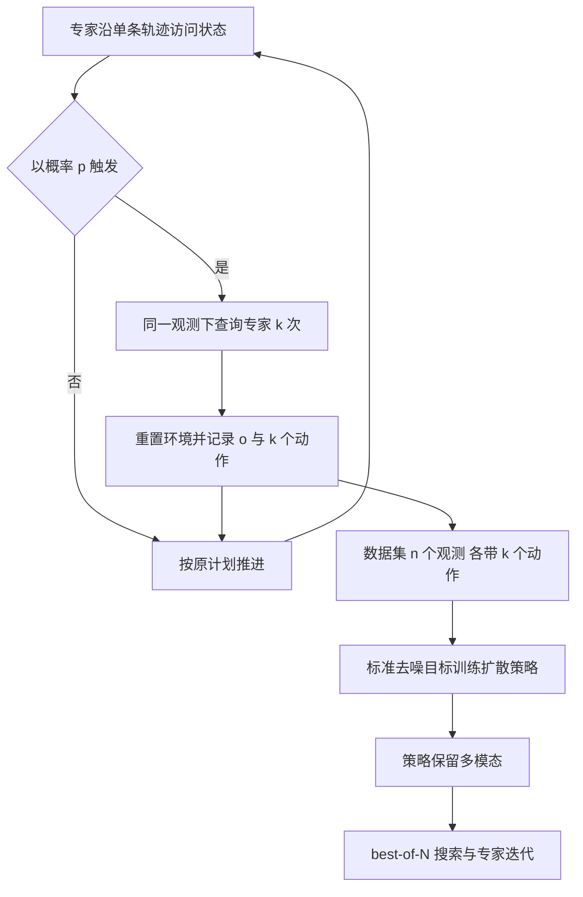

# Vine 采样：把示范者多模态显式写进扩散策略数据（arXiv:2611.10949）

**论文：** *Explicitly capturing demonstrator multi-modality for distillation into diffusion policies*，Chew Chia、Jiang、Agarwal、Hofmann、Kaelbling、Tedrake（MIT CSAIL 与 Pickle Robot Company），[arXiv:2611.10949](https://arxiv.org/abs/2611.10949)，项目页 <https://shaoyuan.cc/research/vine/>。论文与项目页均未给出代码仓库，故本页不写 `code:`。收录于公众号《机器人动作块太长，什么时候该重新规划？》（2026-11-11 的 53 篇论文速览）第 50 条。

## 一句话定义

**在行为克隆数据采集时，于专家访问的部分状态上对同一观测重复查询专家 k 次（vine 采样），让数据显式记录示范者的条件动作分布，从而蒸馏出更接近示范者多模态的扩散策略。**

## 英文缩写速查

| 缩写 / 术语 | 英文全称 | 简要说明 |
|-------------|----------|----------|
| BC | Behavior Cloning | 行为克隆，监督学习模仿专家 |
| vine sampling | vine sampling（源自 TRPO） | 从同一状态分叉出多个动作样本；本文只取其「同状态多次查询」 |
| k | actions per condition | 每个观测记录的动作数，滑动窗口为 k=1 |
| p | re-query probability | 每个时间步触发 k 次重查询的概率 |
| W1 | 1-Wasserstein distance | 衡量策略条件分布与示范者条件分布的距离 |
| SD ratio | standard-deviation ratio | 策略输出标准差 / 示范者标准差，1 表示一致，0 表示塌缩 |
| mode recall@N | mode recall at N | N 次独立采样覆盖的示范者模态质量比例 |
| best-of-N | best-of-N search | 采 N 个候选动作，用仿真加价值网络选最好的执行 |
| SIME | Self-Improvement via Modal-level Exploration | 推理期给观测编码输出加噪的多样性基线 |
| PostBC | Posterior Behavioral Cloning | 训练期对动作加集成协方差噪声的基线 |
| DDPM | Denoising Diffusion Probabilistic Model | 本文扩散策略的去噪采样方式 |

## 为什么重要

- 测试时搜索、专家迭代、RL 后训练都靠策略自己采样出多样动作来探索（§1）。若 BC 策略对每个观测只给一个模式，这些下游步骤无从受益（§1，§4.2：k=1 时 N 从 10 增到 100，模式召回几乎不变）。
- 作者指出标准滑动窗口数据存在歧义：既能被多模态策略拟合，也能被高 Lipschitz 的单模态策略拟合，而扩散策略在稀疏数据下倾向记忆「每个观测一个动作」（摘要，§2）。本文把「每观测动作数 k」作为受控变量，在固定数据总量与训练预算下研究其作用（§1）。
- 与常见的「事后补多样性」（加噪、早停、多采样）正交：从数据源头解决（§6）。

## 核心原理与流程总览

**误差分解（§3.2）：** 记示范者条件分布为 πE，数据集在某观测处存的 k 个动作的经验分布为 P̂k。W1(πθ, πE) ≤ W1(πθ, P̂k)（记忆误差 A）+ W1(P̂k, πE)（采样误差 B）。扩散模型在稀疏数据下近似记忆训练动作，A 很小，策略误差就由 B 主导，B 只能靠更大的 k 降低。

**vine 采样（§5，算法 1）：** 专家照常周期性重规划并执行计划；每个时间步以概率 p 在当前状态重查询专家 k 次，若查询会改变状态就把环境重置回该状态；只有这些状态入库，每个带 k 个动作。作者明确不沿 k 个分支各自继续 rollout，以免状态分布偏向 episode 后段（附录 B）。

**实验两层（§4，§6）：**

| 层 | 设置 | 比较 |
|----|------|------|
| 合成任务（§4，附录 A） | 16 维观测与动作，仅 1 维有信息，动作主坐标有 4 个等权模态；3.1M 参数 1D 卷积 U-Net，5×10^6 步 | n·k=1000 下 k∈{1,10,100}；另做 10^2 到 10^5 的数据规模扫描 |
| 二维卡车卸载（§6，附录 C） | Drake 仿真，平面臂加吸盘卸 4 个箱子，示范者为 BiRRT 加轨迹优化规划器；2000 个训练实例，370,000 样本，k=10 且 p=0.1 对 k=1 滑动窗口 | 策略误差、SD 比、best-of-N（N=10、100）、专家迭代，对照 early stopping、more search、SIME、PostBC |

## 实验结果

论文正文对卡车任务只给图与文字描述，图 5 的具体数值未在正文报告，本页不引用读图数字。

| 实验 | 指标 | 结论（作者自述） | 出处 |
|------|------|------------------|------|
| 合成任务，n·k=1000，k∈{1,10,100} | 策略 W1、条件熵、mode recall@N、SD 比、越界质量 | k 越大采样误差与 W1 越低；条件熵从 k=1 的 0 升到 k=100 的 1；k=1 时 N 从 10 增到 100 召回几乎不变；越界质量各 k 相近 | §4.2，图 4 |
| 合成任务，数据规模扫描 10^2–10^5 | 同上 | n·k=10^5 时 k=1 追平 k=10 与 k=100，优势只在稀疏数据区 | §4.2，图 7 |
| 卡车卸载（Drake，600 测试实例） | 策略误差、SD 比、best-of-N（N=10、100）成功率与吞吐、专家迭代 | vine（k=10，p=0.1）在误差、SD 比与搜索后的成功率、吞吐上均优于滑动窗口；专家迭代后期成功率轻微下降 | §6，图 5 |
| 基线对照 | 同上 | early stopping、more search（N=100）、SIME、PostBC 都不能替代把多模态写进数据集 | §6，附录 C.6–C.7 |

示范者本身在 600 个测试实例上成功率 95.8%、吞吐 766 件 / 小时（C.2），可作为参照上限。

## 与其他工作对比

| 工作 | 关注点 | 与本文的区别 |
|------|--------|--------------|
| 本文 vine 采样 | 数据采集时同一观测重复查询专家 k 次，显式记录条件动作分布 | 从数据源头补多模态，训练目标与网络不变 |
| [Diffusion Policy](./paper-diffusion-policy.md) | 用扩散模型表达多模态动作分布 | 本文沿用其 CNN U-Net 策略，指出在稀疏的滑动窗口数据下它会记忆成单模态 |
| [DAgger](../methods/dagger.md) | 在学习者访问的状态上查询专家纠正标签 | 解决协变量偏移，每状态仍只要一个标签；本文在专家访问的状态上要 k 个动作以覆盖多模态 |
| SIME / PostBC（论文基线） | 推理期给观测编码加噪 / 训练期对动作加集成协方差噪声 | 事后补多样性；论文实验中都不及 vine（附录 C.6–C.7）；本仓库暂无对应页面 |

## 结论

**vine 采样说明扩散策略学不到示范者多模态的主因常在数据而不在模型：每个观测只记一个动作时，稀疏数据下策略会退化为记忆单模态，而对同一观测多次查询专家可以直接把多模态写进数据集。**

1. 误差分解 W1(πθ, πE) ≤ 记忆误差 + 采样误差，扩散模型记忆误差小，策略误差主要由每观测动作数 k 决定（§3.2）。
2. 合成任务与二维卡车卸载均显示更大的 k 提升多样性，并改善 best-of-N 搜索与专家迭代（§4.2、§6）。
3. 加噪、早停、多采样等事后补多样性的做法不能替代数据层面的多模态（§6）。
4. 局限：采集算力约 30 倍、需可重复查询的示范者、只有一个仿真任务且未调 p 与 k，优势可能只在稀疏数据区（§7）。

## 工程实践

- **适用前提：** 示范者必须能在同一状态被重复查询（§1）：仿真中可重置环境的闭环示范者（人类遥操作者、反馈控制器），或不改变世界状态的开环规划器。部分可观测等不可查询状态可在算法 1 第 6 行加条件过滤（附录 B）。
- **超参数：** 论文只试了 k=10、p=0.1（满足 p·k=1，使每 episode 期望样本数与滑动窗口相同）并说明未调 p 与 k（§6，§7）。
- **训练配方：** 卡车任务用 Chi 等的 CNN U-Net 扩散策略，ResNet-18 从头训练，100 步 DDPM，AdamW，学习率 3×10^-4，批量 2048，100,000 步，EMA，2 张 H100 约 8 小时 / 策略（表 2）；价值网络单卡 4.9 小时（表 3）。vine 与滑动窗口策略仅数据集不同（C.3）。
- **采集成本：** vine 数据集每 episode 在 96 核机器上 55 s，滑动窗口 1.8 s，约 30 倍（C.2，§7）。该示范者每次抓放只规划一次，因此此比例是论文这个示范者的实测，换成每步重规划的示范者，比例会不同（推测）。
- **复现状态：** 无官方代码，论文给出的算法 1 与附录超参数足够重写数据采集，但示范者、仿真任务与 best-of-N 实现需自行搭建（推测）。

## 与文章说法的核对

文章原话：「围绕同一观测重复采集专家动作，用分叉采样显式保存可行行为的多模态。合成任务和二维卸载实验支持其价值；目前证据尚未覆盖真实机械臂的复杂接触操作。」（原文见 claims 文件，标题为「同一状态多采几种动作，保留示范多样性」）

| 文章说法 | 核对结果 |
|----------|----------|
| 围绕同一观测重复采集专家动作 | 符合：算法 1 在同一观测对专家查询 k 次（§5）。 |
| 「分叉采样」显式保存多模态 | 基本符合但需限定：vine 原指分支 rollout，本文只分叉动作，不沿分支继续执行，并明确舍弃后者（附录 B）。 |
| 合成任务和二维卸载实验支持其价值 | 符合：合成任务（§4.2）与卡车任务（§6）均支持，论文用词为「substantially improves」best-of-N 与专家迭代。但合成实验也显示 k=1 在 n·k=10^5 时追平（§4.2，图 7），优势限于稀疏数据区，文章未提。 |
| 尚未覆盖真实机械臂的复杂接触操作 | 方向符合：论文明说只在仿真中研究，best-of-N 与专家迭代还依赖仿真器评估候选（§7）。细节：论文并未用「复杂接触操作」措辞，卡车任务是二维、吸盘、无部分可观测的任务（C.1），文章的「复杂接触」是对缺口的概括而非论文原话。 |
| 文章未提的限定 | 约 30 倍采集算力（§7，C.2）；需要可重复查询的示范者（§1）；仅一个仿真任务、未调 p 与 k（§7）；会议为 CoRL 2026 Pretrain to Adapt Workshop（首页脚注）。 |

## 局限

**论文自述（§7）：** 采集算力更高；未探索最优 p、k；best-of-N 的最佳 k 未必适合原始策略；只在仿真评估，搜索与专家迭代也用仿真器；示范者不改状态时可上硬件，但被重查询的计划从未被执行，质量未验证；优势可能仅在稀疏数据区，大型机器人基础模型是否处于该区间留作未来工作。

**读者观察（本页判断）：**
- 本文性质为工作坊短文，实验只有一个合成任务与一个二维卡车任务，每个方法只训练一个策略（C.3 未提多随机种子），图 5 的误差条是对测试实例的重采样区间（C.4），不含训练随机性（推测）。
- 示范者是随机打乱候选抓取的规划器，多模态来源于人为随机化；真实人类示范的多模态是否同样可被重复查询采集，论文未验证。
- 价值网络与搜索依赖仿真器给出候选动作的短程结果（C.5），真实机器人上缺少等价的评估器时下游收益未知。
- 对比基线 SIME 与 PostBC 按作者选定超参数运行（σ=4，α=1），PostBC 的集成训练步数相对原论文缩减（C.6），其表现可能受此影响（推测）。
- 图 5 的具体数值未在正文报告，本页不引用读图数字。

## 关联页面

- [扩散策略（Diffusion Policy）](../methods/diffusion-policy.md)
- [行为克隆（Behavior Cloning）](../methods/behavior-cloning.md)
- [模仿学习](../methods/imitation-learning.md)
- [多模态性基础](../concepts/multimodality-basics.md)
- [行为克隆的谜题](../concepts/behavioral-cloning-mysteries.md)
- [扩散模型](../concepts/diffusion-model.md)
- [Diffusion Policy 论文页](../entities/paper-diffusion-policy.md)
- [Drake](../entities/drake.md)

## 参考来源

- [sources/papers/vine-sampling-diffusion-policy_arxiv_2611_10949.md](../../sources/papers/vine-sampling-diffusion-policy_arxiv_2611_10949.md)
- [arXiv:2611.10949](https://arxiv.org/abs/2611.10949)
- 项目页 <https://shaoyuan.cc/research/vine/>

## 继续阅读

- [arXiv PDF（v1）](https://arxiv.org/pdf/2611.10949v1)
- [Diffusion Policy 论文页](../entities/paper-diffusion-policy.md)
- [扩散策略方法页](../methods/diffusion-policy.md)
