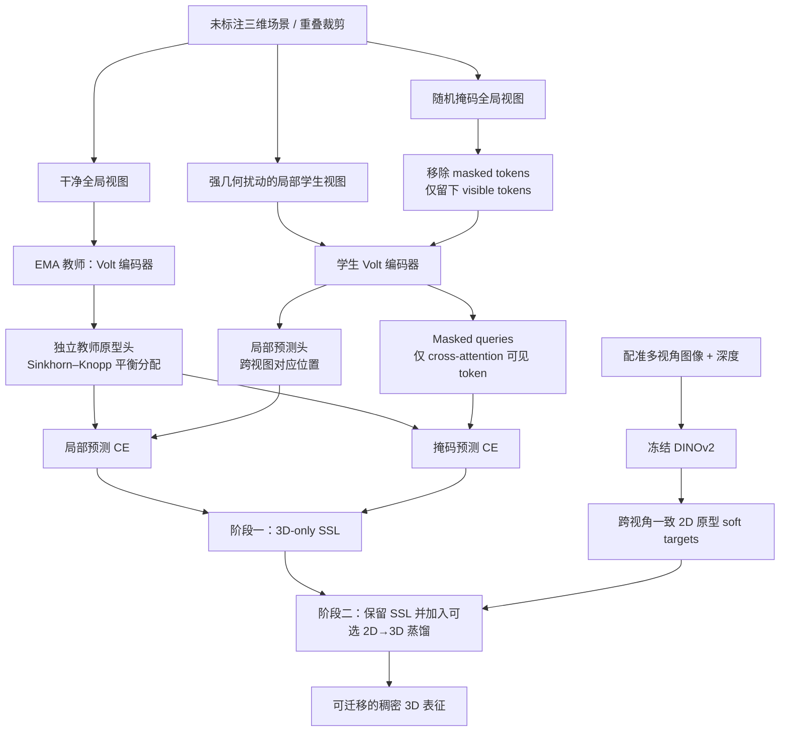

# VINO：以 Volume Transformer 重新审视三维自监督表征学习

## 一句话定义

**VINO（Revisiting 3D Representation Learning with Volume Transformers）** 是基于 [Volt 3D Transformer](./paper-volt.md) 的场景级自监督表征学习框架：用**干净全局教师视图 → 强扰动局部学生视图**的非对称自蒸馏、**隐藏几何位置的 masked prediction**，以及可选的**视角一致 2D→3D 蒸馏**，从未标注的三维场景学习语义特征。论文为 arXiv:2611.07176v1（2026-11-04），并非 ECCV 2026 Long Oral；该会场身份属于 Volt。

## 英文缩写速查

| 缩写 | 英文全称 | 简要说明 |
|---|---|---|
| SSL | Self-Supervised Learning | 无 3D 语义标签的预训练 |
| EMA | Exponential Moving Average | 教师编码器按学生参数滑动更新 |
| VFM | Vision Foundation Model | 第二阶段冻结的 2D 视觉表征教师 |
| SK | Sinkhorn–Knopp | 将教师原型 soft assignment 平衡化 |
| mIoU | mean Intersection over Union | 语义分割与线性探测报告的交并比均值 |
| RoPE | Rotary Position Embedding | 通过 Volt 编码器注入 3D 相对位置信息 |

## 为什么重要

- **先验证骨干，再改目标：** 3D 场景自监督长期受 PTv3 分层结构及掩码几何泄漏限制；VINO 用单尺度 Volt token 重做 dense prediction。
- **冻结表征可检验：** 论文用 frozen encoder + linear head 检查语义质量，避免只看全量微调后下游 decoder 的收益。
- **对机器人感知的启发：** 对点云语义地图、场景检索和 3D 特征迁移有研究价值；论文并未证明可直接替换 SLAM、避障距离场或闭环机器人策略。

## 核心信息

| 项 | 内容 |
|---|---|
| 机构 | 亚琛工业大学（RWTH Aachen University）；埃因霍温理工大学（Eindhoven University of Technology）；卢加诺瑞士意大利语区大学（USI Lugano） |
| 原文 | [arXiv:2611.07176v1](https://arxiv.org/html/2611.07176) |
| 项目页 | [VINO](https://adriankruse.github.io/VINO/) |
| 使用的骨干 | [Volt / Volume Transformer](./paper-volt.md)，不是另一套单独的场景 Transformer |
| 开源状态（2026-11-13） | [AdrianKruse/VINO](https://github.com/AdrianKruse/VINO) **仅 README 占位，训练/推理代码及预训练权重待发布** |

## 核心原理

### 流程总览

### 三项设计与定量消融

1. **教师/学生输入非对称。** 教师用 clean global crops，学生用强破坏的 local crops；教师原型不再是学生预测头的 EMA 副本，而以 swapped clustering 独立优化，避免把两种输入分布硬耦合。
2. **Masked geometry 不泄漏。** 在学生编码器之前删掉被遮蔽体素 token；预测器的 masked query 只 cross-attend 可见 token，**没有 query-to-query self-attention**，阻断从其他 masked queries 的空间布局取巧。
3. **视角一致 2D 蒸馏是第二阶段。** 冻结 DINOv2，用相机位姿和深度找跨视图对应点，在图像特征空间学一致原型，监督 3D 特征预测 soft assignment；不直接回归视角依赖的二维特征。

ScanNet200 消融（线性探测）：Sonata/PTv3 **28.3** → Sonata/Volt **29.6** → 非对称增强及解耦头（局部预测）**32.8** → 加掩码预测 **35.6** → 特征伪影修复 **35.9** → 第二阶段 2D 蒸馏 **40.4 mIoU**。数字依不同实验阶段，不能把各增量理解为独立叠加。

## 实验与评测

**协议：** 冻结 3D encoder，**仅训练线性语义分割头**，所有数字为论文 Table 5 的验证集 mIoU；不是 3D 无监督分割的直接输出。

| 预训练 | ScanNet200 | ScanNet | ScanNet++ | nuScenes | SemanticKITTI | Waymo |
|---|---:|---:|---:|---:|---:|---:|
| VINO，3D-only | 35.9 | 76.9 | 42.4 | 76.7 | 70.7 | 68.6 |
| VINO，另加 2D VFM 蒸馏 | 40.4 | 77.9 | 48.2 | 80.6 | 71.1 | 70.6 |

- **严格对照：** 3D-only VINO 的 ScanNet200 **35.9** 高于 DOS **30.7**；增加 2D 蒸馏后提升为 **40.4**。前后不代表“完全无需其他预训练”。
- **下游微调：** 全量微调在 ScanNet200/ScanNet++ 分别 **42.7/52.6 mIoU**（论文 Table 6），与冻结线性探测不是同一评测。
- **实例迁移：** SPFormer 下 ScanNet200 mAP50 为 **55.7**（VINO）对 **48.4**（监督初始化），见附录 Table 13。

## 与其他工作对比

| 工作 | 核心差别 |
|---|---|
| [Volt](./paper-volt.md) | **骨干与监督训练配方**；VINO 在其骨干上重新设计**自监督**目标 |
| Sonata / DOS | 典型 PTv3 或原型 3D 自蒸馏基线，VINO 消除教师噪声与 masked 占据泄漏 |
| [DINOv2](./paper-dinov2.md) | 图像表征学习先例；VINO 并非复刻 2D DINO，需处理体素占据与几何一致性 |
| [六种空间表征](../concepts/embodied-perception-six-spatial-representations.md) | 学习的是**3D 特征**，不等于 TSDF/ESDF 等地图物理量 |

## 结论

**VINO 证明场景级 3D 自监督的关键改进不仅在换 backbone，更在于教师目标洁净、masked geometry 无捷径及跨视图一致的蒸馏目标。**

- **做自监督实验：** 先重现 3D-only frozen linear probe，避免与有 2D 教师的版本混比。
- **复现 masked prediction：** 必须删除被遮挡 token，而非仅以特殊 token 替换其 feature。
- **引入 2D 教师：** 采用两阶段策略与跨视角原型目标，检查对齐是否依赖相机标定与深度。
- **机器人部署：** 输出仍是 3D 表征而非可直接消费的 free-space/距离场；闭环价值需额外验证。
- **开放资源：** 截至 2026-11-13 VINO 权重及代码待发布，不应把 Volt 开源仓库当作 VINO 完整复现。

## 工程实践

| 项 | 建议 |
|---|---|
| 预训练输入 | 室内 2 cm、室外 5 cm 体素；两张 global + 四张 local 裁剪（论文 Appendix A.2） |
| 掩码 | 55% block masking；室内 80 cm，室外 2 m |
| 教师目标 | 4096 prototypes，SK 平衡；EMA 仅更新 encoder，目标原型独立优化 |
| 消融复现 | 先 3D-only，保持 encoder freeze 后训练线性头；再做 2D 蒸馏 |
| 官方可运行实现 | **尚未发布**，目前只能依据论文复现思路，无可核验 CLI / checkpoints |

## 源码运行时序图

**不适用（2026-11-13）：** [VINO 官方仓库 README](https://github.com/AdrianKruse/VINO) 明示代码与预训练权重将来发布，尚无可阅读的训练/推理入口。上方流程图是**论文方法流程**，不是虚构的源码调用关系。

## 局限与风险

- **预训练数据与评测协议：** 3D-only 不使用 3D 人工语义标签；2D 阶段引入已经预训练的 DINOv2 作为教师。线性 probe 仍使用标注数据训练/评测下游头。
- **论文宣称范围：** 强结果是静态 3D 场景分割、实例分割及迁移指标，不直接证明实时机载、动态连续扫描或具身策略性能。
- **代码复现：** 公开仓库暂不可运行，无法核验论文中训练超参数与代码逐行一致性。
- **几何与标定：** 2D 蒸馏需要相机位姿、深度及跨视角表面对应，原始点云不足以直接运行此阶段。

## 关联页面

- [Volt：3D Volume Transformer](./paper-volt.md)
- [DINOv2：图像自蒸馏表征](./paper-dinov2.md)
- [具身感知六种空间表征](../concepts/embodied-perception-six-spatial-representations.md)
- [视觉表征作为策略输入](../concepts/visual-representation-for-policy.md)

## 参考来源

- [VINO 论文全文归档](../../sources/papers/vino_arxiv_2611_07176.md)
- [VINO 作者项目页](../../sources/sites/vino-project.md)
- [VINO 官方仓库开放情况](../../sources/repos/adriankruse-vino.md)
- [arXiv HTML 原文 v1](https://arxiv.org/html/2611.07176)

## 推荐继续阅读

- [VINO 官方项目与交互特征可视化](https://adriankruse.github.io/VINO/)
- [VINO arXiv 论文全文](https://arxiv.org/html/2611.07176)
- [Volt（配套 3D Transformer 骨干）](https://yilmazkadir.github.io/Volt/)
