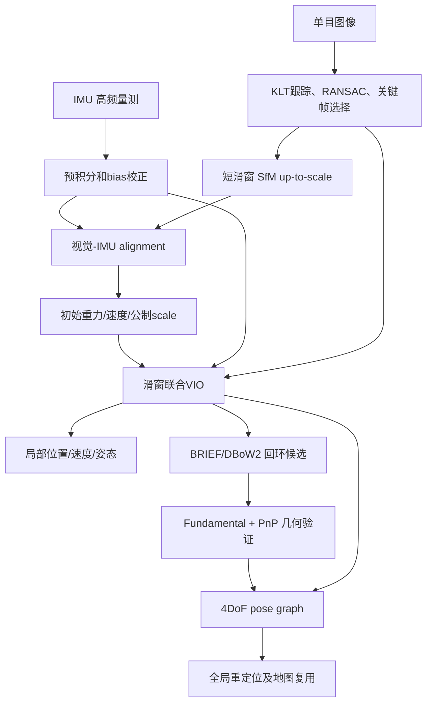
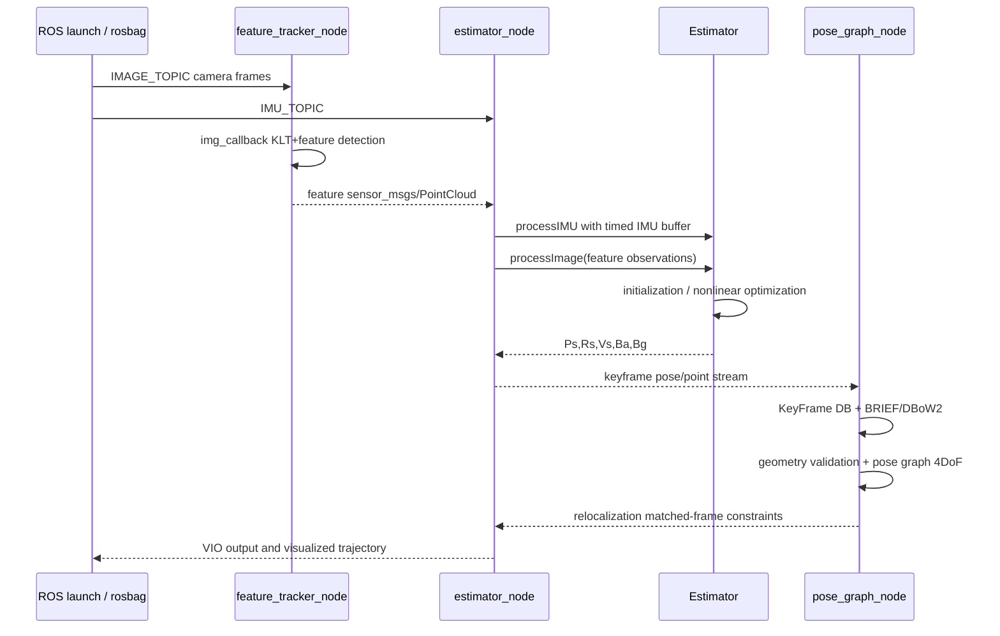

# VINS-Mono：鲁棒单目视觉惯性状态估计 / A Robust and Versatile Monocular Visual-Inertial State Estimator

## 一句话定义

VINS-Mono 使用单目 Camera + IMU，先由 vision-only SfM 和 IMU alignment 恢复可观尺度/重力/零偏，再在有限滑窗中紧耦合融合惯性预积分与球面视觉误差，以 DBoW2 回环和 4DoF 全局位姿图抑制长期漂移。

## 英文缩写速查

| 缩写 | 英文全称 | 简要说明 |
|---|---|---|
| VIO | Visual Inertial Odometry | 视觉惯性局部里程计 |
| SfM | Structure from Motion | 恢复未知尺度相机轨迹的初始化步骤 |
| IMU | Inertial Measurement Unit | 加速度/角速度，高频运动先验 |
| BA | Bundle Adjustment | 多视觉重投影误差的非线性优化 |
| KLT | Kanade Lucas Tomasi | 光流特征跟踪 |
| DBoW2 | Distributed Bag of Words 2 | 候选回环地点识别 |
| PnP | Perspective n Point | 3D/2D 对应几何验证 |
| DoF | Degrees of Freedom | 全局图重力锁定后的4自由度 |

## 为什么重要

单目视觉无法直接获得公制尺度，IMU 又有加速度/陀螺仪偏置和未知初始重力方向，直接把测量送入滑窗优化容易落入错误尺度/重力极小值。VINS-Mono 将**从运动中初始化、紧耦合滑窗估计、重定位和全局漂移消除**组成完整产品化结构，而不是简单把 IMU 融进一个视觉滤波器。

## 核心原理与方法

1. **视觉前端**：KLT 跟踪特征，补点并使视野均匀；RANSAC 筛误匹配。以陀螺短期积分补偿旋转带来的伪视差确定关键帧。
2. **IMU 预积分**：对 `alpha,beta,gamma` 向量/四元数积分、偏置一阶校正，递推 covariance 和 Jacobian，避免每轮优化重积分全部 IMU。
3. **初始化**：窗口内先 SfM 恢复 unknown-scale 相机位姿；相机-IMU 时空对齐估计 `gyro bias/gravity/velocity/metric scale`，gravity 约束在固定长度球面切空间再精修（§V）。
4. **局部 VIO**：滑窗状态包括 `p,v,q,ba,bg`、相机-IMU 外参和视觉逆深度；Ceres 优化 IMU 预积分残差、球面视觉重投影与边缘化先验（Eq. 22）。
5. **回环重定位**：额外 BRIEF 关键点描述子入 DBoW2；2D-2D fundamental RANSAC 与 3D-2D PnP 双重几何检验，relocalization 把历史约束插入当前 VIO 滑窗。
6. **全局 4DoF**：重力让 roll/pitch 可观，优化 x/y/z/yaw 的 pose graph；局部输出和全局 loop 修正有异步线程。
7. **可用性**：具备失败检测/重启动、地图保存/复用和 online extrinsic/time-offset calibration。但对应功能在后续 README 维护中有更新，应区分原论文与源码版本。

## 流程总览（论文 Fig2–4，§IV–VIII）

## 源码运行时序图

基于 HKUST 官方 `VINS-Mono@90dabb5` 的 `vins_estimator/launch/euroc.launch`、`feature_tracker/src/feature_tracker_node.cpp`、`vins_estimator/src/estimator_node.cpp`、`vins_estimator/src/estimator.cpp`、`pose_graph/src/pose_graph_node.cpp`。异步节点只画**可检查的话题/回调关系**，未执行 rosbag。

## 实验与评测

作者 T-RO 2018 原论文可从 [arXiv v1](https://arxiv.org/html/1708.03852) 公开阅读。

| 数据集/示范 | 论文事实 |
|---|---|
| EuRoC MH03 / MH05 | 使用**单左目 20Hz + IMU 200Hz**，与 OKVIS mono/stereo 比；原文只说 loop 版误差较低，**不宣称拥有不存在的统一分数** |
| 室内外 ~700m 手持 | 无连续 GT，VINS-Mono 无闭环最终漂移占路程 **0.88%**，闭环后末端偏移约 `(-0.032,0.09,-0.07)m`；**不是全路径 ATE** |
| 校园 5.62km、1h34min | image 25Hz、IMU 200Hz，i7-4790 测得特征跟踪 25Hz、窗口优化 10Hz（Table I） |
| 机载八字轨迹 61.97m | loop disabled、OptiTrack GT，报告终点位置漂移约 0.18m、100Hz 高频传播给控制器 |

## 结论

**VINS-Mono 的工程价值在于让最小 camera+IMU 传感器方案完成从尺度初始化到闭环重定位的完整闭环。** 但弱激励/时间对不齐/外参不准和视觉失跟是主要风险；仅凭初始化成功不等于长期 ATE 零漂移。

## 工程实践

- 官方 Ubuntu16.04/ROS Kinetic/Ceres1.14 的示例：`roslaunch vins_estimator euroc.launch`，`rosbag play MH_01_easy.bag`，RViz 另开。`ROS2 Humble + Ceres2` 需要移植而不是默认兼容。
- 原仓 README 建议 image >20Hz、IMU >100Hz、正确的 raw acceleration（含重力）、准确 timestamp；在线估外参 `estimate_extrinsic=2`，估时间偏移 `estimate_td=1`，均需要足够旋转/平移激励。
- 与 [Kalibr](./kalibr.md) 配合时，先稳定离线标定，再允许 online extrinsic refine；仅“让系统自己估外参”不能代替严谨标定。

## 局限与风险

运动激励不足会让 monocular scale/gravity/IMU biases 难观；纹理匮乏、强光变化、快速转动可能造成光流失跟。窗口边缘化固定线性化点、增加长期偏差；回环几何约束的误匹配需双重 RANSAC。默认 ROS1 老依赖需迁移，未在当前机器实测性能。

## 关联页面

- [VINS-Fusion](./vins-fusion.md)
- [LVI-SAM](./paper-lvi-sam.md)
- [Kalibr](./kalibr.md)

## 参考来源

- [VINS-Mono 原始论文通读](../../sources/papers/vision3d_vins_mono_primary_paper_20261108.md)
- [VINS-Mono 官方源码记录](../../sources/repos/vision3d_vins_mono_20261108.md)
- [arXiv 论文全文](https://arxiv.org/html/1708.03852)
- [HKUST 官方仓库](https://github.com/HKUST-Aerial-Robotics/VINS-Mono)

## 推荐继续阅读

- [IEEE T-RO 正式发表版](https://ieeexplore.ieee.org/document/8421746)
