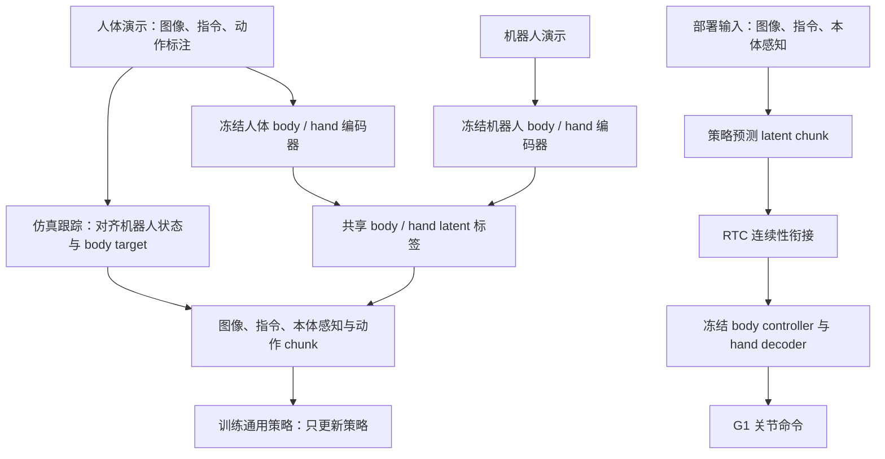

# VioLA：从人类数据学习人形通用控制

**一句话定义：** VioLA 不让通用策略直接输出高维关节命令，而是预测与冻结机器人控制器对齐的身体和手部动作潜变量；人类动作因此可以直接构成策略的动作标签。

## 英文缩写速查

| 缩写 | 英文全称 | 简要说明 |
|---|---|---|
| VLA | Vision-Language-Action | 从视觉、语言和动作数据学习指令执行策略 |
| WAM | World-Action Model | 联合预测世界 / 视频动态与动作的模型家族 |
| WBC | Whole-Body Control | 协调躯干、腿、手臂等身体部位的控制问题 |
| RTC | Real-Time Chunking | 通过已排队动作条件化新 chunk，减少切换不连续 |
| FSQ | Finite Scalar Quantization | 论文动作编码器使用的有限标量量化 |
| SMPL | Skinned Multi-Person Linear Model | 人体动作表示，body 编码器的人类动作输入 |
| MANO | Model for Articulated and Non-rigid Hands | 手部姿态 / 形状模型，用于拟合手部标注 |

## 方法栈

人形控制的动作维数高、全身耦合强，而高质量机器人演示难以大规模采集。VioLA 用一组预训练 motion encoder / decoder 把动作协调难题部分交给底层控制先验，再让通用策略学习“场景和指令需要什么身体动作”。只要人类与机器人动作被编码进同一潜空间，人类记录就能监督策略的部署动作头，无须每条人类演示都配一条真机演示。

body 通道使用 SONIC 的 motion encoder / controller，手部通道则单独预训练一组 hand encoder / decoder。人体与机器人演示分别经配对编码器映射到共享潜空间；两个通道各 64 维，拼接成每步 128 维动作。策略以第一人称图像、任务指令和机器人本体感知为条件，预测一段连续动作 latent chunk。策略训练阶段只更新一般策略，编码器和执行侧控制模块保持冻结。

在人类示范中，图像和语言指令保留原始记录，身体 / 手部动作标注经冻结编码器构成动作标签。人类数据缺少机器人本体状态，研究者通过仿真中的冻结 body controller 跟踪人体动作，构造时间对齐的机器人 proprioception 与依赖当前朝向的 body target。没有手部标注的演示只监督 body 输出。

训练后的策略生成 body / hand latent；冻结 body controller 结合机器人当前状态产生全身关节命令，hand decoder 产生手指轨迹。身体与手部命令按 50 Hz 更新。为减少策略计算期间旧 chunk 仍在执行而导致的切换跳变，VioLA 在 motion-latent 空间使用 RTC：新 chunk 以前一个预测中已排入执行队列的 latent 为条件。

## 流程总览

训练和部署阶段共享相同动作表示：人体和机器人动作产生 latent 监督标签；部署策略预测这些标签，再由冻结解码器负责执行。仿真 tracking 是从人类视频构造机器人状态输入的关键步骤。

## 数据与评测

论文汇总 31,988 个 episode、140,572,312 帧（约 781 小时），其中 93.2% 帧来自人类记录。项目页指出所用训练 schedule 中人类数据约占样本 exposure 的 80%；93.2% 是数据池帧数比例，不代表所有训练阶段都按相同比例采样。

| G1 真实机器人结果 | 成功率 | 口径 |
|---|---:|---|
| Locomotion / posture | 30/30，100% | 六项任务，每项五次；无任务专属微调 |
| Whole-body manipulation | 31/35，88.6% | 七项主要任务，每项五次；无任务专属微调 |
| 加入 bottle-carrying 后 | 31/40，77.5% | bottle-carrying 单项 0/5，按扩展任务口径合并 |
| human-only policy locomotion | 12/30，40% | 一般策略监督只用人类演示，预训练 body / hand 模块仍保留 |

论文还比较 GR00T N1.7、π0.5、DiT4DiT 三类 backbone，数据与训练预算对齐，GR00T 版本在主要结果中最好。human-then-mixed 训练提升 locomotion（robot-only 的 80% 到 100%），但 manipulation 上 robot-only 为 94.3%，高于 human-then-mixed 的 88.6%。不同任务对人类数据的受益程度并不一致。

## 源码与复现状态

- **源码运行时序图：不适用。** 截至 2026-10-13，官方项目页仍标注 “Code coming soon”，暂无已核实的官方运行代码或 checkpoint 下载入口；上方图展示论文方法数据流，而非源码运行时。
- 论文称代码和 checkpoints 将发布。公开入口出现前，当前材料支持理解方法和评测，不支持声称读者可按官方实现复现。
- 主要结果需要人体 / 手部动作标注、仿真 tracking、预训练冻结控制模块及 G1 真机测试；仅有一般策略 checkpoint 也不足以复现完整数据构造链。

## 与其他路线对比

| 路线 | 策略动作接口 | 对人类示范的处理 |
|---|---|---|
| 直接关节策略 | 机器人关节目标 | 通常需要机器人动作标签或额外映射 |
| 动作重定向 | retarget 后的机器人姿态 / 轨迹 | 先将人体骨架映射到机器人再跟踪 |
| VioLA | 共享 body / hand latent | 人体与机器人编码器直接构造同一策略动作目标 |

VioLA 的重点不是取消底层机器人控制，而是把高维动作协调封装进可执行 latent controller。相比关节直出，它减少策略动作维度；相比先生成逐关节 retarget 轨迹，它复用人体与机器人对齐的 encoder/decoder 空间。

## 局限与风险

- **操纵与接触反馈不足：** 冻结 hand decoder 输出手指位置命令，没有接触力反馈；精细抓取和持物仍会失败。加入 bottle-carrying 后单项 0/5，须与主要 manipulation 指标同时报告。
- **人体监督需要标注：** 扩展到更多视频依赖可靠的人体动作估计；没有手部标注的演示不能监督 hand latent。
- **数据配比作用因任务而异：** 人类数据改善 locomotion，但 robot-only manipulation 更高；不能用帧数占比直接推断任务效果。
- **外推有限：** 当前研究在单台 G1、13 个主要任务、每任务五次试验上评测，跨平台和更广环境的泛化还需验证。
- **谨慎解释 zero-shot：** 这里表示不做任务专属微调；任务家族仍参与训练，留出的是评测 episode、环境和物体实例。
- **依赖预训练先验：** body / hand 模块的动作覆盖、控制延迟和解码质量限制策略最终能力，human-only 也不是完全从零训练。

## 结论

VioLA 的关键贡献是让人类动作标签和机器人可执行动作共享同一 latent action space，再用冻结控制器把通用策略预测解码成协调的全身行为。

1. **先看动作接口设计：** 128 维 body / hand latent 把高维关节协调交给预训练控制器处理。
2. **人类动作可以成为部署标签：** 编码器产生策略动作目标，仿真 tracking 补齐人类数据缺失的机器人本体感知。
3. **人类数据存在任务差异：** locomotion 获益明显；当前 manipulation 指标中 robot-only 更高。
4. **谨慎解释 zero-shot：** 无任务专属微调，但任务家族仍见于训练；实验只在一台 G1 上进行。
5. **暂按预印本跟踪：** 官方代码 / checkpoint 尚待发布，接触反馈、抓取与持物仍是短板。

## 关联页面

- [SONIC motion tracking](../methods/sonic-motion-tracking.md) — VioLA 复用的 body motion encoder 与 controller
- [VLA 方法总览](../methods/vla.md)
- [World Action Models](../concepts/world-action-models.md)
- [人形策略网络架构](../concepts/humanoid-policy-network-architecture.md)
- [人形机器人移动](../tasks/humanoid-locomotion.md)
- [Loco-manipulation](../tasks/loco-manipulation.md)
- [前沿人形 / 四足论文动态](../overview/frontier-humanoid-quadruped-2026-10-05-10-09.md)

## 参考来源

- [VioLA 论文摘录](../../sources/papers/viola_arxiv_2610_12435.md)
- [VioLA 官方项目页核查](../../sources/sites/viola-project.md)
- [arXiv:2610.12435](https://arxiv.org/abs/2610.12435)
- [VioLA 官方项目页](https://viola.is.tue.mpg.de/)
- [人形 / 四足前沿论文动态](../../sources/blogs/frontier_humanoid_quadruped_2026_10_05_10_09.md)

## 推荐继续阅读

- [VioLA 官方项目页：方法、结果与代码状态](https://viola.is.tue.mpg.de/)
- [SONIC / GEAR-SONIC](https://nvlabs.github.io/GEAR-SONIC/) — body motion latent controller 上游
- [arXiv PDF](https://arxiv.org/pdf/2610.12435)
