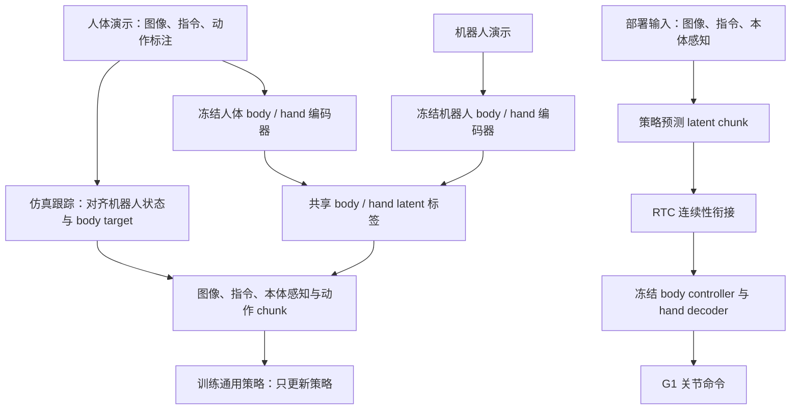

# VioLA：从人类数据中学习通用人形控制策略

**一句话定义：** VioLA 不让通用策略直接输出高维关节命令，而是预测与冻结机器人控制器对齐的身体和手部动作潜变量；人类动作因此可以直接构成策略的动作标签。

## 英文缩写速查

| 缩写 | 英文全称 | 简要说明 |
|------|----------|----------|
| VLA | Vision-Language-Action | 从视觉、语言和动作数据学习指令执行策略 |
| WAM | World-Action Model | 联合预测世界 / 视频动态与动作的模型家族 |
| WBC | Whole-Body Control | 协调躯干、腿、手臂等身体部位的控制问题 |
| RTC | Real-Time Chunking | 通过衔接待执行动作条件化新 chunk，减少切换不连续 |
| FSQ | Finite Scalar Quantization | 论文动作编码器使用的有限标量量化 |
| SMPL | Skinned Multi-Person Linear Model | 人体动作表示；body 编码器的人类动作输入 |
| MANO | Model for Articulated and Non-rigid Hands | 手部姿态 / 形状模型，用于拟合手部标注 |

## 为什么重要

人形控制的动作维数高、全身耦合强，而高质量机器人演示难以大规模采集。VioLA 用一组预训练的 motion encoder / decoder 把动作协调难题部分交给底层控制先验，再让通用策略学习“场景和指令需要什么身体动作”。只要人类与机器人动作被编码进同一潜空间，人类记录就能监督策略的部署动作头，无须每条人类演示都配一条真机演示。

## 核心机制

论文以 SONIC 的 body encoder / controller 作为身体通道，另行预训练手部 encoder / decoder。人体和机器人演示分别经配对编码器映射到共享潜空间，两个通道各 64 维，拼接成每步 128 维动作。一般策略以第一人称图像、任务指令和机器人本体感知为条件，预测一段连续动作 latent chunk；编码器、body controller 和 hand decoder 在一般策略训练时保持冻结。

在人类示范中，视频图像和语言指令保留原始记录；body / hand annotation 经冻结编码器构成动作标签。人类数据不包含机器人状态，研究者通过仿真中的冻结 body controller 跟踪人体运动，为图像时间点构造对齐的机器人 proprioception 和与朝向相关的 body target。随后，人体和机器人示范可以使用相同策略头与动作损失。没有手部标注的示范仍可用于 body supervision。

训练后的策略生成 body / hand latent，冻结的 body controller 结合机器人当前状态产生全身关节命令，hand decoder 产生手指轨迹。身体与手部控制以 50 Hz 更新。为减少策略计算期间旧 chunk 还在执行而造成的新旧动作跳变，VioLA 在 motion-latent 空间使用 RTC：新 chunk 以前一个预测中已经排入执行队列的 latent 为条件。

## 方法与数据流程

图中训练和部署阶段共享相同动作表示：人类和机器人动作产生 latent 监督标签；部署策略预测这些标签，再由冻结解码器负责执行。人类动作的机器人状态对齐依赖仿真 tracking，是数据构造中的重要工程环节。

## 训练数据与实验结果

论文汇总 31,988 个 episode、140,572,312 帧（约 781 小时），其中 93.2% 帧来自人类记录。这个比例是数据池的帧数构成；项目页指出论文采用的训练 schedule 中，人类数据约占训练样本 exposure 的 80%。

| 真实 G1 结果 | 成功率 | 口径 |
|---------------|--------|------|
| Locomotion / posture | 30/30，100% | 六项任务，每项五次；无任务专属微调 |
| Whole-body manipulation | 31/35，88.6% | 七项主要任务，每项五次；无任务专属微调 |
| 加入 bottle carrying 后的 manipulation | 31/40，77.5% | bottle carrying 单项 0/5，按扩展任务口径合并 |
| human-only policy locomotion | 12/30，40% | 通用策略监督只用人类演示；保留预训练的 body / hand 模块 |

通用策略骨干包括 GR00T N1.7、π0.5 和 DiT4DiT，训练数据与预算对齐。主要结果中 GR00T 版本 locomotion 30/30、manipulation 31/35；human-then-mixed 训练提高 locomotion（80% 到 100%），但 robot-only manipulation 达到 94.3%，高于 human-then-mixed 的 88.6%。这说明人类数据对不同任务的作用并不一致。

## 工程实践与开源状态

| 项目 | 论文 / 官方页核查 |
|------|------------------|
| 硬件 | Unitree G1；官方项目页说明所有实验基于一台 G1，每个任务 5 次 |
| 推理接口 | 第一人称图像 + 指令 + 本体感知 → body / hand latent chunks |
| 执行接口 | 冻结 body controller 与 hand decoder 转关节命令；身体 / 手部更新 50 Hz |
| 训练更新 | 只训练一般策略；预训练 motion encoders 与 robot decoders 冻结 |
| 源码运行时序图 | **不适用（截至 2026-10-13 官方代码尚未发布）**；上方图展示论文方法数据流，不是源码运行时图 |
| 代码 / 权重 | 官方项目页标注 Code coming soon；论文称将发布，尚无当前下载入口 |

**复现边界：** 论文主要结果需要带 body / hand 标注的人体动作、仿真 tracking 状态构造和预训练冻结控制模块。仅有一般策略权重不足以复现全链路。项目页称“zero-shot”只表示没有任务专属微调；任务家族参与过训练，保留的预训练先验也不是从零开始。项目当前是 arXiv 预印本，实验数字来自作者在一台 G1 上的有限试次。

## 局限与风险

- **操纵与接触反馈不足：** 冻结 hand decoder 输出手指位置命令，没有接触力反馈；论文展示的抓取与搬运仍会在伸手、抓稳、持物过程中失败。加入 bottle-carrying 后的 0/5 应与主要 manipulation 指标同时报告。
- **人体监督需要标注：** 人类记录需要身体与手部动作估计；扩展到更多视频依赖可靠的动作重建 / 标注质量。人类-only 结果并非丢弃预训练控制器或所有机器人知识。
- **对数据配比敏感：** 人类数据明显改善 locomotion，但 robot-only manipulation 更高；“93.2% 是人类帧”不等于人类数据在所有任务、所有训练阶段都占相同比例。
- **外推有限：** 评估仅覆盖一台 G1、13 个主要任务和每任务五次试验。需要跨机器人、更多环境与更多物体的实验验证稳健泛化。
- **zero-shot 不等于开放集泛化：** 任务类别并非完全未见；留出的是 episode、实验室环境和对象实例，不应把结果外推到任意新技能或形态。

## 结论

VioLA 的关键贡献是让人类动作标签和机器人可执行动作共享同一 latent action space，再用冻结控制器把通用策略预测解码成协调的全身行为。

1. **先看动作接口设计：** 128 维 body / hand latent 把高维关节协调交给预训练控制器处理。
2. **把人类动作变成部署标签：** 人体编码器产生策略动作目标，仿真 tracking 补齐人类数据缺失的机器人本体感知。
3. **人类数据有任务差异：** locomotion 获益明显，manipulation 当前 robot-only 指标更高。
4. **谨慎解释 zero-shot：** 不做任务专属微调，但任务家族仍见于训练；实验也仅在一台 G1。
5. **暂按预印本跟踪：** 官方代码 / checkpoint 尚待发布，且精细抓取、持物与力反馈仍是短板。

## 关联页面

- [SONIC motion tracking](../methods/sonic-motion-tracking.md) — VioLA 复用的 body motion encoder 与 controller
- [Imitation Learning](../concepts/imitation-learning.md) — 人类演示到策略监督
- [Locomotion](../tasks/locomotion.md) — G1 全身移动评测
- [Loco-manipulation](../tasks/loco-manipulation.md) — 行走、伸手与操作耦合任务

## 参考来源

- [VioLA arXiv 论文归档](../../sources/papers/viola_arxiv_2610_12435.md)
- [VioLA 官方项目页归档](../../sources/sites/viola-project.md)
- [arXiv:2610.12435](https://arxiv.org/abs/2610.12435)
- [VioLA 官方项目页](https://viola.is.tue.mpg.de/)

## 推荐继续阅读

- [VioLA 项目页：方法、结果与代码状态](https://viola.is.tue.mpg.de/)
- [SONIC / GEAR-SONIC](https://nvlabs.github.io/GEAR-SONIC/) — body motion latent controller 上游
- [arXiv PDF](https://arxiv.org/pdf/2610.12435)
