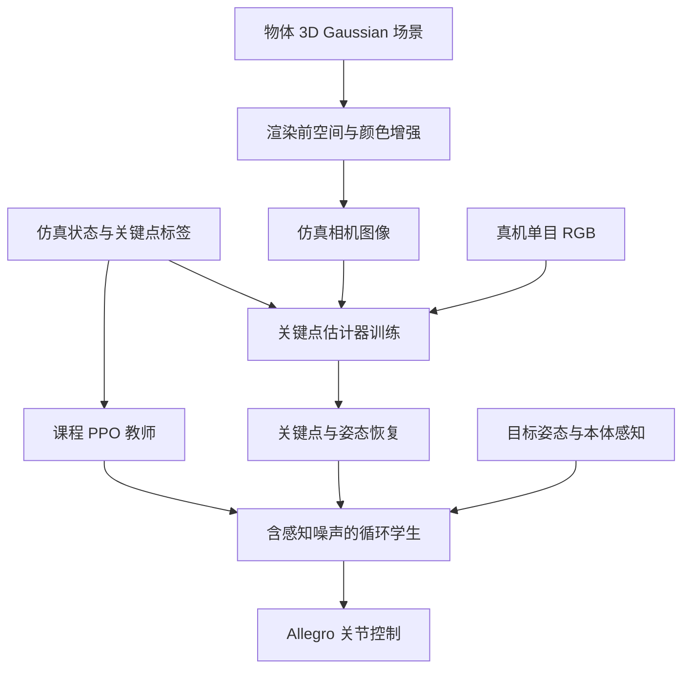
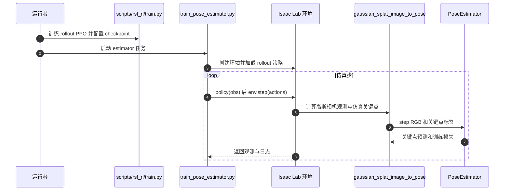

# ViserDex: Visual Sim-to-Real for Robust Dexterous In-hand Reorientation / 鲁棒灵巧手内重定向的视觉仿真到真实迁移

## 一句话定义

ViserDex 用三维高斯泼溅及渲染前增强训练单目物体姿态估计器，再将其接入课程强化学习和教师学生蒸馏得到的手内重定向策略。

## 英文缩写速查

| 缩写 | 英文全称 | 简要说明 |
|------|----------|----------|
| RGB | Red Green Blue | 彩色视觉输入 |
| RL | Reinforcement Learning | 强化学习 |
| PPO | Proximal Policy Optimization | 教师策略优化算法 |
| Sim2Real | Simulation to Reality | 仿真到真机迁移 |

## 核心信息

| 项 | 内容 |
|----|------|
| 机构 | 苏黎世联邦理工学院（ETH Zurich）；NVIDIA |
| 论文 | [arXiv:2604.11138 v1](https://arxiv.org/pdf/2604.11138)，已核对正文、实验及附录 |
| 会议 | RSS 2026 |
| 官方项目 | [viserdex](https://rffr.leggedrobotics.com/works/viserdex/) |

## 流程总览

## 核心机制

- 在高斯参数空间做聚类空间、颜色和全局扰动，生成多样外观；图像训练关键点回归器，再通过刚体配准恢复姿态。
- 教师用性能驱动课程学习，学生用在线 DAgger 蒸馏，注入延迟、噪声和跟踪故障；估计姿态是学生输入。
- 论文面向不同物体采用各自策略；公开仓库说明释放的是高斯渲染、姿态估计训练评测和生成轨迹用的 Isaac Lab 默认任务，不能视作完整论文真机部署栈。

## 源码运行时序图

源码依据：`scripts/pose_estimator/train_pose_estimator.py`、`inhand_env_cfg.py`、`mdp/observations.py` 与 `pose_estimator/pose_estimator.py`，版本 commit `937d533ff0bdbbe278a5848c2c745a29787c7adb`。图展示公开的估计器训练流程，不代表论文未公开的完整真机控制代码。

## 实验与评测

- 每个物体、每种光照运行 5 次，成功阈值为姿态误差 0.4 rad。五物体正常光照平均连续成功 37.6，强干扰光照 25.4；各物体差异很大，强干扰下药瓶 4.2、地球仪 76.2。
- 同一立方体上正常光照 35.4 次，对照 DeXtreme 27.8 次。替换为 FoundationPose 的部署比较约 0.4 次，论文指出频率和跟踪丢失因素。
- 与 GoalDex 的 80/100 单目标成功率不是同一指标或实验协议。

## 结论

ViserDex 表明视觉随机化与足够快的位姿反馈可支持多种实例的真机重定向。

- 渲染前增强直接影响光照变化下的估计鲁棒性。
- 姿态误差和延迟会在控制闭环中放大。
- 不同物体与摩擦条件的成功次数差异明显。

## 局限与工程实践

视觉遮挡和接触力不可直接观测；论文指出物体实例泛化仍需研究。药瓶标签摩擦未建模导致性能下降。公开数据集 [ViserDexSplats](https://huggingface.co/datasets/leggedrobotics/ViserDexSplats) 为 CC BY-NC 4.0，代码仓为 BSD-3-Clause。

## 关联页面

- [GoalDex](./paper-goaldex.md)
- [机器人操作](../tasks/manipulation.md)
- [Sim2Real](../concepts/sim2real.md)

## 参考来源

- [论文归档](../../sources/papers/viserdex.md)
- [项目页归档](../../sources/sites/viserdex.md)
- [源码归档](../../sources/repos/viserdex.md)
