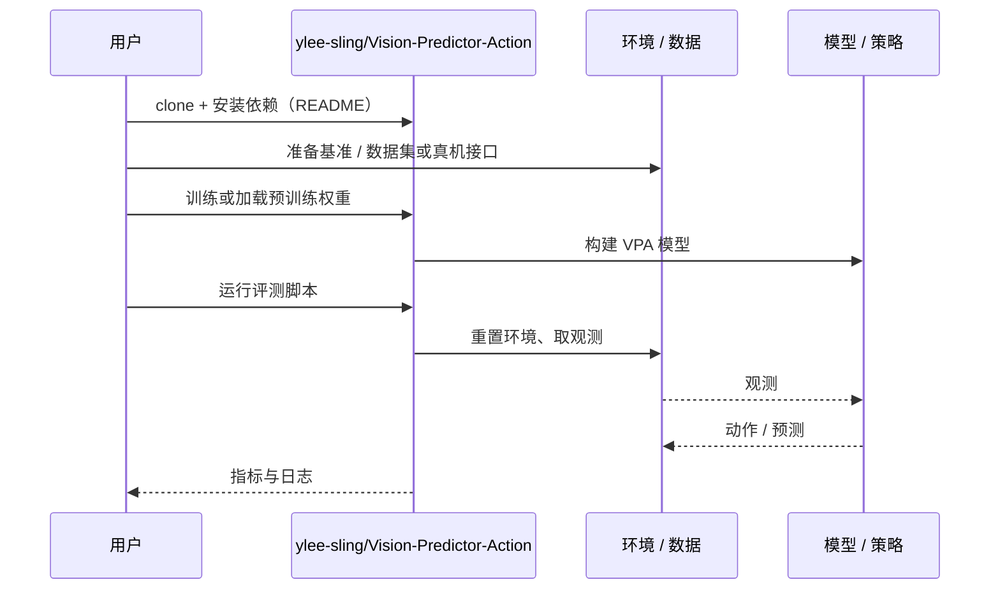

# VPA（arXiv:2610.15556）

**VPA**（*Vision-Predictor-Action: Towards Efficient Embodied AI via Neuro-Symbolic JEPA Predictors*，[arXiv:2610.15556](https://arxiv.org/abs/2610.15556)，[代码](https://github.com/ylee-sling/Vision-Predictor-Action)）来自 [具身智能小站 2026-10-14 盘点](../../sources/blogs/wechat_embodied_station_41_papers_streamingwam_2026-10-14.md)，属「VLA 与动作生成」组。

## 一句话定义

**组合离散技能选择、JEPA 潜在预测与流匹配动作块生成，以潜在预测循环降低串行推理成本。**

## 英文缩写速查

| 缩写 | 英文全称 | 简要说明 |
|------|----------|----------|
| JEPA | Joint-Embedding Predictive Architecture | 联合嵌入预测 |
| VPA | Vision-Predictor-Action | 本文框架 |
| FM | Flow Matching | 流匹配 |

## 为什么重要

- VLA 串行推理昂贵；潜在预测器可替代部分视觉–语言前向。
- 开源结论：**已开源**（步骤 2.5，2026-10-14）。仓库可达。
- 同期同组工作见 [流式动作块与世界模型记忆：具身智能小站 10-14 期 41 篇阅读坐标](../overview/embodied-station-2026-10-14-41-papers-technology-map.md)。

## 核心机制

| 项 | 内容 |
|----|------|
| **arXiv** | [2610.15556](https://arxiv.org/abs/2610.15556) |
| **开源** | **已开源** |
| **要点** | 当前证据是 LIBERO-10 单次训练概念验证；速度与成功率来自不同相机配置。 |
| **文内指标** | 概念验证；以原文为准。 |

## 源码运行时序图

以下为按仓库入口（`ylee-sling/Vision-Predictor-Action`）推断的通用运行链路；入库日仅核实仓库可达，未逐文件阅读，具体脚本名以 README 为准。

## 实验与评测

- 概念验证；以原文为准。
- **读法：** 本页为索引级摘要，依据公众号转述的官方摘要与仓库信息整理；逐项数字与 baseline 以原文 PDF 为准。

## 与其他工作对比

- 横向索引见 [流式动作块与世界模型记忆：具身智能小站 10-14 期 41 篇阅读坐标](../overview/embodied-station-2026-10-14-41-papers-technology-map.md)；同 arXiv 不重复造页。

## 结论

**JEPA 预测器作动作生成中枢是方向性尝试，结论尚需更强实验。**

1. 开源边界：**已开源** — 仓库可达。
2. 核心机制：当前证据是 LIBERO-10 单次训练概念验证；速度与成功率来自不同相机配置。
3. 复现与选型前核对任务协议、硬件与基准口径，勿直接横比公众号摘录数字。

## 关联页面

- [flow-matching-embodied-policy](../concepts/flow-matching-embodied-policy.md)
- [action-chunking](../methods/action-chunking.md)
- [vla](../methods/vla.md)
- [embodied-station-2026-10-14-41-papers-technology-map](../overview/embodied-station-2026-10-14-41-papers-technology-map.md)

## 参考来源

- [vision_predictor_action_jepa_arxiv_2610_15556.md](../../sources/papers/vision_predictor_action_jepa_arxiv_2610_15556.md)
- [wechat_embodied_station_41_papers_streamingwam_2026-10-14.md](../../sources/blogs/wechat_embodied_station_41_papers_streamingwam_2026-10-14.md)
- [arXiv:2610.15556](https://arxiv.org/abs/2610.15556)

## 推荐继续阅读

- [arXiv PDF](https://arxiv.org/pdf/2610.15556)
- [https://github.com/ylee-sling/Vision-Predictor-Action](https://github.com/ylee-sling/Vision-Predictor-Action)
