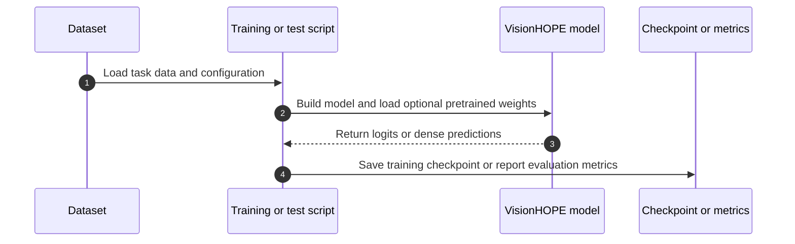

# VisionHOPE：自修改学习系统视觉骨干

## 一句话定义

VisionHOPE 是一种基于 Nested Learning 的通用视觉骨干：图像上下文逐步累积时，模型记忆的内容与记忆更新规则通过五种耦合记忆共同演化。

## 英文缩写速查

| 缩写 | 英文全称 | 简要说明 |
| --- | --- | --- |
| NL | Nested Learning | 让不同更新频率的记忆/优化过程嵌套协同的学习视角 |
| SRNL | Self-Referential Nested Learning | VisionHOPE 实现所用的自指嵌套学习构造 |
| ViT | Vision Transformer | 以图像 token 全局交互建模的常见视觉骨干 |
| COCO | Common Objects in Context | 论文检测、实例分割评测数据集 |
| ADE20K | ADE20K Scene Parsing Dataset | 论文语义分割评测数据集 |

## 为什么重要

常见视觉骨干主要固定了网络结构和参数更新规律；VisionHOPE 探索让“记住什么”与“如何更新”随单张图像中的视觉上下文共同变化。它将 Nested Learning 的自指机制从序列建模扩展到二维视觉特征，也为视觉骨干设计提供了区别于 CNN、ViT、SSM 和 TTT 的方向。

这项工作与机器人感知的联系在视觉表征层：若机器人视觉编码器使用可适应的视觉骨干，记忆更新和空间扫描可能影响特征质量与推理代价。论文没有直接评测机器人任务，不能据此推断其已提升 VLA、导航或操控表现。

## 核心原理

### 方法栈：五种记忆与二维扫描

VisionHOPE 构建五种耦合记忆，分别承担内容存储、key/value 表征生成，以及学习率和保留控制。它们随着视觉上下文扫描而协同变化，使模型的状态和更新方式都参与输入内适应。

将这种自指更新直接用于视觉骨干会带来不稳定风险。作者使用两项稳定性控制：对自指注入量设置软上限，并对保留记忆转移施加谱裁剪；论文证明受控记忆动态沿每次扫描具有非扩张性。

二维特征图采用四个方向的扫描。chunk 与图像的行、列对齐，完成扫描后恢复空间布局，并用可学习的通道融合组合方向特征。官方实现提供 Tiny、Small、Base 三种层级，并含独立的 SRNL、VisionHOPEOperator 与 VisionHOPEBlock 接口。

## 实验与评测

论文报告了三个视觉基准方向：

| 任务 | 数据集 / 配置 | 论文报告 |
| --- | --- | --- |
| 图像分类 | ImageNet-1K | 达到有竞争力的结果 |
| 目标检测与实例分割 | COCO | 达到有竞争力的结果 |
| 语义分割 | ADE20K | 达到有竞争力的结果 |

具体指标、模型规模和基线对比应以论文表格为准。模型页提供对应任务的 T/S/B 预训练权重；COCO Mask R-CNN 3× 仅列出 Tiny 与 Small，ADE20K 使用 UPerNet。

## 源码运行时序图

官方 README 通过 `scripts/train` 与 `scripts/test` 中按任务和模型尺寸区分的脚本启动训练或评估；COCO 与 ADE20K 任务使用 ImageNet 预训练骨干。CUDA 扩展会在首次使用时编译。

## 与其他工作对比

| 方向 | 主体适应机制 | 与 VisionHOPE 的区别 |
| --- | --- | --- |
| CNN | 卷积核局部聚合 | VisionHOPE 的记忆状态和更新规律随扫描共同演化 |
| ViT | token 间全局注意力 | VisionHOPE 使用状态式耦合记忆和四向空间扫描 |
| SSM | 输入相关状态转移 | VisionHOPE 的状态更新还自修改其学习/保留机制 |
| TTT | 图像处理中适应内层学习器 | VisionHOPE 将自修改机制扩展到视觉骨干的耦合记忆体系 |

## 结论

**一句话总判：VisionHOPE 的主要贡献是把输入内适应扩展为“记忆与更新规则共演化”，并为视觉扫描中的自指更新加入稳定性约束。**

1. **读方法时关注两部分：** 五种耦合记忆定义了可演化状态，软上限与谱裁剪控制状态更新稳定性。
2. **二维适配依赖扫描设计：** 行列对齐 chunk 加四向扫描处理空间特征，不能只把它看作普通序列模块。
3. **评测覆盖常规视觉任务：** ImageNet-1K、COCO、ADE20K 结果支持其作为视觉骨干的可行性，不等于机器人任务验证。
4. **复现入口可用：** 官方提供源码与任务 checkpoints，但完整环境需 NVIDIA/CUDA 编译栈和相应数据集。

## 工程实践

- **开放状态（2026-10-18）：** 官方 PyTorch 代码与预训练权重均可获取。代码覆盖分类、检测/实例分割、语义分割及 standalone 模块；任务数据集需自行准备。
- **环境：** README 建议 Python 3.10、PyTorch 2.1 与 CUDA 12.1，并要求 `nvcc` 和 C++ 编译器。CUDA 扩展首次使用时编译。
- **模型权重：** Hugging Face 提供 VisionHOPE-T/S/B 及各任务模型；分类样例可下载 `visionhope_small.pth`，再用 `visionhope.models.create_model` 加载。
- **机器人应用边界：** 当前公开评测不包含 VLA 或实体机器人感知任务；接入机器人视觉塔前，应实测延迟、显存、输入分辨率适配和下游任务精度。

## 局限与风险

- arXiv 版本为预印本；论文结论与实验数值应结合后续版本复核。
- 论文摘要只称结果有竞争力，不能替代逐项读取基线、输入分辨率、训练配方和误差范围。
- 需要 CUDA 扩展编译，CPU-only 或受限部署环境的可用性没有由 README 保证。
- 当前机器人关联是视觉骨干层面的潜在借鉴，不是机器人控制或具身任务的实验证据。

## 关联页面

- [视觉骨干网络](../concepts/vision-backbones.md)
- [Vision Transformer（ViT）](../concepts/vision-transformer.md)

## 参考来源

- [VisionHOPE 论文来源归档](../../sources/papers/visionhope_arxiv_2609_33325.md)
- [VisionHOPE Hugging Face 模型页](../../sources/sites/visionhope-huggingface.md)
- [VisionHOPE 官方代码仓库](../../sources/repos/visionhope.md)

## 推荐继续阅读

- [arXiv: VisionHOPE](https://arxiv.org/abs/2609.33325)
- [官方 PyTorch 实现](https://github.com/PSRben/VisionHOPE)
- [Hugging Face 预训练权重](https://huggingface.co/PSRben/VisionHOPE)
