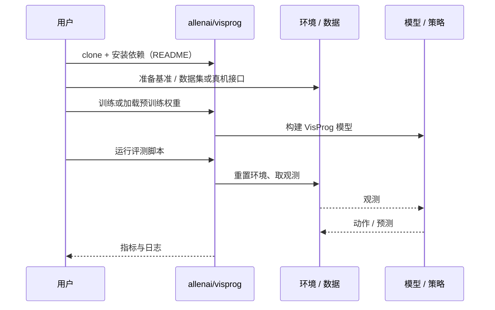

# VisProg（arXiv:2211.11559）

**VisProg**（*Visual Programming: Compositional Visual Reasoning Without Training*，[arXiv:2211.11559](https://arxiv.org/abs/2211.11559)，[项目页](https://prior.allenai.org/projects/visprog)，[代码](https://github.com/allenai/visprog)）来自 [深蓝具身智能 2026-11-01 盘点](../../sources/blogs/wechat_shenlan_cv_best_papers_2023_2026_labs.md)，属「视觉推理与可控生成」组。

## 一句话定义

**VisProg 用大语言模型的上下文学习把自然语言指令写成 Python 式模块化视觉程序，调用现成视觉模型逐步求解，无需任务专门训练。**

## 英文缩写速查

| 缩写 | 英文全称 | 简要说明 |
|------|----------|----------|
| VisProg | Visual Programming | 大模型生成视觉程序的神经符号系统 |
| LLM | Large Language Model | 大语言模型 |
| VQA | Visual Question Answering | 视觉问答 |

## 为什么重要

- 把大模型推理与传统视觉模块组合，得到可解释的执行过程（公众号归属：AI2 PRIOR 团队）。
- 开源结论：**已开源**（步骤 2.5，2026-11-01）。仓库 allenai/visprog 经 git ls-remote 可达；项目页 HTTP 200。
- 同期同组工作见 [从视觉编程到 4D 重建：CV 三大会 2023–2026 Best Paper 阅读坐标](../overview/cv-best-papers-2023-2026-technology-map.md)。

## 核心机制

| 项 | 内容 |
|----|------|
| **arXiv** | [2211.11559](https://arxiv.org/abs/2211.11559) |
| **开源** | **已开源** |
| **要点** | LLM 生成模块化程序，程序每一行调用检测、分割、VQA 等现成模型或 Python 函数，中间结果传给后续步骤，并给出可解释的推理依据（arXiv 摘要）。 |
| **文内指标** | arXiv 摘要称在 4 类任务上验证灵活性（含组合式视觉问答与图像编辑等）；具体数字未在本页转录。 |

## 源码运行时序图

以下为按仓库入口（`allenai/visprog`）推断的通用运行链路；入库日仅核实仓库可达，未逐文件阅读，具体脚本名以 README 为准。

## 实验与评测

- arXiv 摘要称在 4 类任务上验证灵活性（含组合式视觉问答与图像编辑等）；具体数字未在本页转录。
- **读法：** 本页为索引级摘要，依据公众号转述的官方摘要与仓库信息整理；逐项数字与 baseline 以原文 PDF 为准。

## 与其他工作对比

- 横向索引见 [从视觉编程到 4D 重建：CV 三大会 2023–2026 Best Paper 阅读坐标](../overview/cv-best-papers-2023-2026-technology-map.md)；同 arXiv 不重复造页。

## 结论

**VisProg：神经符号路线——让 LLM 写程序而不是训练专用模型。**

1. 开源边界：**已开源** — 仓库 allenai/visprog 经 git ls-remote 可达；项目页 HTTP 200。
2. 核心机制：LLM 生成模块化程序，程序每一行调用检测、分割、VQA 等现成模型或 Python 函数，中间结果传给后续步骤，并给出可解释的推理依据（arXiv 摘要）。
3. 复现与选型前核对任务协议、硬件与基准口径，勿直接横比公众号摘录数字。

## 关联页面

- [visual-representation-for-policy](../concepts/visual-representation-for-policy.md)
- [cv-best-papers-2023-2026-technology-map](../overview/cv-best-papers-2023-2026-technology-map.md)

## 参考来源

- [visprog_arxiv_2211_11559.md](../../sources/papers/visprog_arxiv_2211_11559.md)
- [wechat_shenlan_cv_best_papers_2023_2026_labs.md](../../sources/blogs/wechat_shenlan_cv_best_papers_2023_2026_labs.md)
- [arXiv:2211.11559](https://arxiv.org/abs/2211.11559)

## 推荐继续阅读

- [arXiv PDF](https://arxiv.org/pdf/2211.11559)
- [项目页](https://prior.allenai.org/projects/visprog)
- [https://github.com/allenai/visprog](https://github.com/allenai/visprog)
