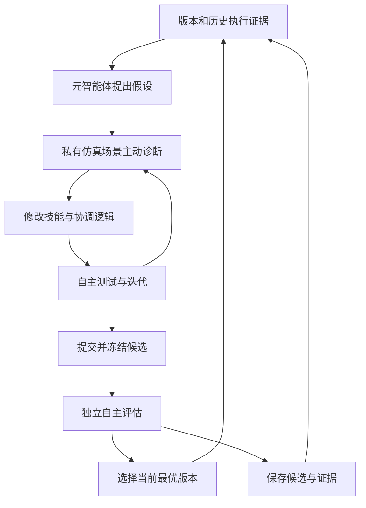
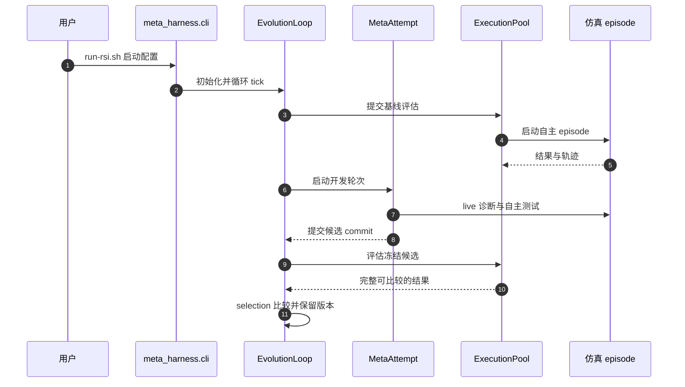

# VISTA: Active Exploration for Self-Improvement in Embodied Agents / 具身智能体主动探索与自我改进

## 一句话定义

VISTA 让编码元智能体通过主动仿真诊断和执行证据迭代技能、指令及决策逻辑；底层模型参数保持固定。

## 英文缩写速查

| 缩写 | 英文全称 | 简要说明 |
|------|----------|----------|
| VLA | Vision-Language-Action | 视觉语言动作模型，本文底层策略（如 π0.5）属于此类 |
| VLM | Vision-Language Model | 视觉语言模型，VLA 通常由预训练 VLM 扩展而来 |
| LLM | Large Language Model | 大语言模型，本文中作为在线规划器和元智能体的基础 |
| DAG | Directed Acyclic Graph | 有向无环图，记录 harness 版本的血缘关系（Harness DAG） |
| T/S | Instruction Redirection / Position Swap | LIBERO-Pro 的两类扰动：指令重定向与位置交换 |
| pp | percentage points | 百分点，文中“提升 X 个百分点”的单位 |

## 核心信息

| 项 | 内容 |
|----|------|
| 机构 | 清华大学、新加坡国立大学 |
| 论文 | [arXiv:2610.35051v1](https://arxiv.org/html/2610.35051v1)，2026-10-26 |
| 资源 | [项目页](https://agenticei.github.io/VISTA-page/)（2026-11-06 核查可访问）；[代码](https://github.com/AgenticEI/VISTA) |
| 开放边界 | LIBERO-Pro T/S 实现已提供；RoboCasa、RoboTwin 接入待发布；演化结果和记录未随源码提供 |

## 为什么重要

具身智能体的表现不只取决于预训练基础模型，也取决于围绕模型的 harness（指令、技能、记忆与决策逻辑）。已有方法多把 rollout 当作静态日志做事后反思，改写 harness 后往往没有在环境中测试和修正。VISTA 把这一步改成“开发期主动探测 + 冻结候选的独立自主评估”，给出一种把具身交互经验沉淀为可执行代码的路径，对研究“不改模型权重、只改控制框架”的工程师有直接参考价值。

## 核心原理

**对象。** 一个 harness 写作 $H=(I,S,P,M,D)$：$I$ 为面向模型的指令，$S$ 为技能描述与可执行实现，$P$ 为请求构造、工具选择和反馈处理等钩子，$M$ 为持久程序性知识，$D$ 为工具绑定与能力依赖。模型参数、能力接口和评估规则固定，只优化 harness。

**目标。** 对任务实例 $x$（目标与场景初始化）和执行随机性 $\xi$，成功指示为 $S(H;x,\xi)\in\{0,1\}$，优化目标为

$$
\max_{H\in\mathcal{H}_C} J(H),\qquad J(H)=\mathbb{E}_{x\sim\mathcal{T},\,\xi}\left[S(H;x,\xi)\right]
$$

其中 $\mathcal{H}_C$ 为允许的 harness 空间，$\mathcal{T}$ 为声明搜索范围内的任务实例分布。

**开发循环（Algorithm 1 概括）。** 每轮从保留的基版本（默认为当前最优 $H^\star$）出发，元智能体自主选择四类操作之一：查阅历史记录、修改 harness 代码、启动私有仿真做实时诊断、请求自主测试中间版本；直到提交候选并冻结。候选随后在新初始化的自主 episode 中评估，并按如下规则决定是否替换在位者。

**选择规则。** 候选与在位者使用相同的任务初始化、重复次数和执行限制，在开发矩阵上计算

$$
\hat J_{dev}(H)=\frac{1}{MR}\sum_{i=1}^{M}\sum_{r=1}^{R} S(H;x_i,\xi_{i,r})
$$

仅当 $\hat J_{dev}(\tilde H_k)>\hat J_{dev}(H^\star_k)$ 时更新 $H^\star_{k+1}=\tilde H_k$，平局保留在位者。被否决的版本仍保留在图中，可被后续开发选作基版本。

**版本与证据。** 每个 harness 对应一个 Git 提交，父子边表示血缘，分支与合并均可表达；运行记录（评估请求、episode、实时诊断、选择决定）挂在对应提交上。论文附录指出，Git 记录代码血缘，运行存储记录证据；复用某个文件或思路并不产生 Git 祖先边。

**元智能体工具面（附录 Table A1）。** 历史查询（如 `history_episodes`、`inspect_decision`）、包开发与提交（`submit` 等）、实时诊断（`live_start`、`live_observe`、`live_capability` 等）、自主测试（`evaluate`）。开发期的实时诊断与中间测试只作证据，晋升只由提交后的独立正式评估决定。

流程总览见下图；图中“提交并冻结候选”之后的评估与选择即上式规则。

Harness 由指令、技能、策略钩子、持久知识和工具绑定组成。Git 提交保存代码血缘，运行记录关联实验条件和证据；失败版本也可作为后续分支。开发时的实时探测和诊断测试不等于正式评估：提交后主控在新初始化的 episode 中运行冻结候选，按可比较的完整结果与 incumbent 比较。

## 源码运行时序图

对应入口与模块见 [源码归档](../../sources/repos/vista-agenticei.md)。2026-11-06 对照官方仓库 `tools/run-rsi.sh`（调用 `meta_harness.cli run`）、`meta_harness/loop.py` 与 `pyproject.toml` 中的 `rpent-evolve` 入口核实了上图的主要节点；实时诊断和正式评估是不同路径，图中仿真 episode 为简化表示。

## 实验与评测

论文按任务选择演化版本；LIBERO-Pro 每任务 8 个场景种子、每种子重复 2 次，T 为指令重定向，S 为位置交换。以下为论文报告的开发条件下选择结果，不能直接视作独立测试集泛化。

| 基准 | 初始 harness | 选择后 | 说明 |
|------|-------------|--------|------|
| LIBERO-Pro 八种设定均值 | 17.5% | 95.0% | +77.5 个百分点；初始接口较精简 |
| RoboCasa365 Composite Seen | 16.4% | 24.2% | 16 个任务 |
| RoboCasa365 Composite Unseen | 4.7% | 13.3% | 16 个任务 |
| RoboTwin | 48.5% | 74.0% | 50 个任务；对照 π0.5 47.9%、LingBot-VLA 50.4%、HarnessVLA 58.0% |

LIBERO-Pro 的 T 与 S 设定分别为 96.5%（由表 1 四列平均计算）与 93.4%；论文正文写 T 为 97.0%，与表格不一致，以表格为准（差异来源未核实）。

四个 LIBERO-Goal 任务的消融中，两轮主动探索提升 85.9 个百分点、平均每任务累计 91.6M meta tokens；仅依据既有轨迹的被动方案分别为 56.3 个百分点和 137.7M。此数字只对应论文特定消融条件，不代表普遍成本。

按任务的开发轨迹显示，最佳版本可在多轮中逐步提升，但单个候选分数并不单调（例如 Goal-t08 中第二轮候选未超过在位的 68.75%，被拒绝；后续分支达到 100%），因此曲线平台不等于开发停止。

## 结论

**一句话总判：** VISTA 的可取之处在于把“开发期的实时探测”与“提交后的独立评估”分开，用版本图保存失败分支；仿真内的大幅提升不能直接外推为真机或新任务泛化。

1. **分离证据与评估** — 开发期诊断、中间测试只作证据，晋升只看冻结候选的独立正式评估，避免把开发集表现当作独立成绩。
2. **按任务选优要谨慎读数** — 每个任务各自选择版本，且 LIBERO-Pro 每任务仅 8 个场景种子、每种子 2 次重复，成功率的置信区间较宽。
3. **成本需要预留** — 主动探索比被动方案在 LIBERO-Goal 消融中累计 meta tokens 更少（91.6M 对 137.7M），但整体仍依赖多次模型调用和仿真 rollout，复现时应预先估算。
4. **先确认开放范围** — 当前公开的是 LIBERO-Pro T/S 的开发运行时与初始 harness；论文中的演化 harness 与实验记录不随源码提供，RoboCasa、RoboTwin 接入待发布。
5. **真机结论尚无** — 作者明确仅做了仿真，真机（如 Franka 机械臂）验证列为后续工作。

## 与其他工作对比

| 对照 | 差异读法 |
|------|----------|
| [VLA](../methods/vla.md) | VLA 直接输出动作；VISTA 保持 VLA 参数不变，改写调用和协调它的 harness。 |
| 仅轨迹反思（如 Meta-Harness 等） | 静态反思只用已有 rollout；VISTA 允许元智能体在开发期主动启动私有仿真验证假设，正式评估仍独立自主运行。 |
| [ASPIRE](../methods/aspire.md) | 论文相关工作中同样通过迭代探索获得技能；VISTA 的重点是把技能与协调逻辑作为可版本化的 harness 演化，并保留失败分支。 |

## 工程实践

**开源状态（步骤 2.5 核查，2026-11-06）。** 项目页可访问，其资源区与论文均指向 [AgenticEI/VISTA](https://github.com/AgenticEI/VISTA)（Apache-2.0）。仓库 README 称当前版本提供 LIBERO-Pro T/S 的开发运行时、仿真适配器、初始 harness、实验配置及离线测试（README 报告 142 项测试通过），RoboCasa 与 RoboTwin 接入待发布；论文中的演化 harness 与实验记录不在本次源码发布范围内。归档见 [仓库归档](../../sources/repos/vista-agenticei.md)。

**复现入口。**
- 安装：`python -m pip install -e '.[test]'`，LIBERO-Pro 另需仿真与模型服务环境（见官方 `docs/libero.md`）。
- 配置：复制 `configs/env.example.sh` 为本地环境文件，并用 `tools/configure_run.py` 选择模型；启动前运行 `python tools/check_config.py configs/local/libero.json`。
- 运行：`bash tools/run-rsi.sh --config configs/local/libero.json --run runs/libero-example`（官方示例为 Goal-t09 单任务单场景单轮）。

**关键配置（论文 §4.1 报告值）。**

| 项 | 取值 |
|----|------|
| 在线规划器 | GPT-5.6 Sol |
| 元智能体 | Codex 与 GPT-6 |
| 底层 VLA | LIBERO-Pro：π0.5；RoboCasa365：RLDX-1；RoboTwin：LingBot-VLA |
| 单 episode 规划器轮次上限 | 100 |
| 环境步数上限 | LIBERO-Pro、RoboTwin 为 10,000；RoboCasa365 按任务 300–2900 |
| 评估规模 | LIBERO-Pro 每 suite 160 episode（10 任务 × 8 种子 × 2 次）；RoboTwin 每任务 4 场景 × 2 次 |

**调试与监控指标。**
- 区分开发期本地测试（small-scale，如 n=2–4）与正式评估（完整任务矩阵）的成功率，只用后者判断晋升。
- 记录每轮候选成功数与当前在位版本，单轮下降不代表开发失败（论文中多次出现候选下降但在位版本保留的情况）。
- 记录 meta tokens（含缓存与未缓存输入、输出及子智能体用量），作为复现成本核算依据。

**源码观察（论文主文未描述）。** 仓库 `meta_harness/selection.py` 另含“成功率优先、在阈值之上再比较部署耗时”的选择分支（`time_optimization` 配置）。复现论文结果时应确认所用配置是否启用该分支。

**机器人应用。** 当前结果全部来自仿真，未涉及真机部署；若要迁移到真机，需额外设计传感噪声、执行延迟与安全探索约束。

## 局限与风险

- **仅仿真验证。** 论文评测完全在仿真环境中进行，作者尚未完成真机验证；传感噪声、执行器延迟和未建模接触动力学均未考察。
- **按任务开发与选择。** 每个任务各自选出版本，论文未证明同一 harness 可无修改地迁移到所有任务或新场景。
- **开发集与独立测试的区别。** 选择依据是开发矩阵上的成功率，评估使用相同的任务初始化设定；正文中的增益应理解为“开发条件下的选择结果”，不是独立测试集泛化。
- **统计样本有限。** LIBERO-Pro 每任务仅 8 个场景种子、每种子 2 次重复；RoboCasa 每类 16 个任务，样本量较小。
- **数值一致性。** 项目页与论文表格存在小幅差异（如 Spatial-T 初始值论文 19.0、项目页 18.8；优化后论文 98.0、项目页 98.1），以论文表格为准（差异来源未核实）；论文正文 T 设定均值 97.0% 与表格计算值 96.5% 不一致。
- **成本与依赖。** 复现依赖多个闭源或外部模型服务（规划器、元智能体、VLA 检查点及仿真资产），元智能体的 meta token 开销随轮次增长，需提前评估预算。
- **可复现性边界。** 论文中的演化 harness 与实验记录不随源码发布，直接复现论文表格需要自行重新开发。

## 关联页面

- [VLA](../methods/vla.md)
- [Manipulation](../tasks/manipulation.md)
- [LLM 机器人控制接口](../concepts/llm-robotics-control-interfaces.md)
- [ASPIRE](../methods/aspire.md)

## 参考来源

- [论文归档](../../sources/papers/vista_arxiv_2610_35051.md)
- [源码归档](../../sources/repos/vista-agenticei.md)
- [项目页归档](../../sources/sites/vista-active-exploration.md)（归档中记录的“项目页不可访问”为 2026-11-03 状态，2026-11-06 已可访问）

## 推荐继续阅读

- [论文全文 v1（arXiv HTML）](https://arxiv.org/html/2610.35051v1)
- [项目页（含视频与图示）](https://agenticei.github.io/VISTA-page/)
- [官方 LIBERO-Pro 运行说明](https://github.com/AgenticEI/VISTA/blob/main/docs/libero.md)
