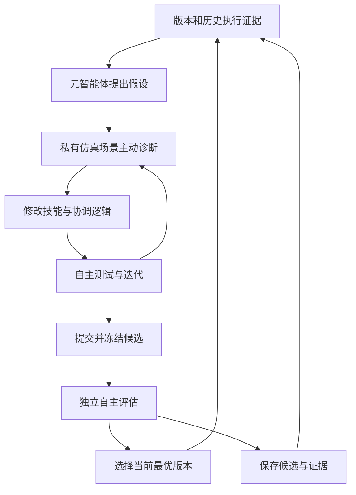
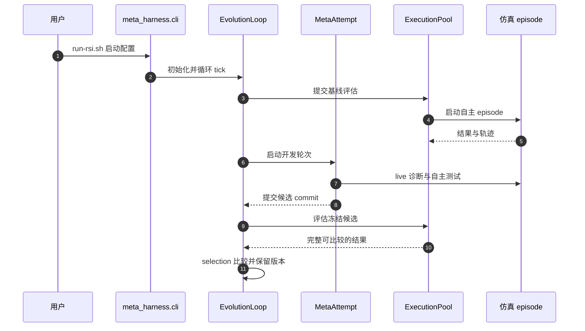

# VISTA: Active Exploration for Self-Improvement in Embodied Agents / 具身智能体主动探索与自我改进

## 一句话定义

VISTA 让编码元智能体通过主动仿真诊断和执行证据迭代技能、指令及决策逻辑；底层模型参数保持固定。

## 英文缩写速查

| 缩写 | 英文全称 | 简要说明 |
|------|----------|----------|
| VLA | Vision-Language-Action | 视觉语言动作模型 |
| DAG | Directed Acyclic Graph | 有向无环图，记录版本血缘 |
| VLM | Vision-Language Model | 视觉语言模型 |

## 核心信息

| 项 | 内容 |
|----|------|
| 机构 | 清华大学、新加坡国立大学 |
| 论文 | [arXiv:2610.35051v1](https://arxiv.org/html/2610.35051v1)，2026-10-26 |
| 资源 | [项目页](https://agenticei.github.io/VISTA-page/)（本次无法访问）；[代码](https://github.com/AgenticEI/VISTA) |
| 开放边界 | LIBERO-Pro T/S 实现已提供；RoboCasa、RoboTwin 接入待发布；演化结果和记录未随源码提供 |

## 流程总览

Harness 由指令、技能、策略钩子、持久知识和工具绑定组成。Git 提交保存代码血缘，运行记录关联实验条件和证据；失败版本也可作为后续分支。开发时的实时探测和诊断测试不等于正式评估：提交后主控在新初始化的 episode 中运行冻结候选，按可比较的完整结果与 incumbent 比较。

## 源码运行时序图

对应入口与模块见 [源码归档](../../sources/repos/vista-agenticei.md)。实时诊断和正式评估是不同路径，图中仿真 episode 为简化表示。

## 实验与评测

论文按任务选择演化版本；LIBERO-Pro 每任务 8 个场景种子、每种子重复 2 次，T 为指令重定向，S 为位置交换。以下为论文报告的开发条件下选择结果，不能直接视作独立测试集泛化。

| 基准 | 初始 harness | 选择后 | 说明 |
|------|-------------|--------|------|
| LIBERO-Pro 八种设定均值 | 17.5% | 95.0% | +77.5 个百分点；初始接口较精简 |
| RoboCasa365 Composite Seen | 16.4% | 24.2% | 16 个任务 |
| RoboCasa365 Composite Unseen | 4.7% | 13.3% | 16 个任务 |
| RoboTwin | 48.5% | 74.0% | 50 个任务 |

四个 LIBERO-Goal 任务的消融中，两轮主动探索提升 85.9 个百分点、平均每任务累计 91.6M meta tokens；仅依据既有轨迹的被动方案分别为 56.3 个百分点和 137.7M。此数字只对应论文特定消融条件，不代表普遍成本。

## 结论

VISTA 展示了固定模型、通过主动获取证据来改进可执行控制框架的路径。

1. 将失败诊断、代码修订和候选评估分开记录，以区分探索过程与自主表现。
2. 根据任务选优及有限种子解读成功率；不将其等同新任务泛化。
3. 复现时预留模型调用及仿真成本；当前论文尚无真机验证。
4. 先核对已发布的基准适配和模型依赖，项目页资源区仍待复核。

## 与其他工作对比

| 对照 | 差异读法 |
|------|----------|
| [VLA](../methods/vla.md) | VLA 输出动作；VISTA 在冻结模型基础上开发调用和协调它的 harness。 |
| 仅轨迹反思 | VISTA 可在开发期主动调用仿真能力验证假设；正式评估依旧独立自主运行。 |

## 局限与风险

仅报告仿真实验；作者尚未完成真机验证。按任务开发与选择，未证明单个 harness 迁移至所有任务。项目主页本次访问失败，源码开放范围依据官方仓库 README 核对，需补核网页本身。

## 关联页面

- [VLA](../methods/vla.md)
- [Manipulation](../tasks/manipulation.md)

## 参考来源

- [论文归档](../../sources/papers/vista_arxiv_2610_35051.md)
- [源码归档](../../sources/repos/vista-agenticei.md)
- [项目页归档](../../sources/sites/vista-active-exploration.md)

## 推荐继续阅读

- [论文全文 v1](https://arxiv.org/html/2610.35051v1)
- [官方 LIBERO 运行说明](https://github.com/AgenticEI/VISTA/blob/main/docs/libero.md)
