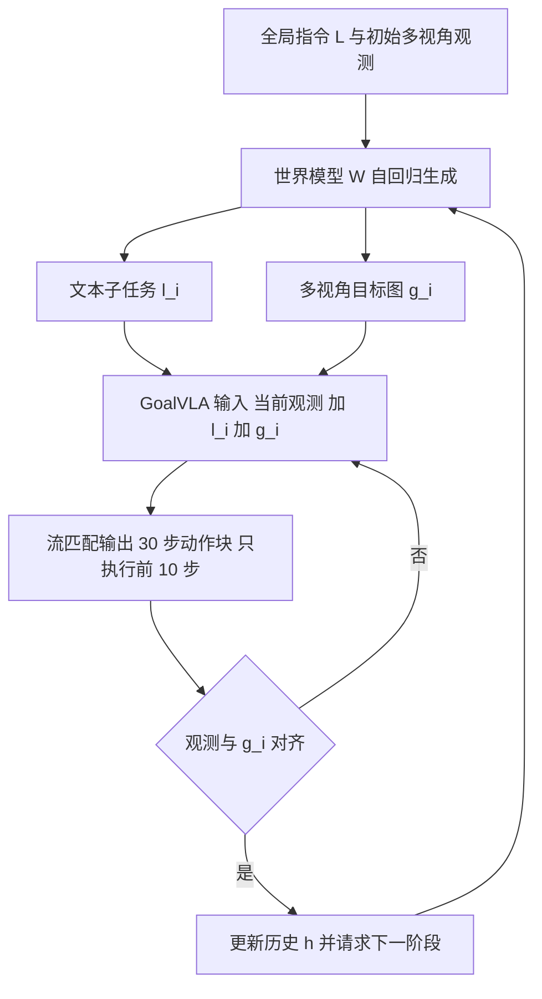

# Scaling World Model for Hierarchical Manipulation Policies（VISTA，arXiv:2602.10983）

> 本页依据 arXiv v1 全文（见 [来源归档](../../sources/papers/vista-hierarchical-world-model-goalvla_arxiv_2602_10983.md) 的核对范围）。作者自述与本页判断分开标注，章节号指论文章节。

## 一句话定义

**VISTA（VIsual Subgoal TAsk decomposition）是一个两层 VLA 框架：高层是由 Emu3.5 继续训练得到的世界模型，自回归地生成「文本子任务 + 多视角目标图像」序列；低层是 π0 架构的 GoalVLA，以当前观测、子任务文本与目标图像为条件输出动作块（摘要、III、IV）。**

## 英文缩写速查

| 缩写 | 英文全称 | 简要说明 |
|------|----------|----------|
| VISTA | VIsual Subgoal TAsk decomposition | 本文框架名 |
| VLA | Vision-Language-Action | 视觉-语言-动作策略 |
| GoalVLA | Goal-image conditioned VLA | 本文低层策略，输入含目标图像 |
| OOD | Out-of-Distribution | 分布外（未见物体、背景、干扰物） |
| IBQ | IBQ（论文未展开全称） | Emu3.5 使用的图像 tokenizer，论文称 IBQTokenizer（IV-A） |
| RDP | Ramer-Douglas-Peucker | 轨迹折线简化算法，用于检测里程碑边界（IV-C） |
| EE | End-Effector | 末端执行器，GoalVLA 输出末端位姿增量 |
| X2I | Any-to-Image | 共训的任意输入到单图生成数据（附录 B） |

## 为什么重要

- **作者主张（I）：** 文本子目标泛化好但缺空间与物理约束，稠密视频预测又有时间漂移；只预测稀疏关键帧图像作为「视觉里程碑」，是介于两者之间的中间表示。
- **证据（V-C，Table I）：** 在仅 2 小时、5 件物体的真机数据上微调后，未见目标物设置下执行成功率 π0 为 0.04、π0-subtask 为 0.31、VISTA 为 0.67。
- **本页判断：** 这是「把互联网规模图像生成模型改造成机器人规划器，再把规划结果落成图像接口」的一个具体样例；接口是图像而非动作或隐变量，便于人工查看生成结果是否合理，但论文没有做该可检查性的定量验证。

## 核心原理与流程总览

**世界模型（IV-A，附录 A-A）：** 图像经 IBQ tokenizer（512×512 输入，1024 个视觉 token）、文本经 Qwen3 tokenizer，共用 282,926 词表；序列为 (初始观测, 指令, 子任务 0, 目标图 0, ..., 子任务 N, 目标图 N)，用标准交叉熵自回归训练（式 2），推理时 beam search 选整体概率最高的序列。总参数 34.1B，在开源 Emu3.5 检查点上继续训练 2000 步，128 块 H100 约 2 天。

**GoalVLA（IV-B，附录 A-B）：** π0 式流匹配（式 4），PaliGemma-3B 加 0.3B 动作专家；输入 3 张当前视角图加 3 张目标图。两项训练设计：子任务感知动作补零（子任务边界之后的动作补零，让策略学会在达到目标后停下），随机目标图偏移（边界重叠窗口内随机取 g_i 或 g_{i+1}，抵抗世界模型生成帧偏早或偏晚）。

流程图依据 III 与 Fig. 2；其中「对齐」判定由 subtask switcher 完成，论文正文未给出判定细节（本页未见）。

**数据（IV-C，附录 B）：** 1.2M 条轨迹经自动流水线（50 个原子技能库，RDP 加夹爪状态变化切分，Qwen2.5-VL 72B 合并片段并写子任务）转成交错序列，来自 Open-X Embodiment、AgiBot World Beta、自采 Mobile Aloha；另以较大权重（Table A.1 中 0.45）共训 Any-to-Image 数据。

## 工程实践

- **GoalVLA 两阶段训练（附录 A-B）：** 先在 AgiBot-Beta 的 200,000 条带子任务与目标图标注的样本上训 100,000 步（batch 512，学习率 5e-5），再在 737 条自采真机轨迹上微调 10 epoch（batch 128，学习率 2e-5）。
- **部署（附录 A-B-c）：** 每次推理出 30 步，只执行 10 步，取第 5 与第 10 步的绝对末端位姿为路点，闭环控制。
- **评测规模（V-A）：** 78 个场景（15 域内 + 63 OOD）每场景 3 次 rollout，每策略共 234 次；单场景只 3 次，Table I 中的比例多为 9 次里的几次（如 0.89 对应 8/9，本页推算）。
- **算力与延迟：** 世界模型 34.1B 参数，论文未见推理时延、调用频率或硬件占用的数字。
- **代码：** 摘要给出项目页 vista-wm.github.io，本次未见代码仓库地址，因此本页 frontmatter 不写 `code:`。

## 与清单说法的核对

清单（Glen Berseth《My CoRL 2026 Reading List》第 076/101 条，P2）对该论文的一句话摘要：「Hierarchical VLA: a pretrained world model generates subgoal images and a VLA executes them, improving OOD generalization.」清单明确说摘要是 LLM 据摘要起草、排序为作者个人兴趣打分，非质量评价。逐项核对：

| 清单措辞 | 与论文的核对 |
|----------|--------------|
| 分层 VLA，世界模型生成子目标图像，VLA 执行 | 一致（摘要、III、IV）。补充：世界模型同时生成文本子任务，且是多视角图像；VLA 的输入还包括子任务文本。 |
| pretrained world model | 部分一致：它是在开源 Emu3.5 上继续训练 2000 步并以机器人数据为主（外加 Any-to-Image 共训）得到的（IV-A），不是现成的预训练世界模型直接使用。 |
| improving OOD generalization | 一致，但限定词缺失：仅真机、仅抓放（VII）；摘要的 14% 到 69% 是 63 个新场景的平均，对象是「相同结构的 VLA」π0（摘要）；Table I 的未见目标物设置为 0.04 到 0.67，与之不同。 |
| 未提及的限定 | 世界模型的子目标质量没有定量指标，论文以样例图展示（Fig. 5 至 8）；评测里没有与其他分层或视频规划方法的对比，基线只有 π0 与 π0-subtask（V-A，本页判断）。 |

## 局限

**论文自述（VII，附录 F）：**
- 真机评测只有抓放任务，更长程和更多样的操作留待未来。
- 生成的视觉子目标可能与真实子任务终点有小偏差，偏差较大时 GoalVLA 会失败。
- 跨 embodiment 的目标图虽能迁移交互先验，但真机执行仍依赖训练数据里存在对应交互模式。
- 世界模型的空间与语义指令跟随仍有限且常有幻觉（附录 F）。

**本页看到的未验证之处（判断，非作者自述）：**
- Table I 基础设置里 π0 的执行成功率（0.96）高于本文（0.93），优势只出现在 OOD 设置；每格仅 9 次 rollout，差异的统计置信度论文未给。
- 基线 π0 与 GoalVLA 的预训练是否对等不清：GoalVLA 第一阶段用了 200k 条 AgiBot-Beta 带目标图样本，论文对 π0 基线的预训练与微调配置写得很少（V-A 仅说明用 π0 与替换指令的 π0-subtask）。
- 世界模型与 VLA 分别增益多少、目标图是否是关键因子，论文没有对目标图质量、时机或视角数做消融（本页通读未见）。
- 数字口径有出入：数据量 15.2B token 对应 Any-to-Image（正文写 15.0B，Table A.1 写 15.2B），embodiment 数正文写 14、附录 B 写 10。
- 14% 与 69% 在文字中只出现于摘要与引言，Fig. 10 的 Avg 值为图上目测。
- 世界模型是否在闭环中按观测重新规划、推理延迟如何，论文未详述。

## 关联页面

- [VLA（Vision-Language-Action）](../methods/vla.md)
- [生成式世界模型](../methods/generative-world-models.md)
- [世界动作模型（WAM）](../concepts/world-action-models.md)
- [分布外泛化](../concepts/out-of-distribution-generalization.md)
- [π0 论文页](../entities/paper-pi0.md)：GoalVLA 的架构与基线来源
- [Open X-Embodiment](../entities/paper-open-x-embodiment.md)：世界模型训练数据来源之一
- [AgiBot World](../entities/agibot-world-2026.md)：AgiBot World Beta 数据来源之一
- [Emu3.5](../entities/paper-sa-2510-26583-emu3-5-native-multimodal-models-are-world-learne.md)：世界模型的初始化检查点
- [模仿学习](../methods/imitation-learning.md)

## 参考来源

- [来源归档：VISTA（arXiv:2602.10983）](../../sources/papers/vista-hierarchical-world-model-goalvla_arxiv_2602_10983.md)
- [arXiv:2602.10983](https://arxiv.org/abs/2602.10983)
- 项目页：<https://vista-wm.github.io>（未访问）

## 继续阅读

- [arXiv PDF](https://arxiv.org/pdf/2602.10983v1)
- [世界模型功能分类](../concepts/functional-taxonomy-world-models.md)
- [π0 论文页](../entities/paper-pi0.md)
