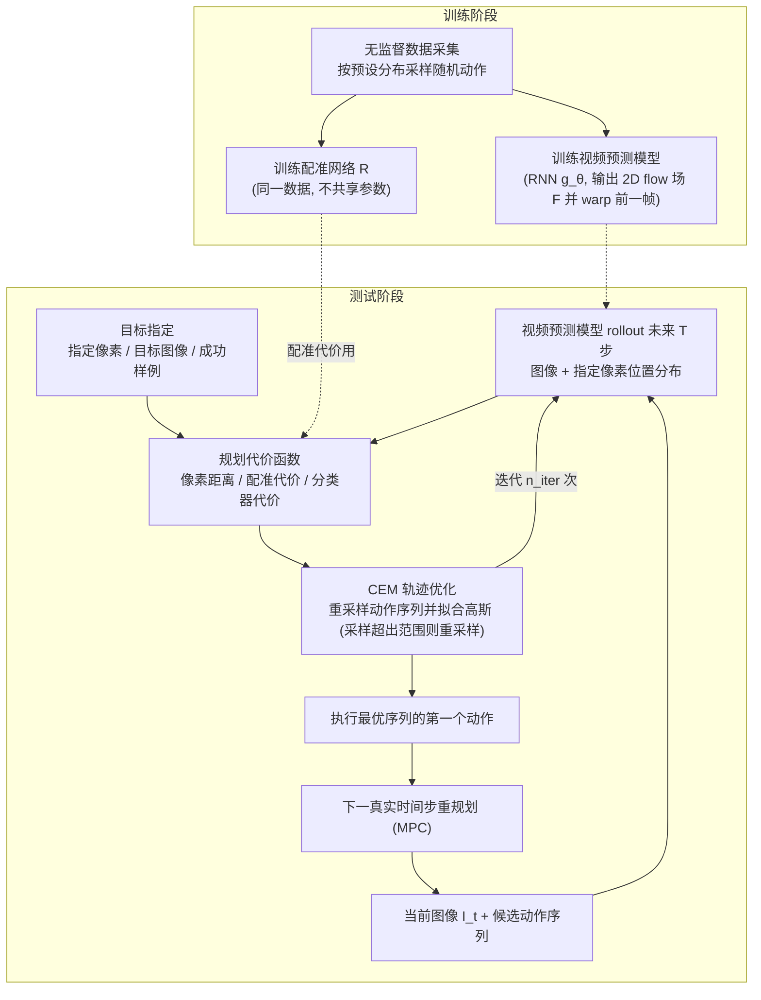

# Visual Foresight

**Visual Foresight** 收录于 [具身智能研究室 · 具身世界模型六路线综述](https://mp.weixin.qq.com/s/mmIJRp9g6NqblMCjd9D5GQ) **规划主导型** 段。本页为知识库 **策展编译** 详情节点；量化指标以原文 PDF / 项目页为准。

## 一句话定义

动作条件视频预测接入真实机器人视觉 MPC，奠定预测后果—在线选择—重规划范式。

## 英文缩写速查

| 缩写 | 英文全称 | 简要说明 |
|------|----------|----------|
| WM | World Model | 根据状态与动作预测未来观测/状态 |
| WAM | World Action Model | 联合未来与动作生成的具身策略 |
| MPC | Model Predictive Control | 滚动时域优化选动作 |
| VLA | Vision-Language-Action | 视觉–语言–动作策略 |

## 为什么重要

- 属于六路线 taxonomy 的 **规划主导型**：预测结果被用于 **执行时在模型中试走，外部规划/验证裁决动作。**
- 与 [六路线技术地图](../overview/embodied-wm-six-routes-technology-map.md) 中同段工作对照阅读，避免与 WAM/评估/记忆类节点混淆。

## 流程总览

图依据：论文 §3 Overview / §4 Video Prediction / §5 Planning Cost Functions / §6 Trajectory Optimizer（Algorithm 1）/ Fig.2

## 核心信息

| 项 | 内容 |
|----|------|
| **路线** | 规划主导型 |
| **出处** | [arXiv:1812.00568](https://arxiv.org/abs/1812.00568) |
| **文内角色** | 动作条件视频预测接入真实机器人视觉 MPC，奠定预测后果—在线选择—重规划范式。 |

## 结论

**Visual Foresight 在六路线框架下的读法：先看预测输出被谁消费，再看是否改善真实行动——而非只看网络新旧或画面观感。**

- 归入 **规划主导型** 的判断标准是 **闭环职责**，不是模型架构标签。
- 与同路线邻接工作对照时，优先比较 **动作条件性、物理一致性与部署接口**。
- 细节数字与开源状态以原文为准；本页服务图谱导航与交叉引用。

## 实验与评测

- **本页无量化数字**：六路线综述只给出该工作在 taxonomy 中的定位，未转述实验表格；成功率、消融与实机协议以 [arXiv:1812.00568](https://arxiv.org/abs/1812.00568) 为准。
- **该路线该看的指标**：任务成功率、规划时延与 rollout 步数、模型误差随预测时域的放大速度。
- **综述的评价取向**：按文内判断「评价从画质转向行动效用」，读实验时先问预测是否改善了真实执行，再看画面观感（见 [六路线技术地图](../overview/embodied-wm-six-routes-technology-map.md)）。

## 与其他工作对比

- **同路线邻接工作**（综述 **规划主导型** 段）：[PETS](./paper-pets-probabilistic-dynamics-mpc.md)、[PlaNet](./paper-planet-latent-dynamics.md)、[MuZero](./paper-muzero-planning-latent-dynamics.md)。
- **对照要点**：四者都在「预测—裁决」结构里，差别是 **预测什么**：Visual Foresight 预测像素、PlaNet 预测隐状态、PETS 预测低维动力学分布、MuZero 只预测搜索需要的奖励/策略/价值。
- **跨路线区分**：规划主导型的闭环职责是「执行时预测后果、由外部规划或验证裁决动作」；与其他路线的分界是 **预测结果被谁消费**，不是模型架构或参数量。定量对照回到各自原文，本页不做跨论文数字拼接。

## 关联页面

- [具身世界模型六路线技术地图](../overview/embodied-wm-six-routes-technology-map.md)
- [规划主导型 分类 hub](../overview/embodied-wm-route-planning.md)
- [Generative World Models](../methods/generative-world-models.md)
- [World Action Models](../concepts/world-action-models.md)

## 参考来源

- [wechat_embodied_ai_lab_wm_six_routes_survey_2026-08-25.md](../../sources/blogs/wechat_embodied_ai_lab_wm_six_routes_survey_2026-08-25.md)
- [arXiv PDF](https://arxiv.org/pdf/1812.00568)：已通读方法部分（实验与附录以略读为准）：§3 Overview、§4 视频预测模型、§5 代价函数（5.1–5.3）、§6 轨迹优化器；§7–§9 实验与附录略读

## 推荐继续阅读

- [arXiv:1812.00568](https://arxiv.org/abs/1812.00568)
