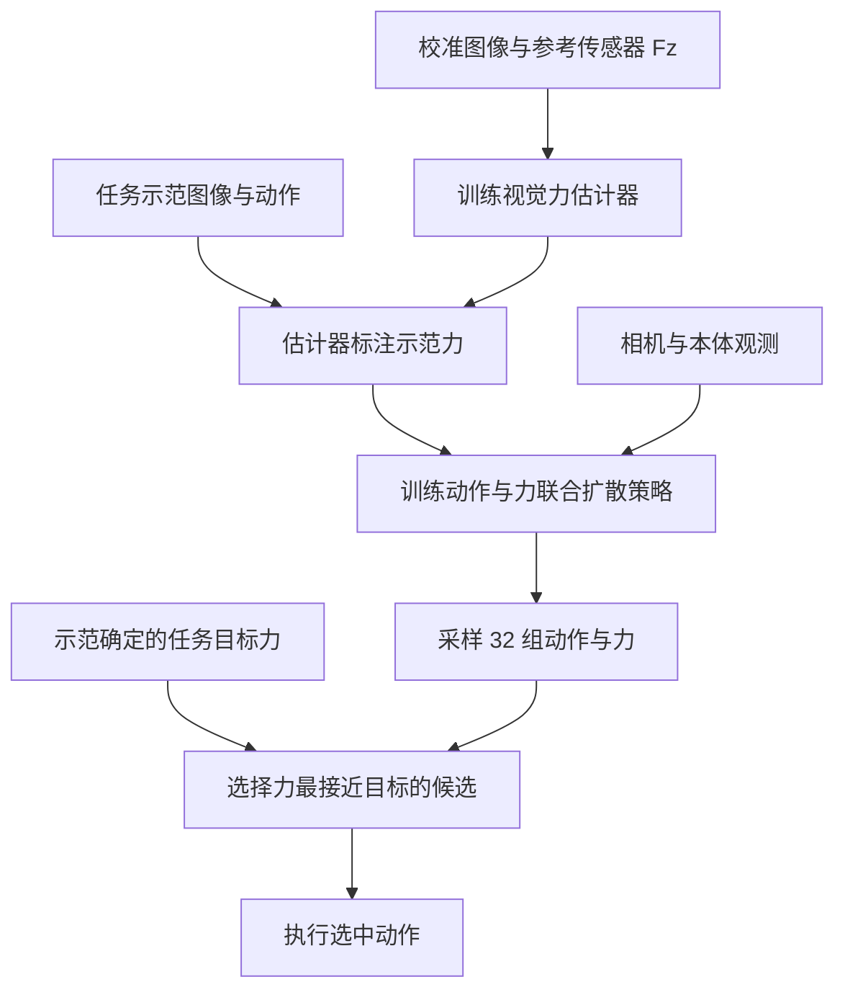
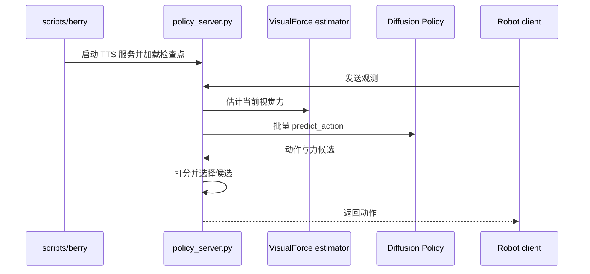

# VisualForce：基于视觉预测力的机器人学习

## 一句话定义

利用柔性 Fin Ray 夹爪形变学习力估计器，给示范标注力，再从策略生成的动作–力候选中选取接近目标力的动作。

## 英文缩写速查

| 缩写 | 英文全称 | 简要说明 |
|---|---|---|
| RGB | Red Green Blue | 相机图像 |
| F/T | Force/Torque | 校准使用的力与力矩传感器 |
| MAE | Mean Absolute Error | 平均绝对误差 |

## 核心信息

| 项 | 内容 |
|---|---|
| 机构 | 哈佛大学、麻省理工学院、宾夕法尼亚大学、斯坦福大学 |
| 论文 | [arXiv v2，2026-10-20](https://arxiv.org/html/2610.04741v2) |
| 平台 | ARX 机械臂、Fin Ray 夹爪、D405 腕相机和 D435 侧相机 |
| 开源 | [代码](https://github.com/visual-force/visual-force)公开；数据、检查点及独立机器人控制器未随仓库提供 |

## 流程总览

校准时使用参考力传感器，并非整个流程都不需要传感器。训练数据为 117 段、47.5 分钟；每任务 40 条示范。论文中的推理筛选使用**策略生成的力值**，而不是对候选动作再运行视觉估计器；力值不直接作为机器人控制命令。

## 源码运行时序图

依据官方 `scripts/berry`、`scripts/lib/berry_tts.sh` 和 `policy_server.py`。代码 berry 默认启用直接夹爪反馈，且可按夹爪轨迹选择；这比论文描述的纯策略力值筛选多了在线估计与控制，复现时需核对配置。代码依赖外部检查点、数据和机器人控制器。

## 评测与局限

论文自报：在 3 段共 442 帧的力估计评估中，按段等权 MAE 为 0.91 N，电流基线为 4.20 N。以下各方法每任务 15 次，使用同一策略检查点。

| 任务 | 单次采样 | 力搜索 |
|---|---:|---:|
| 易拉罐抓取 | 46.7% | 86.7% |
| 浆果采摘 | 0% | 73.3% |
| 板件手内重定向 | 6.7% | 46.7% |
| 插头插入 | 26.7% | 73.3% |

任务目标力来自成功示范；仅估计法向力，不能恢复切向力或力矩。论文方法没有在线力反馈修正预测误差与突发扰动；样本量也限制结果外推。先前研究已探索夹爪形变与视觉力估计，不能认定该思路为首创。

## 与其他工作对比

- **实验内对照**：力估计只对比电机电流线性拟合基线（MAE 0.91 N 对 4.20 N，§IV-B、Fig. 4）；操作只对比同一 [Diffusion Policy](./paper-diffusion-policy.md) 检查点的单次采样（§IV-C、Fig. 5），未与配备 F/T、触觉传感器的策略或其他测试时搜索方法做实测比较。
- **专用力与触觉传感**：GelSight 类光学触觉、F/T 传感器需在部署端加装硬件（§II-A）；本文部署时只用腕相机观察 Fin Ray 夹爪形变，参考传感器仅在校准阶段提供 Fz 监督（§IV-A）。
- **视觉形变估力**：De Barrie 等用有限元仿真数据训练，Kitamura 等用物体内嵌传感器标定，Forces for Free 依赖为力可观性优化的欠驱动手（§II-A）；本文区别在于把估计力用作示范标签，再让策略生成的力参与动作选择。
- **力标注示范学习**：[UMI-FT](./paper-umi-ft.md) 用带力传感的手持接口采集示范，学习运动、抓取力与刚度（§II-B）；本文力标签来自视觉估计器，力值不下发为控制命令，只用于候选排序。
- **测试时搜索**：V-GPS 用离线价值函数、GPC 用世界模型、[TouchGuide](./paper-sa-2601-20239-touchguide-inference-time-steering-of-visuomotor.md) 用触觉接触物理模型修正早期样本（§II-C）；本文按策略生成力与示范目标力的距离从 32 个候选中选择，测试时不调用估计器打分。各文任务、硬件与试验次数不同（本文每任务 15 次），成功率不可横比。

## 结论

视觉形变可为特定夹爪和任务提供有用的力相关信号，但效果依赖校准、目标力和策略候选质量。

- 校准需覆盖预期接触位置与载荷。
- 新任务需要合理选择目标力并评估泛化。
- 精确接触控制应考虑估计误差与在线扰动。

## 关联页面

- [触觉感知](../concepts/tactile-sensing.md)
- [接触丰富操作](../concepts/contact-rich-manipulation.md)
- [机器人操作](../tasks/manipulation.md)

## 推荐继续阅读

- [官方项目页](https://visual-force.github.io/)

## 参考来源

- [论文归档](../../sources/papers/visualforce_arxiv_2610_04741.md)
- [项目页归档](../../sources/sites/visualforce.md)
- [代码归档](../../sources/repos/visualforce.md)
