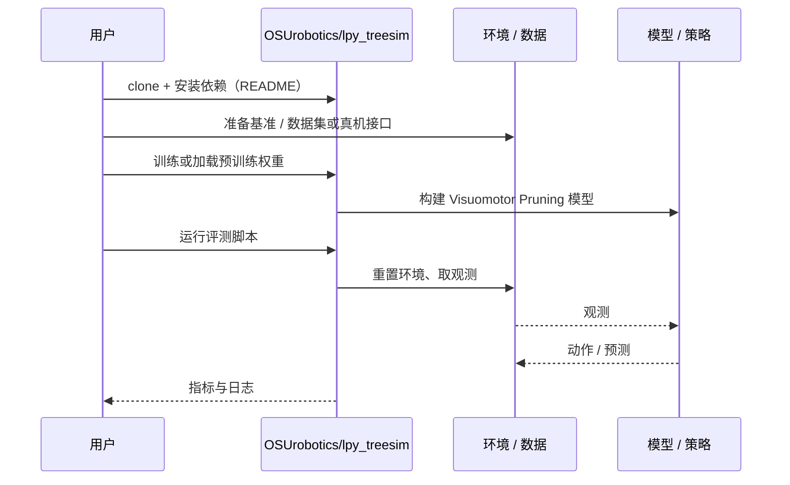

# Visuomotor Pruning（arXiv:2609.24906）

**Visuomotor Pruning**（*Visuomotor Robotic Pruning in Planar Orchards Using Hybrid Reinforcement Learning*，[arXiv:2609.24906](https://arxiv.org/abs/2609.24906)，[代码](https://github.com/OSUrobotics/lpy_treesim)）来自 [具身智能小站 2026-10-18 盘点](../../sources/blogs/wechat_embodied_station_26_papers_embodiedswe_2026-10-18.md)，属「策略与规划」组。

## 一句话定义

**用腕部相机光流驱动闭环控制，混合离线示范与在线仿真学习，在平面整形果树上做修枝。**

## 英文缩写速查

| 缩写 | 英文全称 | 简要说明 |
|------|----------|----------|
| RL | Reinforcement Learning | 强化学习 |

## 为什么重要

- 不必完整三维重建也能闭环引导修枝；纯仿真训练后可迁移实地。
- 开源结论：**已开源**（步骤 2.5，2026-10-18）。仓库可达（git ls-remote）；仓库名为 lpy_treesim（树木仿真），是否含完整训练代码未核实。
- 同期同组工作见 [编程智能体造数据与 VLA 闭环评测：具身智能小站 10-18 期 26 篇阅读坐标](../overview/embodied-station-2026-10-18-26-papers-technology-map.md)。

## 核心机制

| 项 | 内容 |
|----|------|
| **arXiv** | [2609.24906](https://arxiv.org/abs/2609.24906) |
| **开源** | **已开源** |
| **要点** | 腕部相机光流 → 闭环控制；离线示范 + 在线仿真混合 RL。 |
| **文内指标** | 公众号提示：范围是平面整形果树与预先指定的切点；未给具体数字。 |

## 源码运行时序图

以下为按仓库入口（`OSUrobotics/lpy_treesim`）推断的通用运行链路；入库日仅核实仓库可达，未逐文件阅读，具体脚本名以 README 为准。

## 实验与评测

- 公众号提示：范围是平面整形果树与预先指定的切点；未给具体数字。
- **读法：** 本页为索引级摘要，依据公众号转述的官方摘要与仓库信息整理；逐项数字与 baseline 以原文 PDF 为准。

## 与其他工作对比

- 横向索引见 [编程智能体造数据与 VLA 闭环评测：具身智能小站 10-18 期 26 篇阅读坐标](../overview/embodied-station-2026-10-18-26-papers-technology-map.md)；同 arXiv 不重复造页。

## 结论

**光流驱动闭环可替代完整重建，但适用范围限于平面整形果树。**

1. 开源边界：**已开源** — 仓库可达（git ls-remote）；仓库名为 lpy_treesim（树木仿真），是否含完整训练代码未核实。
2. 核心机制：腕部相机光流 → 闭环控制；离线示范 + 在线仿真混合 RL。
3. 复现与选型前核对任务协议、硬件与基准口径，勿直接横比公众号摘录数字。

## 关联页面

- [reinforcement-learning](../methods/reinforcement-learning.md)
- [manipulation](../tasks/manipulation.md)
- [sim2real](../concepts/sim2real.md)
- [embodied-station-2026-10-18-26-papers-technology-map](../overview/embodied-station-2026-10-18-26-papers-technology-map.md)

## 参考来源

- [visuomotor_robotic_pruning_orchards_arxiv_2609_24906.md](../../sources/papers/visuomotor_robotic_pruning_orchards_arxiv_2609_24906.md)
- [wechat_embodied_station_26_papers_embodiedswe_2026-10-18.md](../../sources/blogs/wechat_embodied_station_26_papers_embodiedswe_2026-10-18.md)
- [arXiv:2609.24906](https://arxiv.org/abs/2609.24906)

## 推荐继续阅读

- [arXiv PDF](https://arxiv.org/pdf/2609.24906)
- [https://github.com/OSUrobotics/lpy_treesim](https://github.com/OSUrobotics/lpy_treesim)
