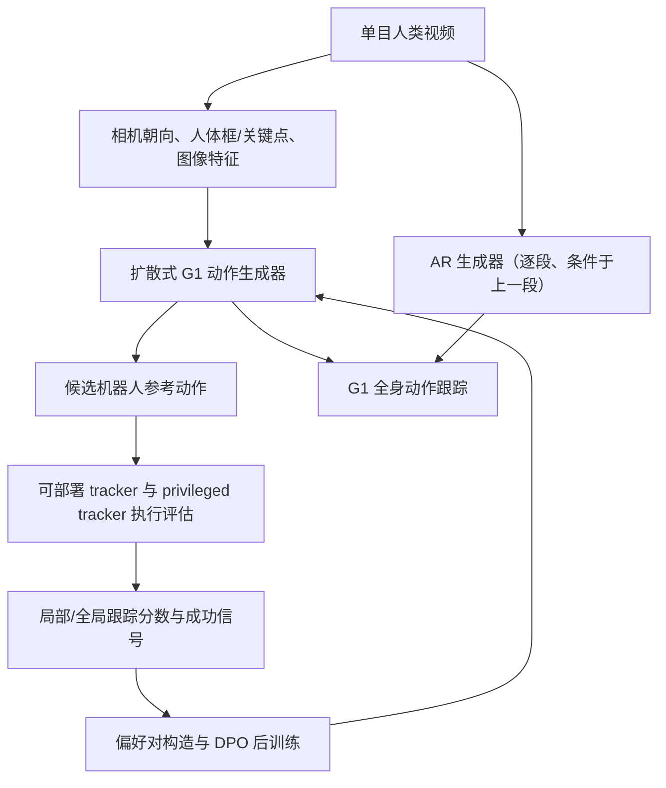
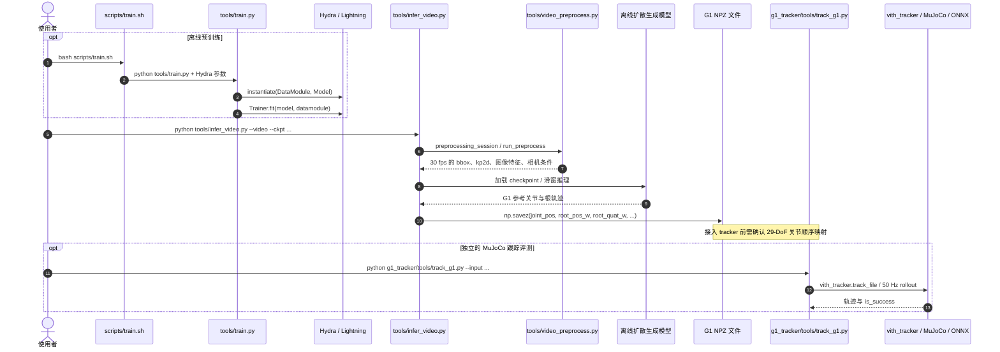

# ViT-H：带运动跟踪反馈的视频到人形控制

**一句话定义：** ViT-H 从单目人类视频直接生成 Unitree G1 的参考动作，并用机器人跟踪表现反向优化生成器。

## 英文缩写速查

| 缩写 | 英文全称 | 简要说明 |
|------|----------|----------|
| ViT-H | Video-To-Humanoid | 将视频转换为人形机器人参考动作的生成与控制框架 |
| DPO | Direct Preference Optimization | 根据 tracker 给出的动作偏好对后训练生成器 |
| AR | Autoregressive | 在线版本按时间片段生成动作并以上一段作条件 |
| G1 | Unitree G1 humanoid robot | 论文中进行实机验证的人形平台 |
| RGB | Red, Green, Blue | 在线遥操作使用的单目彩色图像输入 |

## 为什么重要

常见 video-to-humanoid 流程先从视频重建人体动作，再将动作重定向到机器人骨架，最后由 tracker 执行。ViT-H 将生成目标直接放在目标机器人的动作空间，并用下游 tracker 的执行结果优化生成器，减少分阶段优化带来的接口误差。它把“动作看起来像”与“机器人能否跟踪”放进同一训练闭环。

## 方法栈：视频条件生成与跟踪反馈

ViT-H 的运动生成器读取单目视频派生的条件，包括相机朝向、人体框、2D 关键点和图像特征，直接预测 G1 参考运动。离线版本一次生成整段动作；自回归版本利用前一动作片段，逐段生成新参考动作以支持在线输入。

反馈使用两类 tracker：面向部署的 tracker 提供局部姿态与成功信号；额外观察全局信息的 privileged tracker 为全局轨迹质量提供评价。作者据此为同一视频下的候选运动排序，并通过 DPO 更新生成器。论文称偏好构造不需要人工动作标注。

## 源码运行时序图

下图仅描述**截至 2026-11-08 已公开的离线训练、推理与 MuJoCo G1 跟踪入口**；论文所述 DPO 后训练和实时 G1 视频遥操作源码尚未发布，因此不冒充其运行时实现。

离线推理完整说明见官方 [docs/INFERENCE.md](https://github.com/mileret/ViT-H-release/blob/main/docs/INFERENCE.md)，跟踪仿真见 [g1_tracker/README.md](https://github.com/mileret/ViT-H-release/blob/main/g1_tracker/README.md)。上述为源码入口与调用关系核验，并非本次完成的实际运行测试。

## 实验与评测

- **平台与任务：** Unitree G1 实机；离线视频到人形控制和单 RGB 相机实时遥操作，演示包括行走、拳击、挥手、搬箱、擦桌、踢球、坐下/站立等。
- **实时延迟：** 论文附录 B.7/Table A1 在 RTX 5090 上报告平均端到端 **253.7 ms**（传输 70.1 + 预处理 114.4 + 生成 62.3 + 跟踪 6.9 ms），作者为稳定控制预留 100 ms 余量并报告小于 400 ms；首段动作初始化约需 **10 秒**。这不是本次复现实测。
- **比较结果：** 论文 Table 2（基于估计相机运动）在 **video-only 测试集的 MuJoCo 跟踪成功率**：离线 DPO 后训练前 **74.8%** → 后 **80.0%**；在线前 **49.6%** → 后 **63.8%**。基线 GVHMR+GMR 为 50.3%、GEM+GMR 为 51.7%；**不是实机任务成功率**。论文还报告模型容量、预训练及后训练数据规模增大时指标改善。
- **跨 tracker：** 论文报告跟踪反馈对多个不同 tracker 的可执行性均有帮助；具体数字和实验设定见论文表格与附录。

## 与其他工作对比

| 路线 | 视频到机器人的路径 | 可执行性反馈 |
|------|--------------------|----------------|
| 经典重建—重定向—跟踪 | 视频 → 人体动作重建 → 人机重定向 → tracker | 各阶段通常分开优化 |
| ViT-H | 视频条件 → 直接生成机器人动作 → tracker | tracker rollout 构造偏好对，DPO 更新生成器 |
| SONIC / 通用 tracker | 提供多动作跟踪执行接口 | ViT-H 可将 tracker 作为生成结果评估器；二者职责不同 |

ViT-H 与 [GMR](../methods/motion-retargeting-gmr.md) 的路线差异在于推理时是否显式输出人体动作并做运动学重定向；它也依赖可用的全身跟踪器，和 [SONIC](../methods/sonic-motion-tracking.md) 这类通用跟踪器处在生成与执行的相邻模块。

## 结论

**一句话总判：** ViT-H 的核心贡献是把目标机器人跟踪结果反馈给视频条件动作生成器，使参考动作的可执行性进入后训练目标。

1. 直接预测机器人参考动作，省去推理链路中的人体重建与显式重定向阶段。
2. tracker 执行质量参与候选动作排序，形成生成—执行闭环；DPO 使用偏好对而非人工动作真值。
3. 在线 AR 版本面向流式视频遥操作，论文报告端到端延迟低于 400 ms。
4. 演示与论文结果依赖 G1 和对应跟踪策略，迁移到其他机器人需要重新核验动作表示与 tracker 兼容性。
5. 截至 2026-11-08，**离线预训练/推理及 MuJoCo 跟踪已公开**；但在线实机部署及 DPO 后训练代码仍未发布，不能宣称全流程已复现。
6. 训练数据预处理仍可使用 GMR 重定向；论文的“跳过重建与重定向”只针对**推理**阶段。

## 工程实践与开放状态

| 项目 | 论文 / 项目页信息 |
|------|------------------|
| 输入 | 单目视频；在线演示使用 RealSense D455 RGB 流 |
| 目标输出 | Unitree G1 humanoid reference motion |
| 执行层 | 全身运动跟踪策略将参考动作转为机器人控制 |
| 在线路径 | AR 生成器按片段输出，并把参考动作送入 tracker |
| 代码状态 | **部分开源**：离线预训练 `scripts/train.sh`、离线推理 `tools/infer_video.py`、G1 仿真跟踪 `g1_tracker/tools/track_g1.py` 已开放，权重/处理数据有独立 Hugging Face 链接；在线遥操作与 DPO 后训练代码计划 2026-12-01 发布 |

### 源码复现关键参数

- **官方离线发布环境：** Linux、Python 3.10、CUDA 12.1、PyTorch 2.3；预训练 16 层 Transformer / 1024 维 / 16 heads / 120 帧，数据需单独下载与授权。
- **推理：** 视频按时间戳重采样到 30 fps，默认 SimpleVO 估计动态相机（可选 DPVO），使用 Fast-SAM-3D-Body 特征，输出 G1 29-DoF NPZ；缓存按输入/模型/预处理配置校验。
- **跟踪：** 已发布的 ONNX tracker 在 MuJoCo 中以 50 Hz rollout。离线推理文档列输出 BYD 关节顺序，tracker 文档列其输入要求 IsaacLab 顺序；衔接时需检查转换逻辑，不能默认 NPZ 兼容。
- **证据与复现边界：** 实际阅读官方 README、`scripts/train.sh`、`tools/train.py`、`tools/infer_video.py`、`tools/video_preprocess.py`、`g1_tracker/tools/track_g1.py`；未在本次任务中运行训练、推理、MuJoCo 或真实机器人。
- **论文全链路区别：** 论文的 post-training 使用候选执行反馈构造 DPO 偏好对，官方 release 中当前仍无 DPO / 在线遥操作实现。

## 局限与风险

- **系统级延迟依赖实现细节：** 论文小于 400 ms 的报告不应脱离输入处理、采样配置、硬件和缓冲策略单独外推。
- **跟踪器影响评价：** tracker 的技能范围和偏差会影响偏好排序；privileged tracker 的全局信息也不等同于部署时可观测状态。
- **部分开源边界：** 公开仓库的离线预训练、离线推理与仿真 tracker 可供检查；在线遥操作与 DPO 后训练暂缺。第三方 SAM3D、SMPL/SMPL-X 及原始数据许可另行约束，不能将 README 的未来发布日期视为已发布。
- **操作限制：** 当前是 Unitree G1 29-DoF 运动表示，论文明确未覆盖灵巧手与精细抓握；训练样本的机器人目标动作构建仍依赖 GMR 重定向。
- **预印本状态：** arXiv 论文标注为 under review，结论以当前版本为准。

## 关联页面

- [GMR：通用动作重定向](../methods/motion-retargeting-gmr.md) — 视频到机器人常见显式重定向方案。
- [SONIC：规模化人形运动跟踪](../methods/sonic-motion-tracking.md) — ViT-H 生成器下游的通用 tracker 背景。
- [遥操作（Teleoperation）](../tasks/teleoperation.md) — 在线视频输入驱动机器人控制。
- [移动操作（Loco-Manipulation）](../tasks/loco-manipulation.md) — 项目页演示的搬运与桌面任务类型。

## 参考来源

- [ViT-H arXiv 论文](../../sources/papers/vit_h_arxiv_2610_32966.md)
- [ViT-H 官方项目页](../../sources/sites/vit-h.md)
- [ViT-H 官方代码仓库归档](../../sources/repos/mileret_vit_h_release.md)

## 推荐继续阅读

- [ViT-H 官方项目页](https://awfuact.github.io/vit-h/) — 论文、方法示意与 G1 实机演示。
- [ViT-H 官方实现仓库](https://github.com/mileret/ViT-H-release) — 已公开的离线实现与后续计划。
