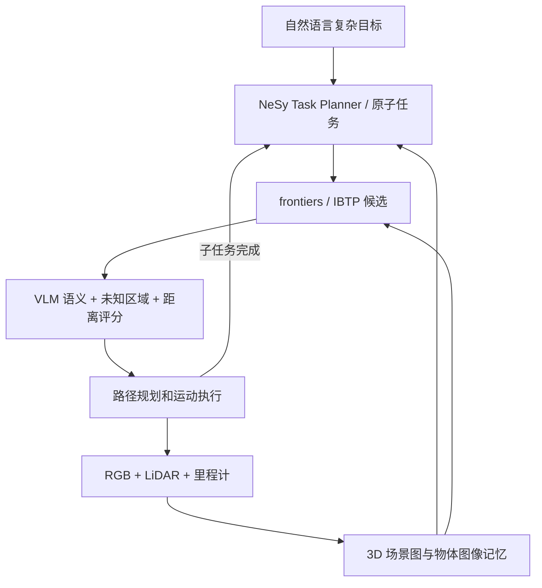

# VL-Nav：神经符号推理驱动的视觉语言导航

**英文：** VL-Nav: Neuro-Symbolic Reasoning-based Vision-Language Navigation · [原论文](https://arxiv.org/abs/2502.00931) · [官方项目](https://sairlab.org/vlnav/)

## 一句话定义

以包含 3D 场景图和最佳视角图像的符号记忆，联合神经语义理解、显式任务分解与启发式探索，使机器人在未知场景执行复杂语言导航。

## 英文缩写速查

| 缩写 | 英文全称 | 简要说明 |
|---|---|---|
| VLN | Vision-Language Navigation | 根据视觉观测与指令选择导航目标 |
| NeSy | Neuro-Symbolic | 神经语义推理与符号约束结合 |
| VLM | Vision-Language Model | 理解复杂指令与目标关系的模型 |
| IBTP | Instance-Based Target Point | 已检测实例的目标验证点 |
| SLAM | Simultaneous Localization and Mapping | 机器人定位建图基础 |

## 为什么重要

“找打印机旁的椅子”不仅是目标检测，还需要把自然语言推理转成空间关系、在未知环境选择探索区域并在每个阶段评估任务完成情况；仅凭端到端视觉动作映射容易反复绕路。

## 核心信息

| 维度 | 内容 |
|---|---|
| 论文身份 | arXiv:2502.00931（v7（2026-07-14）） |
| 奖项 | IROS 2026 Best Paper Award on Cognitive Robotics（[2026 四大顶会策展索引](../../sources/blogs/wechat_shenlan_four_robotics_conferences_12_awards_2026_11_17.md)） |
| 源码/数据 | 项目页提供视频与论文，但未发现 VL-Nav 系统本体官方可运行仓库；所引用 YOLO-World/FastSAM 等依赖开源不等于本系统开源 |
| 研究定位 | VL-Nav：神经符号推理驱动的视觉语言导航 |

## 流程总览

## 核心原理与方法

NeSy Task Planner 将命令分为 explore / go-to 原子任务，使用房间/物体组成的 3D 场景图与物体最佳视角照片作联合记忆并触发重新规划；NeSy Exploration 从 frontier 与 IBTP 生成候选目标，根据视觉语言语义、未知区域收益和路程距离打分；底层局部导航在选定目标上执行。

## 源码运行时序图

**不适用：** 截至 2026-11-17 已核查的 [官方项目页](https://sairlab.org/vlnav/) 未提供该论文完整可运行实现，不能将论文结构图冒称代码调用图。

## 工程实践

论文的实机实现将底层实时导航运行在 Jetson Orin NX，Qwen3-VL-8B 任务规划运行在远端 RTX 4090。**源码运行时序图不适用**：截至 2026-11-17 已核查的 [官方项目页](https://sairlab.org/vlnav/) 未提供该论文完整可运行实现，不能将论文结构图冒称代码调用图。

## 实验与评测

论文报告 DARPA TIAMAT 仿真 **83.4% 室内**、**75.0% 室外**任务成功率；真实环境 **86.3%** 成功率，展示最长 **483m** 导航任务及多层楼演示。指标仅适用于论文测试场景。

## 结论

**总判：以包含 3D 场景图和最佳视角图像的符号记忆，联合神经语义理解、显式任务分解与启发式探索，使机器人在未知场景执行复杂语言导航。**

1. 先确认任务是否需要对象相对关系推断，再决定是否用符号场景图。
2. 未知区域探索和已观察目标验证应使用不同的候选生成逻辑。
3. 评测同时记录成功率与路程/耗时，避免只报告视觉目标找到率。
4. 项目页未给完整系统源码，不能把依赖模型仓库当作 VL-Nav 实现。

## 与其他工作对比

与 [LT-Mem](./paper-lt-mem.md) 更重长期跨会话对象历史不同，VL-Nav 重在单个复杂导航目标的语义分解和探索候选选择；与纯 VLM-in-loop 对比，语义评分和廉价启发式结合减少频繁大模型调用。

## 局限与风险

依赖可靠的开放词汇检测、场景图构建、位姿估计和模型推理；实机系统还需设备/云端计算协同。官方未发布完整系统代码，暂无法按论文完全复现。

## 关联页面

- [LT-Mem](./paper-lt-mem.md)
- [Picking Bins Empty](./paper-picking-bins-empty.md)
- [导航任务](../tasks/vision-language-navigation.md)
- [自主探索任务](../tasks/autonomous-exploration.md)
- [导航纵深路线](../../roadmap/depth-navigation.md)

## 参考来源

- [原始论文阅读归档](../../sources/papers/vl-nav_arxiv_2502_00931.md)（v7（2026-07-14）；已标注方法、评测和局限）
- [2026 四大顶会获奖综述（仅用于奖项线索）](../../sources/blogs/wechat_shenlan_four_robotics_conferences_12_awards_2026_11_17.md)
- [官方项目页](https://sairlab.org/vlnav/)

## 推荐继续阅读

- [原论文全文（arXiv HTML）](https://arxiv.org/html/2502.00931)
- [官方项目页与实验资源](https://sairlab.org/vlnav/)

