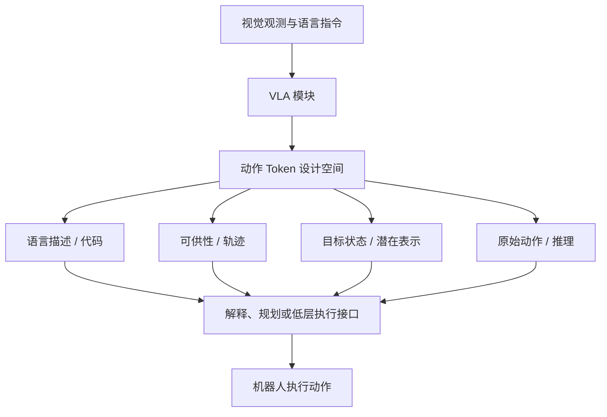

# VLA 动作 Token 化综述：八类输出接口

*A Survey on Vision-Language-Action Models: An Action Tokenization Perspective*（[arXiv:2507.01925](https://arxiv.org/abs/2507.01925)）。

## 一句话定义

以 VLA 的中间动作表示为分类轴，将不同方法归为八种动作 token 家族，并比较它们连接高层语义与底层控制的方式。

## 英文缩写速查

| 缩写 | 英文全称 | 简要说明 |
|---|---|---|
| VLA | Vision-Language-Action | 视觉、语言到机器人动作的模型 |
| VLM | Vision-Language Model | 为动作推理提供多模态语义表征 |
| BEV | Bird's Eye View | 轨迹 token 可采用的俯视坐标空间 |
| CVAE | Conditional Variational Autoencoder | 部分轨迹/动作表示工作的生成模型 |

## 为什么重要

同样被称为 VLA 的模型，可能输出语言、轨迹、代码或连续动作。若不区分 token 类型，难以对比模型接口、执行器需求和训练代价。

## 核心信息

| 项目 | 内容 |
|---|---|
| 原始论文 | [arXiv:2507.01925](https://arxiv.org/abs/2507.01925) |
| 研究机构 | 论文作者机构见原文（本轮尚未逐个核验） |
| 原文复核状态 | **待完成全文/附录核对**；详见来源归档 |

## 核心原理

论文抽象出视觉与语言输入，经 VLA 模块形成动作 token 链，最终得到可执行动作；区分语言描述、代码、可供性、轨迹、目标状态、潜在表示、原始动作及推理八类。以轨迹类为例，论文还区分点轨迹、画面表示的轨迹与光流。八类是横向**分类**，不是一个模型必经的八步。

## 流程总览

## 工程实践

选型时先问模型输出究竟是什么：可直接送电机的控制向量、需要轨迹跟踪的 waypoint、还是需要后续解释/规划的语义 token；再对齐数据标注、执行器、推理时延与跨机器人泛化。论文官方配套仓库是代表性文献目录，不是可直接运行的 VLA 训练框架。

## 源码运行时序图

**不适用**：未核实与此论文逐项对应的官方可运行实现。

## 实验与评测

这篇是方法分类综述，主要比较代表论文，**没有单一新模型的统一成功率基准**。其§7围绕轨迹 token 讨论跨任务运动模式共享和不同表征的下游适配。

## 结论

**本研究的定位：以 VLA 的中间动作表示为分类轴，将不同方法归为八种动作 token 家族，并比较它们连接高层语义与底层控制的方式。**

1. 不同 VLA 的 token 类型决定低层执行接口，不宜只比较模型参数量。
2. 轨迹 token 可以在语义不同但运动相近的任务间共享运动先验。
3. 语言或推理 token 往往需要后续控制模块解释。
4. 原始动作 token 的可执行性更直接，但要对齐本体和控制频率。
5. 本篇是系统综述而非发布新训练算法。

## 局限与风险

本文给出宽覆盖的分类，引用体系与各具体模型的开源状态应逐篇核实；不同工作的任务、数据与机器人差异使跨表对比不能视为控制变量实验。**源码运行时序图不适用**：配套仓库为论文列表，无 VLA 可运行训练程序。

## 与其他工作对比

[RT-1](./paper-rt-1.md) 代表离散动作 token；[π₀](./paper-pi0.md) 用流匹配连续动作；[ACT](./paper-act.md) 用动作块处理时序预测。三者并非按论文分类八类从前到后串联。

## 关联页面

- [RT-1](./paper-rt-1.md)
- [π₀](./paper-pi0.md)
- [11 篇历史阅读路线](../overview/robot-learning-foundations-11-papers.md)

## 参考来源

- [论文核验与阅读归档](../../sources/papers/vla_action_tokenization_survey_arxiv_2507_01925.md)
- [arXiv 官方原文](https://arxiv.org/abs/2507.01925)

## 推荐继续阅读

- [官方相关一手资源](https://github.com/Psi-Robot/Awesome-VLA-Papers)
