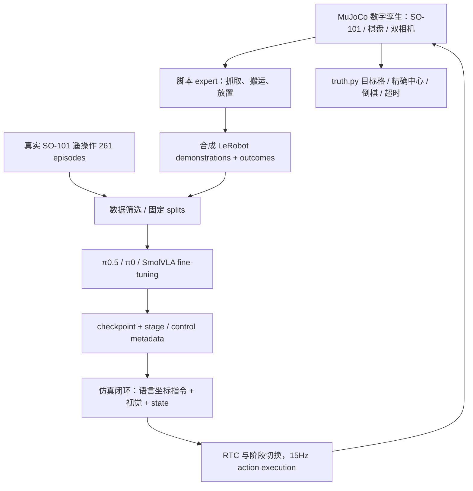
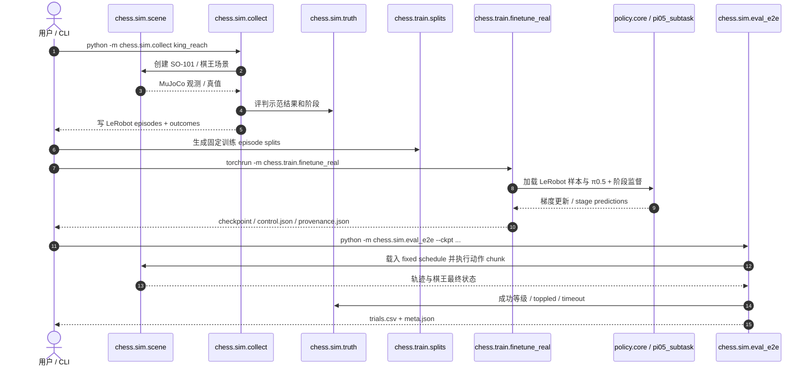

# VLA Adaptation Chess：以机器人棋王搬运研究真实与仿真数据适配
**VLA Adaptation with Real and Simulated Data: A Case Study on Robotic Chess**

## 一句话定义

项目将 SO-101 机械臂「把棋王从起始坐标格搬到目标坐标格」做成**可控、可复现的 VLA 数据规模/训练预算/Sim2Real 适配实验**，发布 MuJoCo 仿真、脚本专家、真实示范与闭环评估工具。

## 英文缩写速查

| 缩写 | 英文全称 | 简要说明 |
|---|---|---|
| VLA | Vision-Language-Action | 图像和语言条件下生成机器人动作 |
| SO-101 | SO-101 Robot Arm | 论文采用的六轴含夹爪机械臂平台 |
| BC | Behavior Cloning | 从示范学习动作预测的监督训练 |
| RTC | Real-Time Chunking | 控制周期重叠动作片段的实时调度 |
| RL | Reinforcement Learning | 论文讨论的在线策略优化路线 |
| EGL | Embedded-System Graphics Library | 仿真无显示器渲染的图形接口 |
| DDP | Distributed Data Parallel | 微调示例使用的多 GPU 训练方式 |

## 核心信息

| 维度 | 可核实结果 |
|---|---|
| 论文 | [arXiv:2611.12676v1](https://arxiv.org/html/2611.12676v1)；Charles University，Matěj Kripner、Milan Straka |
| 官方源码 | [Kripner/vla-chess](https://github.com/Kripner/vla-chess)，Apache-2.0 |
| 真实数据 | [so101-chess-king-moves-real](https://huggingface.co/datasets/Kripi/so101-chess-king-moves-real)，**261** 条 teleop episodes |
| 仿真 | MuJoCo 的 SO-101、棋盘/棋王、相机标定与脚本 expert |
| 策略 | π0.5 stage prediction 细调；π0、SmolVLA 作为对照 |
| 控制评测 | 15 Hz、10-action chunks、固定 easy/hard 1000-move schedules |

## 为什么重要

机器人论文常将**数据质量、数据量、训练计算量、Sim2Real 偏移**混在同一个大任务中，难以判断究竟哪个因素有用。此工作固定硬件、棋王和棋盘几何，集中研究「已预训练 VLA 用多少模拟与真实演示能完成坐标指令」。它不是 AI 下棋策略；研究目标是**连续物理搬运**，可与 [DASH](./paper-dash-async-humanoid-vla.md) 的动作 chunk 实时运行协议作系统对照，但不能比较任务难度或汇总成功率。

## 流程总览（论文与可运行仓库）

训练与评估共享固定任务定义；模拟 expert 和真实示范是两种数据来源，**不**代表所有训练阶段必须联合使用两种数据。

## 核心原理

### 1. 统一场景与任务监督

目标是一个棋王从指定格子（例如 `e4`）移至另一个格子（例如 `a5`），完成接近、抓握、搬运、放置、回待机位五阶段。任务提示是自然语言中的格名；评估由 MuJoCo 的真实状态和轨迹计算，而非仅凭视觉评分。真实鱼眼相机在训练时矫正到仿真 pinhole 视角。

### 2. 对比量是样本量、更新预算与初始化

论文逐个改变 simulated demonstrations 数、fine-tuning steps、学习率 cooldown，以及是否采用机器人预训练权重。固定评测 schedule 对每个 checkpoint 给出统一的成功定义；单纯较低的预测 loss 并不能保证执行成功率更高。

### 3. 真实示范与仿真预训练衔接

真实数据给 SO-101 的示范轨迹与阶段，仿真数据可先使策略学会几何任务，再通过少量真实数据适配相机/动力学。即便硬件同型，图像畸变、夹爪尺度、servo 动力学与控制率仍需对齐。

## 实验与评测

- 官方仓公开 **261** 条真实示范；论文研究训练时需要过滤/分割数据，不能简单把 261 当作每次实验的有效训练样本数。
- 模拟数据大量可自动采集；在作者报告的 10k demo 协议下，训练更新数与末端学习率衰减对成功率影响很大，部分设置的成功率约 60%，而没有 cooldown 的同源 checkpoint 可显著更差。
- 在一组真实 SO-101 适配实验中，使用仿真预训练和 **128** 条真实示范报告 **18/25** 成功，对比不经相同仿真预训练的 **2/25**；只有 25 次评估，不能过度外推。
- `chess/sim/eval_e2e.py` 区分 `lenient`（落入目标格）与 `success`（含精确居中条件）。论文/README 表中的不同口径必须与评估脚本配对。

## 与其他工作对比

| 路线 | 核心变量 |
|---|---|
| [VLA](../methods/vla.md) 通用模仿学习 | 跨场景和跨任务能力，评估域广 |
| 本文棋王搬运 | 任务固定、真实/仿真数据配比与训练预算可精细控制 |
| [DASH](./paper-dash-async-humanoid-vla.md) | 快慢分支语义与视觉时间同步，不以示范规模为主要实验变量 |
| [ExoStack](./paper-exostack.md) | 底层 ROS 2 可穿戴执行与 HIL 优化，是不同硬件对象的系统软件 |

## 源码运行时序图（依据官方仓库实际入口）

入口、函数职责及 `truth.py` 共用评分逻辑来自 [官方仓核验](../../sources/repos/vla-chess-official.md)。图是按实际入口的**跨阶段运行链**，不是声称全部过程发生在一个进程里。

## 工程实践

1. 根据官方 README 的 Python 3.12、PyTorch/CUDA、EGL 依赖安装；先执行 `python -m arm.mapping`、`python -m arm.so101_kin` 和 `python -m chess.sim.scene --out /tmp/scene` 验证 FK 与渲染。
2. 仿真示范：`python -m chess.sim.collect king_reach --n 10300 --seed 7000 --style reach --workers 16`；准备固定 split 再用 `chess.train.finetune_real` 训练。
3. 复用 `chess.sim.eval_e2e --schedule schedules/hard_v1.json` 做评估并保存原始 `trials.csv`，明确每个数字用 `success` 还是 `lenient`。
4. 上机前检查机器人关节/夹爪单位转换、双目/鱼眼图像矫正、真实刚度/动力学以及手臂急停；仓库开放不意味着可无校准直接使用。

## 局限与风险

- 单棋王搬运任务几何与物体种类受限，不是复杂棋类策略、灵巧多物体装配或长时程自主规划 benchmark。
- 合成演示 expert 的分布可能与真实人/设备不同；真实适配实验的评估次数有限。
- 训练 π0.5 所需的 GPU 和模型权重下载是额外成本；本次仅做源码静态核验，未完成训练复现。

## 结论

**这是一份以可控环境检验 VLA 适配规律的实证工作：开放模拟器与少量真实示范使「算法改进」与「训练预算、数据量」能拆开讨论。**

1. 用固定 schedule、相同评分阈值比较 checkpoint。
2. 把 simulated demonstrations、real demonstrations、训练 steps、cooldown 作为独立实验轴。
3. 确认 `success` 与 `lenient` 的定义后再引用百分比。
4. 在真实部署中保留标定/物理安全，不以仿真无碰撞替代上机验证。

## 关联页面

- [VLA 方法](../methods/vla.md)
- [Imitation Learning](../methods/imitation-learning.md)
- [DASH：异步控制与分块衔接](./paper-dash-async-humanoid-vla.md)
- [ExoStack：不同具身硬件的软件栈](./paper-exostack.md)

## 参考来源

- [论文全文与实验口径](../../sources/papers/vla_adaptation_chess_arxiv_2611_12676.md)
- [Apache-2.0 实际源码入口](../../sources/repos/vla-chess-official.md)

## 推荐继续阅读

- [论文原文](https://arxiv.org/html/2611.12676v1)
- [官方代码、运行方法与评测](https://github.com/Kripner/vla-chess)
- [真实 SO-101 示范数据](https://huggingface.co/datasets/Kripi/so101-chess-king-moves-real)
