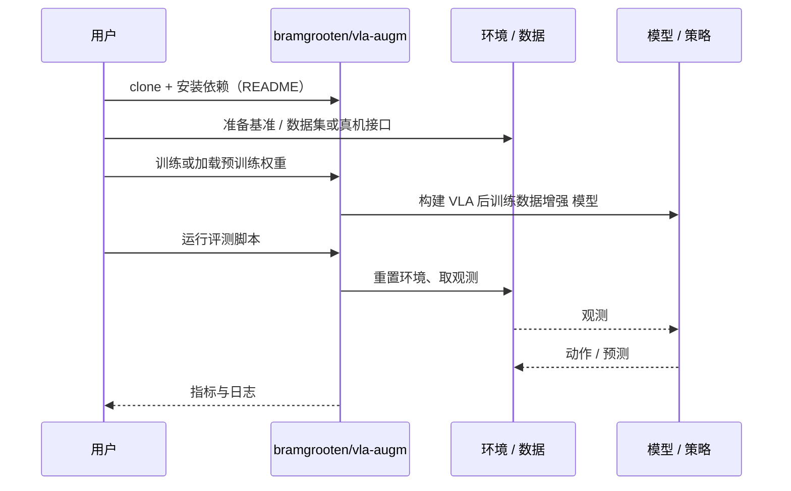

# VLA 后训练数据增强（arXiv:2610.05994）

**VLA 后训练数据增强**（*How (and How Not) to Use Data Augmentation in VLA Post-Training*，[arXiv:2610.05994](https://arxiv.org/abs/2610.05994)，[项目页](https://bramgrooten.nl/vla-augm/)，[代码](https://github.com/bramgrooten/vla-augm)）来自 [具身智能小站 2026-10-13 盘点](../../sources/blogs/wechat_embodied_station_34_papers_mulligan_2026-10-13.md)，属「策略与后训练」组。

## 一句话定义

**PPO 后训练中只增强价值模块输入更利于视觉泛化，增强策略输入反而破坏训练。**

## 英文缩写速查

| 缩写 | 英文全称 | 简要说明 |
|------|----------|----------|
| VLA | Vision-Language-Action | 视觉–语言–动作策略 |
| PPO | Proximal Policy Optimization | 近端策略优化 |
| DA | Data Augmentation | 数据增强 |

## 为什么重要

- 增强加在哪个模块决定成败。
- 开源结论：**已开源**（步骤 2.5，2026-10-14）。项目页链接的 GitHub 仓库可达（基于 RLinf）。
- 同期同组工作见 [失败导向采集与可组合世界动作模型：具身智能小站 10-13 期 34 篇阅读坐标](../overview/embodied-station-2026-10-13-34-papers-technology-map.md)。

## 核心机制

| 项 | 内容 |
|----|------|
| **arXiv** | [2610.05994](https://arxiv.org/abs/2610.05994) |
| **开源** | **已开源** |
| **要点** | 两种 VLA 与仿真基准。 |
| **文内指标** | 以原文为准。 |

## 源码运行时序图

以下为按仓库入口（`bramgrooten/vla-augm`）推断的通用运行链路；入库日仅核实仓库可达，未逐文件阅读，具体脚本名以 README 为准。

## 实验与评测

- 以原文为准。
- **读法：** 本页为索引级摘要，依据公众号转述的官方摘要与仓库信息整理；逐项数字与 baseline 以原文 PDF 为准。

## 与其他工作对比

- 横向索引见 [失败导向采集与可组合世界动作模型：具身智能小站 10-13 期 34 篇阅读坐标](../overview/embodied-station-2026-10-13-34-papers-technology-map.md)；同 arXiv 不重复造页。

## 结论

**RL 后训练的增强先加 critic 不加 actor。**

1. 开源边界：**已开源** — 项目页链接的 GitHub 仓库可达（基于 RLinf）。
2. 核心机制：两种 VLA 与仿真基准。
3. 复现与选型前核对任务协议、硬件与基准口径，勿直接横比公众号摘录数字。

## 关联页面

- [vla](../methods/vla.md)
- [ppo](../methods/ppo.md)
- [generative-data-augmentation](../methods/generative-data-augmentation.md)
- [paper-dissect-vla-post-training](./paper-dissect-vla-post-training.md)
- [embodied-station-2026-10-13-34-papers-technology-map](../overview/embodied-station-2026-10-13-34-papers-technology-map.md)

## 参考来源

- [vla_augm_data_augmentation_post_training_arxiv_2610_05994.md](../../sources/papers/vla_augm_data_augmentation_post_training_arxiv_2610_05994.md)
- [wechat_embodied_station_34_papers_mulligan_2026-10-13.md](../../sources/blogs/wechat_embodied_station_34_papers_mulligan_2026-10-13.md)
- [arXiv:2610.05994](https://arxiv.org/abs/2610.05994)

## 推荐继续阅读

- [arXiv PDF](https://arxiv.org/pdf/2610.05994)
- [项目页](https://bramgrooten.nl/vla-augm/)
- [https://github.com/bramgrooten/vla-augm](https://github.com/bramgrooten/vla-augm)
