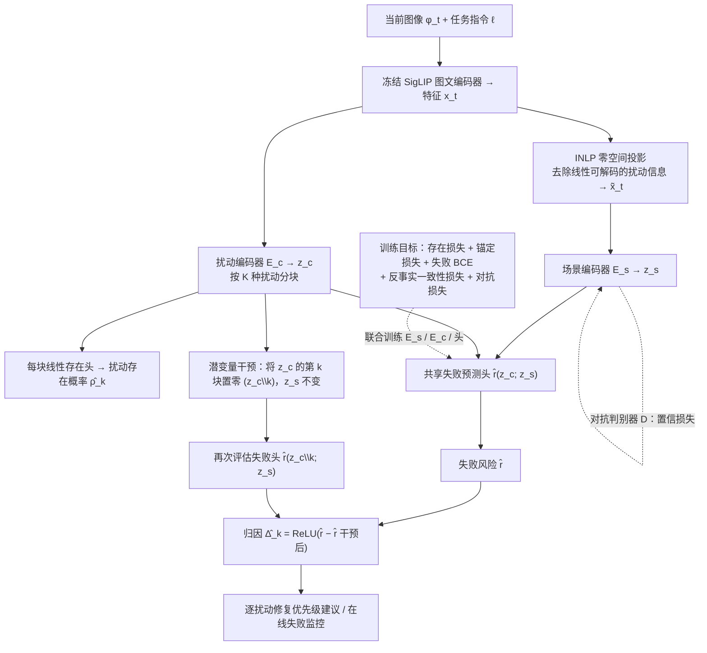

# VLA Corruption Failure Attribution（arXiv:2610.27277）

**VLA Corruption Failure Attribution**（*What Would Removing This Corruption Change? Failure Attribution for Vision-Language-Action Models*，[arXiv:2610.27277](https://arxiv.org/abs/2610.27277)，[项目页](https://vla-attribute.github.io)）来自 [具身智能小站 2026-10-31 盘点](../../sources/blogs/wechat_embodied_station_50_papers_scenerig_photo_to_sim_2026-10-31.md)，属「评测、基准与可靠性」组。

## 一句话定义

**将场景与扰动表征分离，以潜空间干预估计移除扰动的收益；仿真和Franka实验支持风险归因，当前仍依赖训练时已知扰动及其标签。**

## 英文缩写速查

| 缩写 | 英文全称 | 简要说明 |
|------|----------|----------|
| VLA Corruption Failure Attribution | What Would Removing This Corruption Change? Failure Attribution for Vision-Language-Action Models | 本文方法 / 基准的简称 |
| VLA | Vision-Language-Action | 视觉–语言–动作策略 |

## 为什么重要

- 出现视觉扰动，先判断该修哪一种。
- 开源结论：**项目页未列 GitHub**（步骤 2.5，2026-10-31）。项目页 HTTP 200，未见 GitHub 链接或 coming soon 字样。
- 同期同组工作见 [单图重建仿真、VLA 适配评测与跨形态世界模型：具身智能小站 10-31 期 50 篇阅读坐标](../overview/embodied-station-2026-10-31-50-papers-technology-map.md)。

## 流程总览

图依据：论文 §III 问题定义、§IV-A/B（式 1–7）/ Fig.3、Fig.1 在线监控。

## 核心机制

| 项 | 内容 |
|----|------|
| **arXiv** | [2610.27277](https://arxiv.org/abs/2610.27277) |
| **开源** | **项目页未列 GitHub** |
| **要点** | 将场景与扰动表征分离，以潜空间干预估计移除扰动的收益；仿真和Franka实验支持风险归因，当前仍依赖训练时已知扰动及其标签。 |
| **文内指标** | 公众号未给具体数字，本页不引用。 |

## 源码运行时序图

**不适用（项目页未列 GitHub）** — 项目页 HTTP 200，未见 GitHub 链接或 coming soon 字样。 不编造运行脚本；代码公开后再补。

## 实验与评测

- 公众号未给具体数字，本页不引用。
- **读法：** 本页为索引级摘要，依据公众号转述的官方摘要与仓库信息整理；逐项数字与 baseline 以原文 PDF 为准。

## 与其他工作对比

- 横向索引见 [单图重建仿真、VLA 适配评测与跨形态世界模型：具身智能小站 10-31 期 50 篇阅读坐标](../overview/embodied-station-2026-10-31-50-papers-technology-map.md)；同 arXiv 不重复造页。

## 结论

**出现视觉扰动，先判断该修哪一种：将场景与扰动表征分离，以潜空间干预估计移除扰动的收益；仿真和Franka实验支持风险归因，当前仍依赖训练时已知扰动及其标签。**

1. 开源边界：**项目页未列 GitHub** — 项目页 HTTP 200，未见 GitHub 链接或 coming soon 字样。
2. 核心机制：将场景与扰动表征分离，以潜空间干预估计移除扰动的收益；仿真和Franka实验支持风险归因，当前仍依赖训练时已知扰动及其标签。
3. 复现与选型前核对任务协议、硬件与基准口径，勿直接横比公众号摘录数字。

## 关联页面

- [simulation-evaluation-infrastructure](../concepts/simulation-evaluation-infrastructure.md)
- [vla](../methods/vla.md)
- [manipulation](../tasks/manipulation.md)
- [embodied-station-2026-10-31-50-papers-technology-map](../overview/embodied-station-2026-10-31-50-papers-technology-map.md)
- [具身大模型评测基准选型闭环](../queries/embodied-eval-benchmark-selection-loop.md) — 评测基准在选型闭环中的定位与取舍

## 参考来源

- [vla_corruption_failure_attribution_arxiv_2610_27277.md](../../sources/papers/vla_corruption_failure_attribution_arxiv_2610_27277.md)
- [wechat_embodied_station_50_papers_scenerig_photo_to_sim_2026-10-31.md](../../sources/blogs/wechat_embodied_station_50_papers_scenerig_photo_to_sim_2026-10-31.md)
- [arXiv:2610.27277](https://arxiv.org/abs/2610.27277)
- [arXiv PDF](https://arxiv.org/pdf/2610.27277)：已通读全文：问题定义（§III）、因子化风险模型与训练目标（§IV-A/B、Fig.3）、实验设定（§V–VI）

## 推荐继续阅读

- [arXiv PDF](https://arxiv.org/pdf/2610.27277)
- [项目页](https://vla-attribute.github.io)
