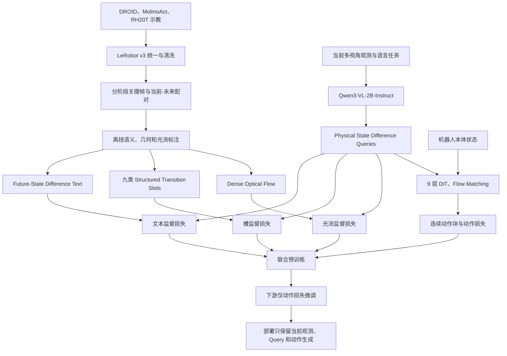
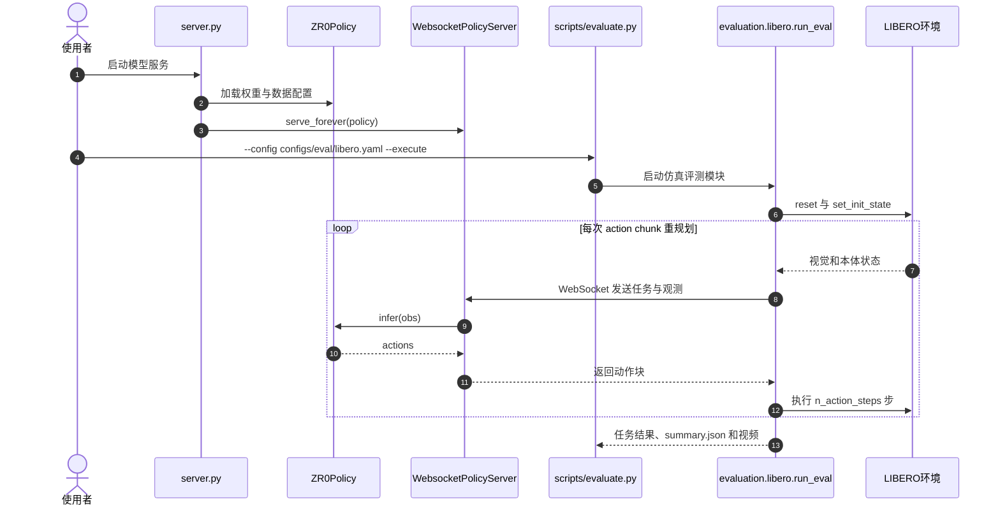

# VLA-Δ：学习物理状态转移的视觉语言动作模型 / Learning Physical State Transition for Vision-Language-Action Models

## 一句话定义

**VLA-Δ**（*VLA-Δ: Learning Physical State Transition for Vision-Language-Action Models*，[arXiv:2610.21306v1](https://arxiv.org/html/2610.21306v1)）以**任务相关的物理状态变化**为训练期监督，令 VLA 的差异查询表示同时编码任务阶段、目标与夹爪位置、接触状态及视觉运动，随后通过流匹配动作专家直接预测连续动作。作者来自浙江大学和中南大学。

## 英文缩写速查

| 缩写 | 英文全称 | 简要说明 |
|---|---|---|
| VLA | Vision-Language-Action | 当前视觉、指令与机器人状态到动作的策略 |
| VLM | Vision-Language Model | 本文 Qwen3-VL-2B-Instruct 图文骨干 |
| DiT | Diffusion Transformer | 9 层动作专家结构 |
| FM | Flow Matching | 从噪声到连续动作块的向量场训练目标 |
| OF | Optical Flow | 训练期约束局部视觉位移的稠密光流 |
| LIBERO | Lifelong Robot Learning | 标准机器人多任务操作基准 |

## 为什么重要

- 直接从图像回归示教动作容易形成轨迹依赖：抓取失败还走向放置点，或未接触目标就闭爪。作者将中间状态改变作为学习信号（论文 §1）。
- 高层推理文本强调“下一步做什么”，未来图像预测强调视觉外观；VLA-Δ 明确监督**接触、几何运动、任务进度如何变化**，但部署时不生成未来图像。
- 这属于 VLA 的训练表示增强路线，不能简单等同于在线运行视频世界模型的 WAM。

## 核心原理与流程总览

图示依据论文 §2 与附录 B。未来帧只生成**离线监督标签**，并不在测试时作为动作模型输入。

### 监督信号与模型结构

1. **Structured Transition Slots（九类）**：任务进度、任务阶段、目标位置、夹爪位置、运动和相对位移、可交互位置、夹爪开闭变化、接触转移、障碍风险；附录 D.1 表 8 表明九个输出共用七组 Query（进度/阶段共享 G12，夹爪/接触共享 G78）。
2. **Optical Flow（稠密光流）**：从同相机视角的当前/后续图像估计二维运动，使用全有效像素误差及加权运动像素误差，补充空间对齐细节；光流本身不能辨别任务相关性。
3. **Future-State Difference Text（未来状态差异文本）**：围绕进度、空间变化、接触状态、物理约束形成连贯叙述。生成目标文本只能注意 Queries 与前序文本，使当前图文信息必须先汇入 Queries。

整体架构遵循 GR00T N1 设计：Qwen3-VL-2B-Instruct 与九层 DiT 动作专家；视觉语言骨干从 ZR-0 base 初始化。输入当前多视角图像、任务指令与独立编码的本体状态，动作专家以 flow matching 生成 action chunk。

预训练联合使用 Text、slot、flow、action 四种损失；下游只优化动作损失。**推理仍执行 Query 表征提取**，只是无需自回归生成差异文本或预测光流/结构化槽目标。

## 数据与自动标注

- DROID、MolmoAct、RH20T 整合约 **484 小时、2400 万帧**。先统一至 LeRobot v3，再用 Qwen3.8-27B 识别阶段与关键帧；SAM 3 分割对象/夹爪，UniDepth V2 估深，MegaFlow 离线标注同视角光流（§2.3、附录 B）。
- 八步流水线包含样本筛选、格式统一、质量清洗、关键帧与语义、几何/光流、对齐整合、规则与模型审查、分层人工质量抽查；标注保留不确定性和追溯记录。
- 附录 B.3 审核 **300 个**当前–未来配对；目标和夹爪位置的参考框由 GPT-5.6 辅助生成，论文明确它们不构成独立人工真值，字段有效率也**不等于框 IoU**。

## 实验与评测

| 评测 | VLA-Δ | 作者报告对照 / 协议 |
|---|---:|---|
| LIBERO 平均成功率 | **98.4%** | π0.5 96.9%；ZR-0 97.8%；40 任务 × 50 回合 |
| LIBERO-Plus 语言扰动 | **89.0%** | π0.5 82.6%；其他扰动不应统一套此数值 |
| RoboTwin 2.0 Clean / Random | **90.06% / 89.74%** | ZR-0 88.70% / 87.98%；50 任务，每配置 100 回合 |
| AgileX PiPER 6-DoF 双臂真机 | **68.0%** | 五任务 × 40 回合；论文称较 π0.5 高 5.5 个百分点 |
| LIBERO 消融：仅 Query + 动作预训练 | **96.45%** | 加差异文本 97.20%、加 slots 96.90%、加光流 97.35%；全部 98.40% |

- RoboTwin 附录 C.2：预报 16 步、执行前 8 步后重规划；包括 Clean 和随机化双臂任务，不可将环境回合数与真机回合混合。
- 真机 PiPER 有一个头部相机与两个腕部相机；五任务分别考察避障物理约束、长程执行、细粒度操作、空间推理、换桌布背景泛化。
- 消融对比表明各监督单独存在收益，三者结合最高；这些来自作者实验，**未在本次 ingest 环境独立复现**。

## 结论

**VLA-Δ 的核心收益是把训练期的物理状态变化知识注入动作条件表示，而不是增加推理期的未来帧生成链。**

1. 优先与“Query + action-only pretraining”消融版本对照，区别监督设计带来的增益与单纯多数据训练。
2. 评测除最终成功率外，单列抓取失败、接触转移、局部对齐、障碍关系等失效模式。
3. 性能/时延测试需要实测图文骨干 + Query + 动作专家，不能把“不预测未来帧”解释为零额外计算。
4. 先使用公开预训练/benchmark 权重验证复现链，再决定是否重做大规模多级标注。
5. 真机适配务必检查相机标定、动作维度/单位、控制周期和安全限制；五项任务成功率不是部署安全证明。

## 源码运行时序图

已核官方 README、scripts/evaluate.py、server.py、utils/websocket_server_policy.py 和 evaluation/libero/run_eval.py。以下是**已公开 LIBERO 评测入口的实际调用链**：

训练入口：scripts/prepare_pretraining.py **基于已有标注**制备数据；scripts/train.py 经 utils.cli_options / utils.portable_run 和 accelerate.commands.launch 运行 train_vla.py。官方依次提供 stage1_ar、stage2_aux、stage3_joint 配置；微调入口为 configs/finetune/libero.yaml 或 robotwin.yaml。

## 工程实践

| 项目 | 工程边界 |
|---|---|
| 环境 | Linux、Python 3.10、CUDA；README 示例 PyTorch 2.6/cu124 |
| 权重 | [base](https://huggingface.co/t0rn0d0/VLA-Delta-base)、[LIBERO](https://huggingface.co/t0rn0d0/VLA-Delta-libero)、[RoboTwin](https://huggingface.co/t0rn0d0/VLA-Delta-robotwin) |
| 评测 | 先执行 server.py --config configs/eval/libero_server.yaml，再从独立环境运行 scripts/evaluate.py --config configs/eval/libero.yaml --execute；两者用 WebSocket |
| 微调 | scripts/train.py --config configs/finetune/libero.yaml --execute；不带 --execute 仅展示命令，支持 --dry-run |
| 开源 | Apache-2.0 主仓提供训练/微调/仿真评测代码和三个权重；未确认完整 484h 转移标注数据及全部原始自动标注服务公开 |
| 本次验证 | 静态阅读入口和实际调用；未执行完整 GPU 训练、真机或仿真复现 |

## 与其他工作对比

| 对照 | 实质区别 |
|---|---|
| [VLA](../methods/vla.md) | VLA-Δ 强调对状态转移的直接训练监督 |
| [WAM](../concepts/world-action-models.md) | 推理时不需要生成未来视频；但仍保留动作条件的差异 Query 计算 |
| [Flow Matching](../concepts/flow-matching-embodied-policy.md) | 主要改的是动作条件表示，而不是舍弃 FM 动作生成 |
| [LIBERO](./libero-benchmark.md) | 任务成功率不等于状态估计误差和真机安全指标 |

## 局限与风险

- 论文实验覆盖标准操作基准与受控 PiPER 双臂五任务；不能外推至未知接触力学、开放世界复杂场景或全身控制。
- 标注依赖多个离线模型，语义/几何估计可能出错；300 对分层抽检并不能覆盖整个数据分布。
- 研究代码与权重已开放，但**尚未确认** 484h 完整状态转移标签、标注全流程全部公开；不能承诺从原始演示一步复现全文训练。
- 仿真成功率与实时控制时延、产线节拍等工程指标须分别测量。

## 关联页面

- [VLA 方法](../methods/vla.md)
- [Flow Matching 具身策略](../concepts/flow-matching-embodied-policy.md)
- [World Action Models](../concepts/world-action-models.md)
- [LIBERO 操作基准](./libero-benchmark.md)
- [Action Chunking](../methods/action-chunking.md)
- [VLA 纵深路线 Stage 2](../../roadmap/depth-vla.md)

## 参考来源

- [VLA-Δ 论文 v1 归档](../../sources/papers/vla_delta_arxiv_2610_21306.md)
- [项目页与开放状态核查](../../sources/sites/vla-delta.md)
- [官方源码及运行入口归档](../../sources/repos/vla-delta.md)
- [arXiv:2610.21306v1 正文](https://arxiv.org/html/2610.21306v1)
- [ZJU-OmniAI/VLA-Delta](https://github.com/ZJU-OmniAI/VLA-Delta)

## 推荐继续阅读

- [论文 PDF](https://arxiv.org/pdf/2610.21306)
- [官方项目主页](https://zju-omniai.github.io/VLA-Delta/)
- [官方评测指南](https://github.com/ZJU-OmniAI/VLA-Delta/tree/main/evaluation)
