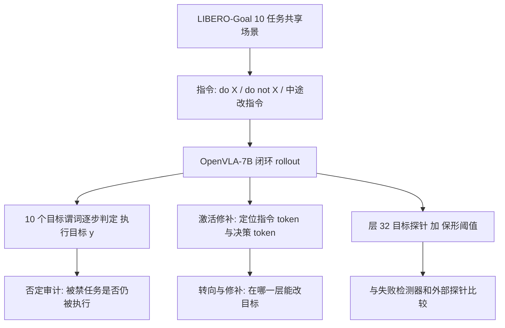

# Localizing and Editing the Goal Representation of a VLA（arXiv:2611.08895）

**Localizing and Editing the Goal Representation of a Vision-Language-Action Model**（Srivastava、Aqlan，University of Louisville；SPAIS Workshop @ CoRL 2026，[arXiv:2611.08895](https://arxiv.org/abs/2611.08895)）。本页依据 v1 全文（含附录 A）整理，归档见 [来源归档](../../sources/papers/vla-goal-representation_arxiv_2611_08895.md)。

## 一句话定义

在 LIBERO-Goal 的单一仿真场景里，审计 OpenVLA-7B 能否遵守「不要做 X」这类禁止指令，并用激活修补、线性探针、激活转向定位模型把「要执行哪个任务」存在哪里、能否改，同时检验「目标读出」能否作运行时合规监控。

## 英文缩写速查

| 缩写 | 英文全称 | 简要说明 |
|------|----------|----------|
| VLA | Vision-Language-Action model | 视觉–语言–动作策略；此处为 OpenVLA-7B |
| LIBERO-Goal | LIBERO 的 Goal 套件 | 10 个任务共享同一场景，仅靠指令决定目标 |
| Activation patching | 激活修补 | 把某层某位置的残差流换成另一条指令下的值，看输出如何变 |
| ρ | 归一化 logit 差 | 首个动作 token 上，修补后向"另一目标"移动的比例（0 到 1） |
| Probe | 线性探针 | 对层激活做 PCA（256 维）后的多项逻辑回归，读出当前目标 |
| AUROC | Area Under ROC | 检测器区分违规与合规的排序指标 |
| TPR / FA | True Positive Rate / False Alarm | 违规 / 合规 rollout 被报警的比例 |
| Redirect | 中途改指令 | rollout 进行中把指令换成同物体的另一任务 |

## 为什么重要

- 许多安全要求是禁止（不许碰某物、不许进某区），它们不命名目标，而是从可执行集合里排除行为（论文 §1）。如果 VLA 对否定无响应，仅靠写进指令的安全约束不可靠。
- **作者的结论（§5）：** 此场景中否定指令没有给 OpenVLA 施加约束，因此应在指令之外强制执行禁令；监控应把目标读出与规范对照，而不是只做失败检测。
- **边界：** 这只是一个模型、一个场景的审计，不能直接推广到其他 VLA 或真机（见「局限」）。

## 核心机制

**流程总览**

**方法要点（§3）**

- **执行目标：** 每个 rollout 的 y 为首个其目标谓词连续成立 5 步（或到回合结束）的任务；未达成任何目标记为停滞。"do c" 的允许集合为 {c}，"do not f" 为除 f 外的全部。
- **目标读出与监控：** 取决策 token（最后一个 prompt token，产生首个动作 token）在各层的 4096 维残差流，训练 L2 正则多项逻辑回归探针；规范感知得分为"不允许目标的最大对数概率"减"允许目标的最大对数概率"，经 10 步去抖后，用 split-conformal 阈值（α=0.1）报警。论文注明其覆盖保证不适用于重定向窗口。
- **修补与转向：** 对长度相同的两条指令，把残差流在指令差异 token、其余模板 token、决策 token 三组位置上替换；预填充修补只作用一次，decode-stream 修补还会覆盖每个已解码的动作 token；转向向量含类均值、反事实均值、逐位置反事实均值与指令跨度向量。

## 评测与结果（作者报告，§4）

| 现象 | 数字 | 位置 |
|------|------|------|
| 名义成功率 | 78%（CI [73, 82]，352 次） | §4 Setup |
| 否定下执行被禁任务 | 95/120（79%，CI [71, 85]） | §4 |
| 配对比较 | 被禁任务 76/92 对 普通指令成功 81/92，McNemar p=0.30 | §4 |
| 重定向被遵从 | 35%；285 个中 163 停滞、23 完成错误目标 | §4 |
| 指令 token 对首动作的决定度 ρ | 层 8 为 0.94，层 12 为 0.69，层 16 起 0.18 | §4 图 1a |
| 决策 token 的决定度 ρ | 层 8 为 0.04，层 16 起 0.77 | §4 图 1a |
| 层 8 指令跨度转向 | 闭环 12/18 重定向 | §4 图 2a |
| 层 12–20 固定向量与预填充修补 | 共 0/158 | 摘要、§4 |
| decode-stream 修补 | 层 16 为 7/18，层 24 为 15/18 | §4 |
| 层 32 目标探针 within-pair AUROC | 0.88 [0.81, 0.95]；外部 DINOv2+文本探针 0.87 | §4 表 1 |

**怎么读（我的解读，非论文原话）**

- 目标信息先写在指令 token 上（层 12 之前），中段之后转移到决策 token，但后续动作 token 仍会回看未被改动的指令 token（§4 的解释），所以只改决策 token 的一次性修补改不了整段动作。
- "not" 在激活里可被线性读出，但目标读出 p(X) 并不因它降低：模型"看到了否定"，却没把它用来排除目标。该因果解释是我对 §4 数字的归纳，论文只陈述了这些观察。

## 工程实践

- **对安全系统的建议（作者，§5）：** 禁令放在指令之外强制（例如外部约束 / 过滤层，可参见 [安全过滤器](../concepts/safety-filter.md) 与 [机器人安全状态机](../concepts/robot-safety-state-machine.md) 的思路，两页并非本文内容）；监控把目标读出与规范比对，并与普通失败检测分开。
- **编辑 OpenVLA 的目标（作者，§5）：** 编辑要么作用在转移之前（层 12 到 16），要么对每个已解码动作 token 都修补。
- **监控不必依赖内部激活（§4）：** 外部的 DINOv2 图像特征加词袋指令编码的探针与层 32 探针 within-pair 差 +0.02（CI [−0.02, +0.06]），内部访问未显示可检测增益。
- **否定场景下监控无用（§4）：** 目标读出对违规与停滞都报警（FA 1.00），作者认为不优于「not」关键词规则。
- **复现（附录 A、仓库 README）：** 代码、计划、逐 episode 摘要与分析输出公开（GitHub + Zenodo）；CPU 脚本可重算数字、表 1 与图；GPU 实验用单张 RTX A6000，每个 rollout worker 约 16 GB 显存；原始 rollout 约 29 GB 未随仓库提供。本页未运行任何代码。

## 与其他工作对比

本页可核对的对比都来自论文自己的基线与对照（§4、表 1；来源归档未摘录 §2 相关工作的具体论点，故不转述）：

| 对照 | 论文结果 | 读法 |
|------|----------|------|
| 已发表的 [OpenVLA](./paper-openvla.md) LIBERO-Goal 成功率 | 本文复现 78% 对已发表 79.2% | 检查点与评测设置与原文接近，审计对象可信 |
| 运行时监控：失败检测类基线 | 重定向未遵从检测 within-pair AUROC：层 32 目标探针 0.88，成功探针 0.74，动作熵 0.59 | 目标读出优于只看「是否失败」的检测器 |
| 运行时监控：外部探针（DINOv2 + 词袋指令） | 0.87，与层 32 探针差 +0.02（CI 含 0） | 内部激活访问未显示可检测增益 |
| 运行时监控：「任务对 + 时间」先验、「not」关键词规则 | 先验 0.76（差 +0.13，CI 含 0）；否定场景下目标读出 FA 1.00，作者称不优于关键词规则 | 相对简单先验的优势证据偏弱 |
| 编辑方式：转向向量 / 预填充修补 / decode-stream 修补 | 层 8 转向 12/18；层 12–20 固定向量与预填充共 0/158；decode-stream 层 24 为 15/18 | 编辑必须在目标转移前，或对每个动作 token 修补 |

## 结论

**在 LIBERO-Goal 单场景中，OpenVLA-7B 基本不响应「不要做 X」，目标表示在层 12–16 从指令 token 转移到决策 token；这是一个单模型单场景的审计结论，不是对 VLA 的一般判断。**

1. 最关键的数字是否定下仍执行被禁任务 95/120（79%），与普通指令成功率无可检测差别（McNemar p=0.30）；安全禁令应在指令之外强制执行（§5）。
2. 编辑目标的可行窗口很窄：层 12 之前转向，或层 16 以后逐 token 修补；中段一次性修补 0/158。
3. 监控读法：目标读出能区分「做了别的任务」，但否定场景下对违规与停滞一律报警，且与外部探针、简单先验的差距 CI 含 0。
4. 次要成本：闭环编辑多为 18 个 rollout、3 个任务对，0/18 对应的真实成功率上限可达 18%。
5. 外推前需补：含否定数据微调的模型、其他 VLA、限制「做法」的禁止与真机验证（§5、附录 A）。

## 局限

**论文自述（§5、附录 A）**

- 仅一个 VLA（OpenVLA-7B）、一个仿真场景、温和的整任务禁止、仿真器给出的目标标签；需在其他 VLA 与真机上验证。
- 多数闭环编辑只有 18 个 rollout、3 个任务对，0/18 允许真实成功率高达 18%（95% CI）。
- 检查点在 10 条无否定的 LIBERO-Goal 指令上微调；未测试限制「做法」的禁止（如「别碰花瓶」而不是「别做这个任务」）。
- 重定向结果按任务对聚类（遵从数 0/24 到 24/24），错误目标样本小（表 1 中 n=17）；类均值向量的计算包含了测试初始状态；「任务对 + 时间」先验为样本内计算。

**我看到的未验证之处（非论文声明）**

- 否定无效可能与微调数据不含否定有关，论文没有对比含否定数据的微调或未微调的底座模型，因此不能把结论读成"VLA 一般听不懂否定"。
- 对目标读出相对「任务对 + 时间」先验的提升，置信区间含 0（+0.13，CI [−0.01, +0.26]），证据偏弱。
- 目标读出在否定下全部报警（FA 1.00），表 1 中该场景只能说明读出反映了"指令里提到的目标"，不构成合规监控的正面证据。
- 小站摘要写成"定位可编辑位置"属实，但"提示把目标合规监测与普通失败检测分开"是作者在 §5 的建议，不是对照实验已确立的结论；论文自己的外部探针结果也说明目标监控未必需要模型内部。
- 阅读者勿将本文与强化学习安全探索混淆：本文不涉及 RL 训练，全部为已训练模型的推理期审计。

## 关联页面

- [VLA 方法页](../methods/vla.md)
- [OpenVLA 论文页](./paper-openvla.md)：被审计的模型
- [LIBERO 基准](./libero-benchmark.md)：LIBERO-Goal 所属基准
- [机制可解释性](../concepts/mechanistic-interpretability.md)：激活修补、探针的方法背景
- [安全过滤器](../concepts/safety-filter.md)
- [机器人安全状态机](../concepts/robot-safety-state-machine.md)

## 参考来源

- [来源归档：本文通读记录](../../sources/papers/vla-goal-representation_arxiv_2611_08895.md)
- [arXiv:2611.08895](https://arxiv.org/abs/2611.08895)
- [官方代码仓库](https://github.com/sudsho/vla-goal-representation)

## 推荐继续阅读

- [arXiv PDF（v1）](https://arxiv.org/pdf/2611.08895v1)
- OpenVLA 原文：[arXiv:2406.09246](https://arxiv.org/abs/2406.09246)；LIBERO：[arXiv:2306.03310](https://arxiv.org/abs/2306.03310)
- 论文所引的 VLA 转向 / 探针相关工作：[arXiv:2509.00328](https://arxiv.org/abs/2509.00328)、[arXiv:2603.19183](https://arxiv.org/abs/2603.19183)
