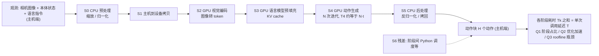

# VLA-HWBench：视觉语言动作模型在端侧硬件上的推理耗时分析

**VLA-HWBench**（*VLA-HWBench: Where the Time Goes When VLA Models Run on Edge Hardware*，[arXiv:2610.34717](https://arxiv.org/abs/2610.34717)）收录于 senlanke「具身运控lab」10-26–10-30 前沿论文动态（Manipulation）。本页依据**周报条目 + arXiv 摘要页**整理，流程图依据论文方法部分（见参考来源），未逐页核对实验数字；指标与结论以论文为准。

## 一句话定义

**VLA-HWBench：视觉语言动作模型在端侧硬件上的推理耗时分析——在 NVIDIA Jetson AGX Thor 和 AMD Ryzen AI Max+ PRO 395 上评测 18 个开源 VLA 模型，将推理流程分为七个阶段。实验发现，动作生成方式比参数量更能解释延迟差异；使用较少 Flow Matching 步数生成较长动作块的模型，更容易满足实时控制要求。**

## 英文缩写速查

| 缩写 | 英文全称 | 简要说明 |
|------|----------|----------|
| VLA | Vision-Language-Action | 视觉–语言–动作模型 |
| IL | Imitation Learning | 模仿学习 |

## 为什么重要

- 周报所述待解决的问题：VLA 的推理延迟不仅取决于模型参数量，还受到动作生成方式、算子实现、CPU 预处理和内存带宽影响。

## 流程总览

图依据：论文 §3.1–3.3、Fig.2（七阶段划分与延迟分解 T = ΣTk）

## 核心机制

| 项 | 内容 |
|----|------|
| **arXiv** | [2610.34717](https://arxiv.org/abs/2610.34717) · [PDF](https://arxiv.org/pdf/2610.34717) |
| **作者（arXiv）** | Xu, Borui, Tan, Hongshi, Jiang, Wenqi, He, Bingsheng, Wu, Ming, Zeng, Jason, Heinrich, Michael |
| **机构（周报所述，未逐条核实）** | 待核实（作者：Borui Xu、Bingsheng He、Michael Heinrich 等）。 |
| **arXiv 评论栏** | （无） |
| **开源** | arXiv 摘要页与评论未见代码或项目页链接（仅核对 arXiv 摘要页，不代表未发布）（2026-11-02） |
| **周报所述创新点** | 在 NVIDIA Jetson AGX Thor 和 AMD Ryzen AI Max+ PRO 395 上评测 18 个开源 VLA 模型，将推理流程分为七个阶段。实验发现，动作生成方式比参数量更能解释延迟差异；使用较少 Flow Matching 步数生成较长动作块的模型，更容易满足实时控制要求。 |

### arXiv 摘要节选（英文原文）

> Vision-language-action (VLA) models increasingly run on edge devices aboard robots, where inference latency constrains closed-loop robot control. However, it remains unclear how to design VLA models, their inference software and edge hardware so that robots can run VLA inference in real time.

## 源码运行时序图

**不适用**：arXiv 摘要页与评论未见代码或项目页链接（仅核对 arXiv 摘要页，不代表未发布），无可对齐的官方代码流程。

## 实验与评测

- 周报与摘要给出的数字/场景已写入上表「创新点」与摘要节选；其余实验细节、基线与成功率定义请回到论文正文。
- 读法：先对齐任务设定、传感器与成功定义（仿真/真机），再解读 headline 数字，勿跨论文直接比较。

## 与其他工作对比

| 维度 | 读法 |
|------|------|
| **同周对照** | 见 [Manipulation周报技术地图](../overview/senlanke-weekly-2026-10-26-30-manipulation-technology-map.md)，按方向浏览同期论文 |
| **开源状态** | arXiv 摘要页与评论未见代码或项目页链接（仅核对 arXiv 摘要页，不代表未发布） |

## 结论

**VLA-HWBench：视觉语言动作模型在端侧硬件上的推理耗时分析。**

1. 本页是入库级摘要，复现前请核对论文正文、附录与代码仓库。
2. 指标须连同实验条件解读。
3. 关注 arXiv 版本更新与代码发布。

## 关联页面

- [senlanke-weekly-2026-10-26-30-manipulation-technology-map](../overview/senlanke-weekly-2026-10-26-30-manipulation-technology-map.md)
- [manipulation](../tasks/manipulation.md)
- [vla](../methods/vla.md)

## 参考来源

- [vla-hwbench-edge-hardware-latency_arxiv_2610_34717.md](../../sources/papers/vla-hwbench-edge-hardware-latency_arxiv_2610_34717.md)
- [wechat_senlanke_weekly_manipulation_2026-10-26_30.md](../../sources/blogs/wechat_senlanke_weekly_manipulation_2026-10-26_30.md)
- [arXiv:2610.34717](https://arxiv.org/abs/2610.34717)
- [arXiv PDF](https://arxiv.org/pdf/2610.34717)：已通读方法部分（实验与附录以略读为准）：研究问题与七阶段延迟分解（§3.1）、指标与设计原则（§3.2–3.3）、各阶段占比/优化/roofline 结果概览

## 推荐继续阅读

- [arXiv PDF](https://arxiv.org/pdf/2610.34717)
