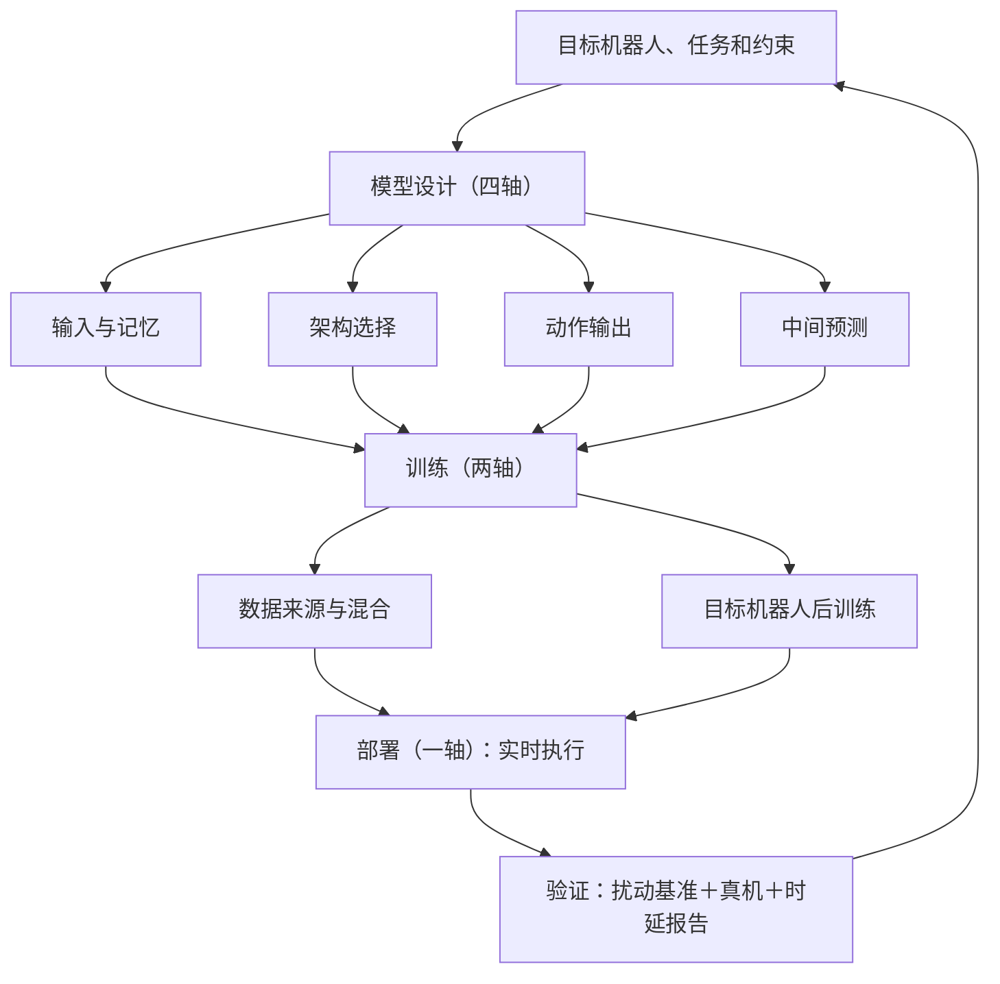

# VLA 全生命周期综述：设计、训练与部署 / Vision-Language-Action Models: A Life-Cycle Survey of Design, Training and Deployment

*Suvarna Kadam、Soran Parsa，2026，arXiv:2611.18372v1。*

## 一句话定义

这是一篇按**模型设计 → 训练 → 真机部署**七个维度解读 VLA 的综述，横向覆盖 88 项工作并详细对照 22 个代表模型；不是发布新模型或新训练算法。

## 英文缩写速查

| 缩写 | 英文全称 | 简要说明 |
|---|---|---|
| VLA | Vision-Language-Action | 从视觉、语言等观测生成机器人动作的模型 |
| VLM | Vision-Language Model | VLA 常用的图文预训练语义骨干 |
| WAM | World-Action Model | 联合预测未来观察与动作的世界–动作模型 |
| OXE | Open X-Embodiment | 跨机器人本体的演示数据体系 |
| ECoT | Embodied Chain-of-Thought | 动作前显式输出任务、目标等推理中间信息 |
| RL | Reinforcement Learning | 利用部署回合反馈进行策略后训练 |

## 为什么重要

- 比按模型名字罗列更有工程可比性：同为 VLA，动作是 token、末端位姿还是连续 chunk，执行频率及真实延迟可能差别很大。
- 将操作、导航、人形全身控制放在统一时间线；提醒上层语义动作必须与机器人本体及低层稳定控制接口对齐。
- 说明 LIBERO 等仿真成功率接近饱和后，必须加扰动和真机证据；跨论文的不同数据量、显卡和推理计量单位不可直接排名。

## 核心信息

| 字段 | 内容 |
|---|---|
| 英文标题 | Vision-Language-Action Models: A Life-Cycle Survey of Design, Training and Deployment |
| 作者/机构 | Suvarna Kadam（Witsense AI）；Soran Parsa（英国哈德斯菲尔德大学，University of Huddersfield） |
| 原文 | [arXiv:2611.18372v1](https://arxiv.org/abs/2611.18372v1)，2026-11-13 |
| 研究性质 | 结构化文献综述，非系统性荟萃分析；没有新模型的统一实验 |
| 覆盖 | 2022-12 至 2026-10 的 88 项工作；表 3 对照 22 个代表模型 |
| 原文版本 | 43 页，9 图，11 表；[HTML 全文](https://arxiv.org/html/2611.18372v1) |
| 代码状态 | 未见与本文对应的官方可运行仓库、训练脚本或模型权重 |

## 核心原理：七轴生命周期

| 阶段 | 轴 | 核心选型问题（§3） |
|---|---|---|
| 模型 | ① 输入与记忆 | 当前帧还是历史？有无本体/相机条件？ |
| 模型 | ② 架构 | 单体端到端、慢 VLM＋快动作模块，还是解释性中间目标＋单独低层策略？ |
| 模型 | ③ 动作输出 | 离散 token、压缩 token、潜动作、扩散/流匹配专家或连续回归？ |
| 模型 | ④ 中间预测 | 除动作之外，是否预测子任务/推理文本/未来帧或潜状态？ |
| 训练 | ⑤ 预训练数据 | 机器人操作、跨本体数据、网页/人视频、仿真和自主轨迹如何混用？ |
| 训练 | ⑥ 后训练 | 目标任务 SFT、示范纠正、在线 RL 等怎样改进实际策略？ |
| 部署 | ⑦ 实时执行 | 推理、网络、动作块衔接与低层控制频率如何匹配？ |

论文特别规定：π0 虽然含动作专家，但在作者分类中属于**单体**，因为专家与 VLM 在同一 Transformer 内逐层交互；“有两个模块”不自动等于双系统。

## 流程总览

以下是**综述的对照/选型流程**，不是论文提出的新 VLA 推理执行图。

## 工程实践：按附录 A 做选型

1. **先明确输出接口**：机械臂末端/关节动作、导航 waypoint 或人形全身参考；分清上层 VLA 与下层控制器职责。
2. **先测目标硬件**：记录传感到动作发出的端到端时间、每个 action chunk 延迟和动作接续抖动；推理赶不上控制周期时，考虑异步推理、Real-Time Chunking 或分层频率。
3. **小样本基线优先**：消费级硬件可评估 SmolVLA，目标本体微调可参照 OpenVLA-OFT；这些是综述附录的**选型起点**，不是本文的全新算法或复现保证。
4. **数据按能力而非只按小时数配比**：明确每种本体、数据来源、成功/失败轨迹和后训练阶段；不同 robot hours、episodes、生成视频量不可直接相加。
5. **评测最少两层**：常规成功率之外，增加 LIBERO-PRO/Plus 等扰动；可用时与真实机器人结果核对，并注明具体硬件及计算口径。

## 源码运行时序图

**不适用**：本文是 88 项工作的分类综述，没有与此论文直接配套的可运行训练/推理实现；所引模型的各自代码需要回到对应独立实体核实，不能拼接为“本文源码”的时序图。

## 实验与评测读法

- 文章的数字来自所引工作、论文表格和发布说明，**没有**训练出一个统一新策略来比较 88 项工作。
- §3 表 2 的推理速度可能分别是 Hz、毫秒/动作块、吞吐量或控制频率，且硬件异构，不可直接作为模型速度排名。
- §9 指出 LIBERO 近饱和：所引 LIBERO-PRO 扰动结果中，部分原模型在物体挪动后成功率可跌至 0%；LIBERO-Plus 中视角或起始位姿变动可使约 95% 下降到 30% 以下。**仅为被引用基准的特定设置**，不能推广成全部 VLA 真机失败率。
- 操作/导航融合（UniVLA、Qwen-VLA）已有共同模型探索，但原文指出其测试仍在分开的任务基准上；人形 whole-body 仍常依赖单独控制器。
- 附录 A 的推荐是基于截至 2026-10 的文献证据，部署前还需核对目标机器人、本体和真实环境的外推。

## 结论

**这篇综述最有价值的是一张跨模型、数据、部署和评测的统一选型表，而不是新 SOTA 成功率。**

1. **比较模型先对齐七轴**：尤其是动作接口、历史信息、目标本体与后训练，而非单看参数规模。
2. **分清模型家族**：VLA 多由图文模型出发，WAM 多由视频生成先验出发，未来观测预测让两者边界逐步融合。
3. **真机控制关注时序**：动作块频率不等于模型推理频率；网络和低层稳定控制都要计入端到端闭环。
4. **高分必须经得起扰动**：将常规 benchmark、扰动测评、仿真到真机预测能力分开披露。
5. **让数据报告可比较**：写清各阶段机器人 episode/hours、非机器人数据占比、本体数、总推理参数量及具名硬件上每动作块时延。

## 局限与风险

- 88 项工作是结构化筛选，不是系统性检索的全领域覆盖；各模型的结果来自不同论文及模型版本。
- 部分 GR00T N1.x 数字来自官方仓库 release notes，而非同行评审论文；不同单位的“小时/回合/帧”不得转换成统一样本量。
- 综述对 VLA/WAM 的术语区分是**工作定义**；混合式预测、规划器与层级控制不能机械归成互斥类别。
- 论文未附带可运行代码，本文无法独立复现所有被引用结果；读者应回查原始数据集、许可证和硬件条件。

## 与其他工作对比

| 资料 | 组织主轴 | 用于回答的问题 |
|---|---|---|
| 本文（2611.18372） | 模型四轴＋训练两轴＋部署一轴 | “从数据到真实运行，如何比较和选型 VLA？” |
| [VLA 动作 Token 化综述](./paper-vla-action-tokenization-survey.md)（2507.01925） | 八类动作中间表示 | “VLA 实际输出什么、如何接到底层？” |
| [VLA 具身综述](./paper-vla-survey-embodied.md)（2405.14093） | 组件/控制策略/规划器三线 | “哪些组件或范式属于 VLA？” |
| [World Action Models 综述](./paper-sa-2606-20781-world-action-models-a-survey.md) | WAM 分类与训练 | “预测未来观察如何辅助动作？” |

## 关联页面

- [VLA 方法总览](../methods/vla.md)
- [VLA 动作 Token 化综述](./paper-vla-action-tokenization-survey.md)
- [VLA 具身综述](./paper-vla-survey-embodied.md)
- [WAM 概念](../concepts/world-action-models.md)
- [VLA 纵深路线（Stage 0）](../../roadmap/depth-vla.md)

## 参考来源

- [arXiv v1 原文核对归档](../../sources/papers/vla_lifecycle_survey_arxiv_2611_18372.md)
- [arXiv 官方 HTML 全文](https://arxiv.org/html/2611.18372v1)

## 推荐继续阅读

- [原论文 Appendix A：Building a VLA](https://arxiv.org/html/2611.18372v1)
- [动作 Token 化综述（arXiv:2507.01925）](https://arxiv.org/abs/2507.01925)
