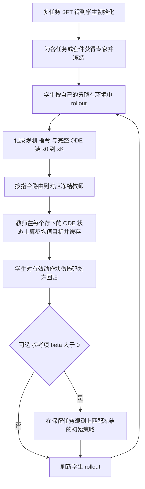

# VLA-MOPD（arXiv:2611.12286）

**VLA-MOPD**（*VLA-MOPD: On-Policy Distillation for Multi-Task VLA Policy Consolidation*，[arXiv:2611.12286](https://arxiv.org/abs/2611.12286)，v1 于 2026-11-09 发布）来自中国科学技术大学、ACE Robotics、中南大学。本页依据 v1 全文（含附录）撰写，逐条标注论文章节；作者自述与本页判断分开写。

## 一句话定义

先获得并冻结若干任务 / 套件专家，再让一个共享的 flow-matching VLA 学生在环境里按自己的策略 rollout，路由到的专家在学生访问到的每个观测与动作块内部每个 ODE 中间状态上给出单步转移目标，学生用掩码均方回归去匹配，从而把多个专家合并成一个策略（§4.1、§4.2）。

## 英文缩写速查

| 缩写 | 英文全称 | 简要说明 |
|------|----------|----------|
| VLA | Vision-Language-Action | 视觉–语言–动作策略 |
| MOPD | Multi-teacher On-Policy Distillation | 论文方法名中的多教师在线（on-policy）蒸馏 |
| OPD | On-Policy Distillation | 在学生自己产生的状态上由教师提供监督 |
| ODE | Ordinary Differential Equation | 流匹配动作头从噪声生成动作块的确定性积分链（本文评测用 5 步） |
| MixRL | Mixed-task RL (GRPO) | 论文对多任务 GRPO 基线的称呼（§1） |
| GRPO | Group Relative Policy Optimization | 组相对策略优化 |
| PPO | Proximal Policy Optimization | LIBERO / RoboTwin 教师的训练算法（§5.1） |
| SFT | Supervised Fine-Tuning | 监督微调，学生初始化与真机教师都用它 |
| LoRA | Low-Rank Adaptation | 学生 VLM 的可训练部分（§4.1） |
| KL | Kullback–Leibler divergence | 论文的动机推导用，实际损失是平方误差代理（§4.2） |
| TV | Total Variation | §3 分布偏移界所用距离 |

## 为什么重要

- 任务专用后训练常得到一堆专家检查点（§1）。本文给出一种「专家 → 单一学生」的两阶段做法，并把监督放到学生自己访问的状态上，而不是固定的专家演示上（§1、§3）。
- 对 flow-matching VLA，监督不止落在最终动作上，还落在动作块内部每个 ODE 步，论文称这比终点动作蒸馏更密（§4.2）。LIBERO 上两者差 0.75 点，见下文核查。
- 相对多任务 RL，论文报告在同样的每步 rollout 预算下收敛更快（§5.3、图 2）。

## 核心原理与流程总览

**两层轨迹（§1）：** 外层是机器人轨迹（执行动作块后到达的观测），内层是流轨迹（从高斯噪声到动作块的 ODE 状态）。

**符号（§4.1）：** 流步 k 的 ODE 步均值 μ_{θ,k}(x,c) = x − δ_k·v_θ(x, s_k, c)，其中 c 为观测与指令，v_θ 为速度场。

**目标（§4.2）：** 对学生存下的每个 (x_k, c)，教师给出 stop-gradient 目标 μ̂ = sg[μ_{ϕ_i,k}(x_k, c)]，学生最小化
L_ODE = E[ 1/(2KHd) · Σ_k ‖μ_{θ,k} − μ̂‖² ]（Eq. 6），无效或填充的动作块由掩码排除（附录 A，Eq. 10）。等价写法是 δ_k² 加权的速度场差平方。成功与失败的 rollout 都可提供有效样本（附录 A）。

**保留项（§4.3）：** 冻结初始策略 π_ref=π_θ0，在保留任务的观测上用同一规则匹配，L_total = L_ODE + βL_ref，保留任务的观测可来自环境重置，不需要专家轨迹。

要点（附录 A）：学生只更新 VLM 的 LoRA 与完整动作专家；教师与学生各自独立编码前缀（VLM 不同）但共享归一化后的动作坐标；教师目标在学生优化前一次性计算并缓存。

## 工程实践

以下数值均来自附录 A、§5.1、附录 C。

- **基座：** π0.5，学生为 RLinf 的 π0.5 SFT 配方得到（§5.1）。流求解器 5 步，教师与学生同一步长表（附录 A）。
- **LIBERO 训练设置：** 64 个训练环境，每个优化步按四个套件各一个 rollout epoch，套件最大步数 240/240/320/480；microbatch 8、global batch 1024；Adam，学习率 2.5×10⁻⁵，β=(0.9,0.95)，权重衰减 0.01，梯度裁剪 1.0，余弦衰减；计划 1000 步、报告前 500 步，每 50 步存检查点，种子 42；动作块长 10（附录 A）。RoboTwin 动作视野 50（附录 A）。
- **主实验 β=0：** 参考项只在保留实验里开（β=1），主 LIBERO 结果不含参考项（附录 A）。
- **教师来源（§5.1、§5.4）：** LIBERO Spatial / Object / Goal 的教师是 RLinf 已有的 PPO 多任务检查点，LIBERO-10 教师是在该检查点上再 PPO 训练 120 步；RoboTwin 为任务路由的 PPO 教师；真机教师是各任务单任务 SFT。
- **rollout 预算（§5.3、图 3b）：** 64 / 32 / 16 环境对应每优化步 256 / 128 / 64 条轨迹，步 500 时平均成功率分别 98.9% / 95.2% / 94.5%。
- **真机（§5.4、附录 C）：** Piper 单臂（6 关节加夹爪），主视角与腕部相机，图像 640×480 缩放填充到 224×224，动作 30 Hz；训练时预测并执行 50 步，评测时预测 50 步但只执行前 25 步再重新预测。两轮 rollout，每轮每任务 50 条轨迹，每轮训练 1 个 epoch。任务：Pick Banana、Stack Cup、Sort Number。

## 实验结果（论文自述）

| 实验 | 设置 | 学生初始 | VLA-MOPD | 教师 | 出处 |
|------|------|----------|----------|------|------|
| LIBERO 四套件均值 | 每任务 1 条演示 SFT 初始化，单种子，每套件 500 episodes | 75.4% | 98.9% | 98.5%（路由 PPO） | 表 1 |
| LIBERO 终点动作蒸馏 | 同上，同训练设置 | | 对照 98.15%（表中 98.2） | | §5.3、表 1 |
| RoboTwin 2.0 三任务均值 | 学生为每任务 50 条干净轨迹的多任务 SFT，每任务 100 episodes | 73.0% | 89.3% | 94.0% | 表 2 |
| Piper 真机三任务均值 | 每任务 30 次试验 | 70.0% | 90.0% | 93.3% | 表 3 |
| 与 MixRL 对比（第 400 步） | 同初始化，同每步环境数与 rollout 数 | 75.4% | 97.6% | 对照 82.55% | §5.3、图 2 |
| Object 遗忘（Spatial 训练后） | Spatial 分数相近的快照（相差不超过 1.4 点） | Object 95.6% | 参考项 92.6%（降 3.0）| 无参考项 82.4%（降 13.2），SFT 82.8%（降 12.8） | §5.3、图 3a |

分套件（表 1）：VLA-MOPD 为 Spatial 99.4、Object 99.0、Goal 98.0、LIBERO-10 99.0；路由 PPO 教师为 97.4、99.2、98.6、98.8；终点动作蒸馏为 99.0、99.2、96.8、97.6。

## 与文章说法的核对

对照对象：公众号《机器人动作块太长，什么时候该重新规划？》（2026-11-11）第 09 条对本文的描述。

| 文章说法 | 核对 | 结论 |
|----------|------|------|
| 让学生沿自身访问的状态向专家学习 | 与 §1、§3、§4.1 一致 | 相符 |
| 用在线分布蒸馏合并技能 | 方法确为 on-policy 蒸馏。但「分布」需限定：因采样器是确定性 Euler，损失是 ODE 步均值的平方匹配，论文明说「不是确定性核之间的 KL」，也不声称匹配最终动作分布（§4.2、附录 B）；只有共享协方差高斯假设下才与 KL 同形 | 基本相符，措辞需收紧 |
| 并约束原有能力退化 | 约束靠可选的参考项（Eq. 8、9）。主 LIBERO / RoboTwin / 真机实验 β=0，即不含该约束（附录 A）；退化约束只在「Spatial 训练 → Object 保留」一组消融里展示（§5.3 图 3a，Object 降 3.0 对 13.2 点），且该组是选取 Spatial 分数相近的快照做的近似对比，不是严格同步数对比 | 部分相符：能力存在，但主结果没用它，证据只有一组消融 |
| 覆盖仿真与真机 | 仿真：LIBERO 四套件、RoboTwin 2.0 三任务；真机：Piper 单臂三任务（§5） | 相符 |
| 复现成本还包括专家策略获取，不能只计算学生训练 | §7 明确承认：需先有任务 / 套件专家，获取与存储带来前置成本，专家质量与覆盖决定学生上限。LIBERO 教师沿用 RLinf 现成 PPO 检查点（§5.1），所以论文自己的训练预算未计入教师成本 | 相符，且是论文自述局限 |

补充（文章未提但读者易误解）：学生并未超越专家，除 Spatial（99.4 对 97.4）外 VLA-MOPD 与教师相当或略低（表 1、2、3）；真机 Sort Number 76.7% 对教师 83.3%（表 3）。

## 局限

**论文自己承认的（§7）：**
- 必须先有任务 / 套件专家，获取与保存专家随任务族增多而增加成本；专家质量与覆盖决定可合并的能力。

**本页看到的未验证之处（作者未声明，属本页判断）：**
- LIBERO 结果为单训练种子，且 VLA-MOPD 与终点动作蒸馏差 0.75 点（98.9 对 98.15），论文对 Goal / LIBERO-10 上的优势只给了「一种可能的解释」（§5.3），未做多种子检验，不宜据此断言中间流状态监督更优。
- 与 MixRL 的比较只覆盖前 500 步，且 MixRL 要从零探索而 VLA-MOPD 的教师本身已由 PPO 训好，二者的总算力未并列报告（§5.3）。
- 学生初始化「每任务 1 条演示」是刻意的极端数据稀缺设定；与完整数据文献行（表 1 上半）比较时，论文说明骨干与协议不同（§5.2），不能当作同条件排名。
- 真机仅 3 个任务、每任务 30 次试验，且教师为单任务 SFT 而非 RL，结论的统计强度有限（表 3，附录 C）。
- 参考项保留实验只测了 Spatial → Object 一对（§5.3），多套件、多任务族下的保留能力未验证。
- 仓库 README 为 RLinf 通用说明，未见 VLA-MOPD 专属内容，复现入口与权重发布情况未核实（见来源归档）。
- 本页性质：方法论文，非数据集 / 硬件 / 教程。

## 关联页面

- [VLA 方法总览](../methods/vla.md)
- [PPO](../methods/ppo.md)（论文教师的训练算法）与 [GRPO](../methods/grpo.md)（MixRL 基线）
- [DAgger](../methods/dagger.md)：论文沿用其「在学习者诱导的观测上查询专家」的外层思想（§1、§2.2）
- [模仿学习](../methods/imitation-learning.md)
- [动作分块 Action Chunking](../methods/action-chunking.md)
- [多专家蒸馏](../methods/multi-expert-distillation.md)
- [流匹配具身策略](../concepts/flow-matching-embodied-policy.md)
- [LoRA](../concepts/lora.md)
- [LIBERO 基准](./libero-benchmark.md) 与 [RoboTwin](./robotwin.md)
- [πRL：流式 VLA 的在线 RL 微调](./paper-rcl-2510-25889-rl-online-rl-fine-tuning-for-flow-based-vision-l.md)：MixRL 基线所用实现的来源（§5.3）
- [RLinf-VLA](./paper-rlinf-vla.md)：论文 SFT 与 PPO 教师所用框架同源
- [多教师在线蒸馏 flow VLA（arXiv:2610.21522）](./paper-multi-teacher-on-policy-distillation-flow-vla.md)：同主题的另一篇论文，本页未核对两者关系

## 参考来源

- [论文来源归档（含核对范围与通读标记）](../../sources/papers/vla-mopd_arxiv_2611_12286.md)
- arXiv：<https://arxiv.org/abs/2611.12286>
- 代码：<https://github.com/yxuan1234/VLA-MOPD>

## 继续阅读

- 先读论文 §4.2 与附录 B，弄清「反向 KL → 速度场回归 → 确定性 ODE 步均值匹配」三者的关系。
- 论文引用的相邻工作：DiffusionOPD、Flow-OPD（连续生成模型的逐步转移匹配）、VLA-OPD（自回归动作 token 的在线蒸馏）、MergeVLA（§2.3）。
- 若关心专家获取成本，对照 [πRL](./paper-rcl-2510-25889-rl-online-rl-fine-tuning-for-flow-based-vision-l.md) 与 [RLinf-VLA](./paper-rlinf-vla.md) 的 PPO 训练设定。
