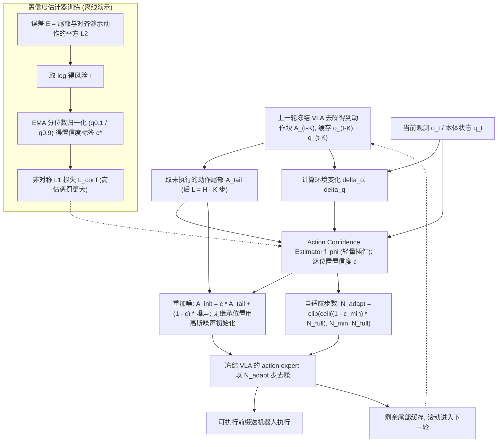

# VLA-Rolling（自适应动作复用的冻结 VLA 加速）

## 一句话定义

**VLA-Rolling 不丢弃 flow-matching VLA 未执行的动作尾部，而是在置信度引导下复用并重加噪，使冻结模型用更少的去噪步数得到更快、更准的动作。**

## 英文缩写速查

| 缩写 | 英文全称 | 简要说明 |
|------|----------|----------|
| VLA | Vision-Language-Action | 视觉语言动作模型，本文对象 |
| chunk | Action chunk | 一次生成的一段连续动作序列 |
| flow matching | Flow Matching | 本文 VLA 所用的生成框架 |
| π0.5 | π0.5 | 本文评测的 VLA 之一 |

## 为什么重要

- VLA 的推理延迟直接影响闭环控制频率；丢弃未执行尾部意味着浪费已完成的去噪进度。
- 方法不改动冻结的 VLA，便于叠加到已有模型上（据摘要与项目页）。

## 流程总览

图依据：论文 §3（§3.1 Action Tail Inheritance、§3.2 Action Confidence Estimation、§3.3 Confidence-Guided Refinement）/ Fig.4

## 方法与机制

- **保持 VLA 冻结。**
- **继承（inheritance）：** 复用上一 chunk 未执行的动作尾部。
- **逐动作置信度估计。**
- **置信度引导的重加噪与去噪：** 对低置信部分重新去噪，高置信部分保留。

## 实验与评测

- 模型与基准：π0.5、SmolVLA、X-VLA、MolmoAct2；四个基准，共 16 个组合。
- 推理吞吐最高 1.48×；MolmoAct2 在 LIBERO 上 chunk 延迟降低 32.52%。
- 成功率：最高 +15.08%（SmolVLA，LIBERO-Plus）；16 个组合中 14 个提升。
- 真机（AgileX PiPER，π0.5）：成功率 70% → 75%，每 chunk 延迟 227.28 → 176.50 ms。

## 与其他工作对比

- 摘要与项目页对比的是同一基础 VLA 在复用前后的表现，未给出与其他加速方法（如蒸馏、一致性模型）的直接数值对比。

## 结论

本文的核心判断是：flow-matching VLA 的未执行动作尾部仍含有可复用的去噪进度。

- 在冻结模型上复用动作尾部，可以同时降低延迟并多数提升成功率。
- 置信度引导的选择性重去噪是关键设计，而非简单复用。
- 证据来自多组合基准与一组真机，代码与模型未在本次核实。

## 工程实践

- 代码与模型链接见项目页（代码 `ZJU-OmniAI/VLA-Rolling`，模型 `Chenbao77/VLA-Rolling`）；仓库内容与许可未核实。
- 复现前需要：所用 VLA（π0.5、SmolVLA 等）的权重与各基准的评测设置。

## 局限与风险

- 仓库内容与许可未在本次核实。
- 摘要只报告了一组真机结果，真机延迟与成功率的提升幅度较小（70% → 75%）。
- 推测：置信度估计的误差会决定哪些尾部被复用，错误复用可能在动作切换处造成不连续。

## 关联页面

- [VLA 方法](../methods/vla.md) — 冻结 VLA 的推理加速背景
- [Action Chunking](../methods/action-chunking.md) — 本文复用的动作 chunk 机制

## 参考来源

- [VLA-Rolling 论文来源归档](../../sources/papers/vla_rolling_arxiv_2610_25043.md)
- [VLA-Rolling 代码与模型](../../sources/repos/vla_rolling.md)
- [arXiv PDF](https://arxiv.org/pdf/2610.25043)：已通读方法部分（实验与附录以略读为准）：§3 方法（§3.1-3.3）；§2 可行性分析与 §4 实验略读

## 推荐继续阅读

- [arXiv 2610.25043](https://arxiv.org/abs/2610.25043)
- [项目页](https://chenbao123ww.github.io/VLA-Rolling/)
