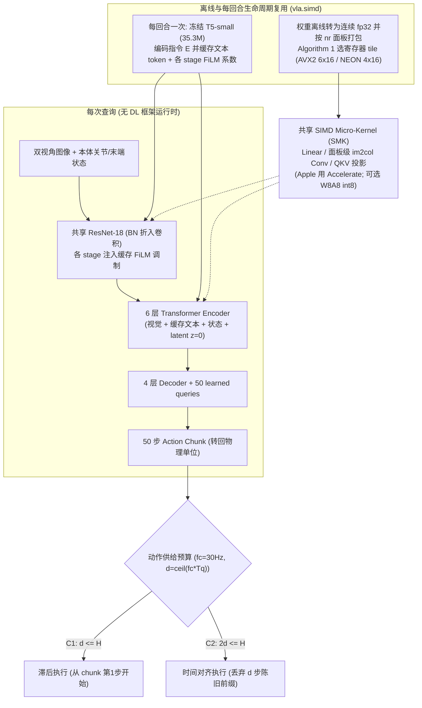

# vla.simd（arXiv:2609.24274）

## 一句话定义

**vla.simd**（arXiv:2609.24274）是一个面向纯 CPU 机器人[操作（Manipulation）](../tasks/manipulation.md)部署的无深度学习框架推理引擎与协同策略工作：通过打包面板共享 SIMD 微内核（SMK）、离线寄存器 tile 优化与按生命周期缓存语言特征的 **IMPACT** 策略，首次让语言条件[动作分块（Action Chunking）](../methods/action-chunking.md)策略在被动散热树莓派 Pi 5 上稳定超越 `30 Hz` 动作供给门槛。

## 英文缩写速查

| 缩写 | 英文全称 | 简要说明 |
| --- | --- | --- |
| SIMD | Single Instruction Multiple Data | 单指令多数据流向量指令集（如 x86 AVX2 / Arm NEON） |
| SMK | SIMD Micro-Kernel | `vla.simd` 中被线性层、im2col 卷积与注意力投影共用的核心矩阵微内核 |
| IMPACT | Instruction-Modulated Perception and Action Chunking with Transformers | 本文提出的基于 ACT、融合冻结 T5-small 缓存指令与 FiLM 视觉调制的轻量化策略 |
| FiLM | Feature-wise Linear Modulation | 基于指令向量的逐通道仿射缩放平移调制，用于引导 ResNet-18 视觉特征 |
| FMA | Fused Multiply-Add | 融合乘加指令；决定寄存器累积器排布能否掩盖指令发射延迟 |
| ISA | Instruction Set Architecture | 处理器指令集架构；引擎按目标 ISA 静态编译与选择微内核配置 |

## 为什么重要

在边缘机械臂与轻量移动平台中，无独立 GPU 场景下的 [VLA](../methods/vla.md) 部署面临三重认识误区：
1. **单次查询延迟（Latency）不等于能否驱动高频控制：** 通过预测多步动作块（Horizon $H$），慢于控制周期 $1/f_c$ 的推理依然可与运动执行并行；真正决定连续供电与否的是 $H$ 与延迟 $T_q$、滞后/时间对齐执行语义共同决定的**动作供给预算**。
2. **通用框架并非面向嵌入式 CPU 最优：** PyTorch Eager / `torch.compile` 默认算子缺少对特定小核（如 Cortex-A76）寄存器数与多视角线程争抢的精确适配；且桌面平台有效的全算子 `W8A8` 量化在苹果 M4 等架构上反而可能减速。
3. **传统轻量级 ACT 缺乏多任务语言分化能力：** 视觉-状态输入无法在同一双物体场景区分 `"Put the tape into the box"` 与 `"Put the cup into the box"`，而简单并入大语言模型会瞬间击穿树莓派等低功耗 CPU 的实时预算。

## 核心原理

1. **动作供给预算分析（Action-Supply Budgets, §III）：**
   定义查询耗时 $T_q$ 对应的控制步延迟 $d = \lceil f_c T_q \rceil$，动作供给率 $f_{\mathrm{eff}} = H / T_q$（**明确区别于观测-动作闭环反馈频率**）。在 `30 Hz` 控制率下：
   - **滞后执行（`C1`）：** 到达后直接从新 chunk 第 1 步播放，需满足 $d \le H$（即 $f_{\mathrm{eff}} \ge f_c$）。
   - **时间对齐执行（`C2`）：** 保留真实时间步索引并丢弃已过期的前 $d$ 步（如 RTC / LeRobot 异步客户端），须同时覆盖当前延迟与等待下一 chunk 的窗口，即 $2d \le H$（约 $f_{\mathrm{eff}} \ge 2f_c = 60\,\text{actions/s}$）。
2. **`vla.simd` 运行时设计与离线 Tile 自动筛选（§IV, Algorithm 1）：**
   - **三层计算生命期分离：** 进程启动打包权重；每回合（episode）仅算一次指令编码；每次查询只处理图像、状态与解码头。
   - **跨算子微内核复用（SMK）：** 线性层、按面板流式构造图像块的 `im2col` 卷积（避免保存全量展开矩阵）以及注意力投影统一归约至 $m_r \times n_r$ 寄存器累积块微内核（Apple Silicon 默认调用 Accelerate，非整除宽度的动作输出层走按行分块核）。
   - **约束驱动寄存器寻优：** 结合平台向量寄存器总数 $R_{\max}$、FMA 与载入吞吐（$P_{\mathrm{fma}}, P_{\mathrm{ld}}$）、FMA 延迟 $\tau$ 与编译期 `SPILLS` 栈溢出检验，最大化算访比 $\phi(m_r, n_r) = \frac{m_r n_r}{n_r + L m_r}$，在 `AVX2` 自动选 `6×16`（用尽 `15/16` 寄存器）、在 `ARMv8 NEON` 选 `4×16`（占 `24/32` 寄存器；在 Pi 5 达 `106.9 GFLOP/s`）。
   - **可选对称 `W8A8` 量化：** 按输出通道对权重量化（`int8`）、按 token/tensor 动态量化激活并走 ARM `dotprod` / x86 `AVX-VNNI` `int32` 累加；非线性、归一化及缓存文本编码器保留 `fp32`。
3. **`IMPACT` 策略架构（§V）：**
   以 `60 M` 参数 CVAE Transformer（6 层编码器 + 4 层解码器，50 动作查询）结合双视角共享 ImageNet 初始化 `ResNet-18`（推理时折叠 BN）。仅通过冻结 `T5-small`（`35.3 M`）生成一次性的 32 个文本 token 与 `ResNet-18` 各 stage FiLM 系数 $[\gamma_i; \beta_i] = G_i \bar{e} + b_i$（初始化为零恒等映射），使每 query 额外语言算力压低至约 **`2.6%`**（88 GFLOP 中仅占 `2.3 GFLOP + 9 MFLOP`）。

## 评测与对比

### 1. 四平台 CPU 动作供给率与 `90 s` 热浸测试（Table III, $f_c=30\,\text{Hz}$；树莓派被动散热）

| 策略 | 可用窗口 $H$ | Apple M4 ($f_{\mathrm{eff}}$) | Intel i9-14900HX | AMD Ryzen 5 5500 | Pi 5 标称 ($f_{\mathrm{eff}}$ / $T_q$) | Pi 5 90s 热浸 `fp32` | Pi 5 90s 热浸 `int8` | Pi 5 预算达成情况 |
| --- | --- | --- | --- | --- | --- | --- | --- | --- |
| **ACT** | `100` | `1150` (`C2`) | `892` (`C2`) | `627` (`C2`) | `109` / `0.92 s` (`C2`) | `89.9` (`C2`) | `242` (`C2`) | 无语言条件参考基准 |
| **DP (10 steps)** | `32` | `58` (`C1`) | `55` (`C1`) | `29.3` (未达标) | `6.3` / `5.08 s` | — | — | 不满足 `C1` |
| **Octo-Small** | `4` | `76` (`C2`) | `48` (`C1`) | `48` (`C1`) | `7.8` / `0.51 s` | `5.8` | `11.3` | 窗口太短 ($H=4$) 不足 `C1` |
| **TurboVLA** | `12` | `87` (`C2`) | `58` (`C1`) | `57` (`C1`) | `9.3` / `1.28 s` | `7.2` | — | 不满足 `C1` |
| **SmolVLA** | `50` | `73` (`C2`) | `42` (`C1`) | `38` (`C1`) | `6.1` / `8.19 s` | — | — | Pi 5 过慢；Ryzen 上靠 `vla.simd` 越过 30Hz |
| **IMPACT (Ours)** | **`50`** | **`453`** (`C2`) | **`334`** (`C2`) | **`262`** (`C2`) | **`41` / `1.21 s`** (`C1`) | **`33.5`** (`C1`) | **`81.2`** (`C2`) | **唯一达标 30Hz 的语言条件策略** |

- **引擎加速与数值保真度（§VI-C）：** 跨越 6 策略 × 4 CPU（28 个配置对），`vla.simd` 相比 `torch.compile`（Inductor CPU 后端）取得 **`~1.4×` 中位加速**（范围 `0.83–3.37×`），且对参考 PyTorch 输出的最大绝对误差 $\le 8.8 \times 10^{-5}$（机器人物理单位）；Intel 与 AMD AVX2 后端达成逐位一致。
- **架构敏感的硬件调优分化（Table IV）：** 在 ACT 上消融 11 项运行时参数发现分块卷积使 i9 提速 `+156%`、Ryzen `+260%`、Pi 5 `+16.9%`；权重重排打包带来 `+14.8%～+31.0%` 增益；**但 `W8A8` 与多线程并非处处有利**——`W8A8` 在 Pi 5 上为 IMPACT 提速 `2.39×`，在 Apple M4 上却仅 `1.06×`，更令 `Octo-Small`（`0.66×`）与 `SmolVLA`（`0.71×`）**变慢**。

### 2. LIBERO 任务性能与双真机验证（Tables V–VII）

| 评测场景 | 关键设定 | 实测指标（论文一手数字） | 核心验证点 |
| --- | --- | --- | --- |
| **LIBERO (Table V)** | 4 套件各 10 任务×20 init states，无机器人预训练，30k 步末轮模型 | Spatial `83.5` / Object `83.5` / Goal `84.5` / Long `54.0` → **均值 `76.4%`**（评估选优 `78.6%`） | 以 `60M` 主体接近预训练模型 Octo-Base (`75.1%`) / OpenVLA (`76.5%`) |
| **LIBERO-Goal 指令置换** | 固定同场景仅置换 3 组指令共 600 轮 | 达成新指令目标 **`91%`**，误触原指令 **`0%`**（正常控制组 `88.5%`） | 证明多任务决策真实受语言指令驱动而非场景过拟合 |
| **SO-101 机械臂 (Table VI)** | 44 条多任务示教 + 20 条长程抽屉示教；每行 20 trials | 多任务 `fp32`: 胶带→盒 `90%` / 胶带→杯 `85%` / 杯→盒 `60%`；`int8`: `85% / 95% / 50%`；抽屉长程 `65%`；无语言多任务 ACT 对照仅 `20% (4/20)` | 目的物体切换比抓取目标切换更易由语言区分；`int8` 精度未出现显著塌陷 |
| **UR10e + Robotiq (Table VII)** | 运行 SmolVLA（`vla.simd`），对比 M4 与 Ryzen，各 20 trials | Apple M4 往返 **`1177 ms` → `60% (12/20)`**；Ryzen 5 5500 往返 **`2343 ms` → `60% (12/20)`** | 序列化与网络传输给纯计算增加约 `0.5–1.0 s` 不可忽视的端到端延迟 |

## 工程实践

1. **按平台实测选择编译/运行期开关而非盲开量化或全核多线程：** 在 x86/ARM 嵌入式设备上务必开启权重量化打包（`packing on`）与分块卷积（`tiled conv`），并通过目标 CPU 实测决定是否开启 `W8A8` 与每视角多线程（Apple M4 需慎用 `W8A8` 与过多并行开销）。
2. **用 `90 s` 以上热浸与全链路端到端往返时间标定部署预算：** 被动散热平台（Pi 5）持续推理会出现显著热降频（`41 -> 33.5 actions/s`），且 UR10e 实验表明相机序列化与网络传输（`0.5–1.0 s`）会侵蚀 `H` 窗口余量，工程验收必须按**尾延迟 + 传输总延迟**校验 `C1/C2`。
3. **重度多任务低算力场景优先缓存静态前缀并利用 FiLM：** 将文本编码与浅层通道调制的投影前移到回合初始化，可在仅增 `2.6%` 查询 FLOP 的前提下赋予轻量级动作块策略显著的抗目标歧义能力。

## 局限与风险

1. **反馈陈旧度不随高频动作供给改善：** 动作块越大虽然越容易满足 `C1/C2`，但每一步执行动作所依赖的观测至少滞后 $d = \lceil f_c T_q \rceil$ 个控制步（在动态障碍或突发滑动场景中存在视觉反馈滞后风险）。
2. **开源实名仓库与权重尚处匿名审稿锁定阶段：** 项目官网当前仅挂出双盲匿名审查链接（`anonymous.4open.science/r/vla-simd` 与 `lerobot-vla-simd`），页脚声明正式代码与权重在论文接收后才公开发布，复现受审稿托管时效制约。
3. **评测范围与样本量限制：** LIBERO 仅评测单一种子；`int8` 量化未系统测试 LIBERO 全套仿真及长程抽屉任务成功率；SO-101 实验在日志中合并了多台 CPU/GPU 服务端结果且每组仅 20 次真机试验（置信区间宽度达 30–40 pp），尚不足以精准量化个体硬件微弱差异。

## 结论

**纯 CPU 部署视觉-语言策略的关键在于同时用动作块窗口 $H$ 覆盖真实全链路延迟（区分滞后 `C1` 与时间对齐 `C2` 预算），并用去框架的生命周期复用与 ISA 专属 SIMD 微内核释放有限核上算力。**

- **供给率不等于闭环反应速度：** 判断模型能否在无 GPU 机器上稳定运行，必须联合检查 $H/T_q \ge f_c$（或时间对齐下的 $2f_c$）与实际观测滞后步数 $d$。
- **硬件适配拒绝“一刀切”：** `vla.simd` 证明了同算法策略在不同微架构上的最佳参数迥异，`W8A8` 能让 Pi 5 迈入 `C2`（`81.2 actions/s`），却会拖慢 Apple M4。
- **“缓存前缀 + 轻量 FiLM”是边缘多任务最优折中：** `IMPACT` 以单回合一次 T5 编码和 `2.6%` 查询算力，在 Pi 5 热降频后仍保住 `33.5`（fp32）/ `81.2`（int8）actions/s 与 `91%` 指令切换准确率。
- **开源跟进提示：** 正式实名 GitHub 源码与模型权重尚未伴随 arXiv v1 发布（目前仅网站挂载 `anonymous.4open.science` 审稿代码）；工程集成或复现前需跟踪官网更新。

## 源码运行时序图

**不适用。** 经核查 `arXiv:2609.24274v1` 与官方网站 `vla-simd.github.io`，作者团队当前仅在官网提供了匿名双盲审稿仓库链接（`anonymous.4open.science/r/vla-simd` 与 `lerobot-vla-simd`），页脚明确标注 *"Code and checkpoints will be released on acceptance."*，尚无实名公开 GitHub 源码仓库归档在本库 `sources/repos/`，故不臆造源码模块运行时序图，待官方正式开源后补充。

## 关联页面

- [Vision-Language-Action (VLA)](../methods/vla.md) — 本研究旨在通过轻量化推理与计算复用落地到纯 CPU 的策略范式
- [Action Chunking](../methods/action-chunking.md) — 决定延迟 $T_q$ 能否与控制周期 $f_c$ 解耦的核心动作预测机制（`C1/C2` 动作供给理论基础）
- [Manipulation](../tasks/manipulation.md) — 本工作在 LIBERO 仿真、SO-101 与 UR10e 上重点验证的机械臂操作任务域
- [VLAQuantBench](./paper-vlaquantbench.md) — 从模型侧量化精度与真实 GPU kernel 延迟角度探讨部署瓶颈的互补研究
- [具身智能 2026-10-18 26 篇技术图谱](../overview/embodied-station-2026-10-18-26-papers-technology-map.md) — 本页面收录时的技术谱系总览

## 参考来源

- [vla.simd 论文来源归档](../../sources/papers/vla_simd_arxiv_2609_24274.md)（arXiv:2609.24274v1 全文与 Table I–VII 核对）
- [vla.simd 项目官网归档](../../sources/sites/vla-simd.md)（`vla-simd.github.io` 离线页面核对，含匿名仓库链接与接收后开源声明）
- [公众号 26 篇论文速览归档](../../sources/blogs/wechat_embodied_station_26_papers_embodiedswe_2026-10-18.md)（早期线索来源）

## 推荐继续阅读

- [arXiv 论文原文 (2609.24274)](https://arxiv.org/abs/2609.24274) / [PDF 全文](https://arxiv.org/pdf/2609.24274)
- [vla.simd 项目主页（含互动式 SMK Tiling 工具与匿名链接）](https://vla-simd.github.io/)
