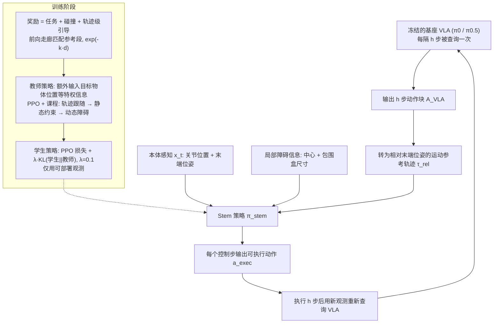

# VLA-Stem：基于强化学习的轻量化视觉语言动作模型安全机制

**VLA-Stem**（*VLA-Stem: A Lightweight Safety Mechanism for Vision-Language-Action Models via Reinforcement Learning*，[arXiv:2610.37378](https://arxiv.org/abs/2610.37378)）收录于 senlanke「具身运控lab」10-26–10-30 前沿论文动态（Manipulation）。本页依据**周报条目 + arXiv 摘要页**整理，流程图依据论文方法部分（见参考来源），未逐页核对实验数字；指标与结论以论文为准。

## 一句话定义

**VLA-Stem：基于强化学习的轻量化视觉语言动作模型安全机制——在冻结 VLA 下方增加强化学习安全策略，将 VLA 动作块转换为参考轨迹。安全策略根据本体状态和局部障碍物信息调整动作，同时尽量保留原始任务意图。训练采用 Teacher–Student 蒸馏和课程学习，在六种受约束仿真环境中，平均无碰撞任务成功率达到 **52.8%**，最强安全基线为 **23.7%**。**

## 英文缩写速查

| 缩写 | 英文全称 | 简要说明 |
|------|----------|----------|
| VLA | Vision-Language-Action | 视觉–语言–动作模型 |
| IL | Imitation Learning | 模仿学习 |

## 为什么重要

- 周报所述待解决的问题：VLA 主要学习完成操作任务，但面对动态障碍物和空间约束时，原始动作块可能发生碰撞。直接重新微调 VLA 成本较高。

## 流程总览

图依据：论文 §III-A 至 §III-D、Fig.2、式 (1)–(9)

## 核心机制

| 项 | 内容 |
|----|------|
| **arXiv** | [2610.37378](https://arxiv.org/abs/2610.37378) · [PDF](https://arxiv.org/pdf/2610.37378) |
| **作者（arXiv）** | Zou, Bojun, Yu, Wenhao, Li, Jiaohao, Lin, Jiaxuan, Ye, Guanting, Geng, Haohan, Yu, Weihao, Zhang, Yanyong et al. |
| **机构（周报所述，未逐条核实）** | 中国科学技术大学、澳门大学等。 |
| **arXiv 评论栏** | （无） |
| **开源** | arXiv 摘要页与评论未见代码或项目页链接（仅核对 arXiv 摘要页，不代表未发布）（2026-11-02） |
| **周报所述创新点** | 在冻结 VLA 下方增加强化学习安全策略，将 VLA 动作块转换为参考轨迹。安全策略根据本体状态和局部障碍物信息调整动作，同时尽量保留原始任务意图。训练采用 Teacher–Student 蒸馏和课程学习，在六种受约束仿真环境中，平均无碰撞任务成功率达到 **52.8%**，最强安全基线为 **23.7%**。 |

### arXiv 摘要节选（英文原文）

> Vision-Language-Action (VLA) models integrate high-level reasoning with low-level action execution for end-to-end robotic control. However, most VLA models target static manipulation in unconstrained environments, overlooking spatial constraints and dynamic obstacles.

## 源码运行时序图

**不适用**：arXiv 摘要页与评论未见代码或项目页链接（仅核对 arXiv 摘要页，不代表未发布），无可对齐的官方代码流程。

## 实验与评测

- 周报与摘要给出的数字/场景已写入上表「创新点」与摘要节选；其余实验细节、基线与成功率定义请回到论文正文。
- 读法：先对齐任务设定、传感器与成功定义（仿真/真机），再解读 headline 数字，勿跨论文直接比较。

## 与其他工作对比

| 维度 | 读法 |
|------|------|
| **同周对照** | 见 [Manipulation周报技术地图](../overview/senlanke-weekly-2026-10-26-30-manipulation-technology-map.md)，按方向浏览同期论文 |
| **开源状态** | arXiv 摘要页与评论未见代码或项目页链接（仅核对 arXiv 摘要页，不代表未发布） |

## 结论

**VLA-Stem：基于强化学习的轻量化视觉语言动作模型安全机制。**

1. 本页是入库级摘要，复现前请核对论文正文、附录与代码仓库。
2. 指标须连同实验条件解读。
3. 关注 arXiv 版本更新与代码发布。

## 关联页面

- [senlanke-weekly-2026-10-26-30-manipulation-technology-map](../overview/senlanke-weekly-2026-10-26-30-manipulation-technology-map.md)
- [manipulation](../tasks/manipulation.md)
- [vla](../methods/vla.md)

## 参考来源

- [vla-stem-lightweight-safety-rl_arxiv_2610_37378.md](../../sources/papers/vla-stem-lightweight-safety-rl_arxiv_2610_37378.md)
- [wechat_senlanke_weekly_manipulation_2026-10-26_30.md](../../sources/blogs/wechat_senlanke_weekly_manipulation_2026-10-26_30.md)
- [arXiv:2610.37378](https://arxiv.org/abs/2610.37378)
- [arXiv PDF](https://arxiv.org/pdf/2610.37378)：已通读方法部分（实验与附录以略读为准）：方法（§III-A VLA 条件执行、§III-B 轨迹级引导、§III-C 教师–学生蒸馏、§III-D RL 与课程）

## 推荐继续阅读

- [arXiv PDF](https://arxiv.org/pdf/2610.37378)
