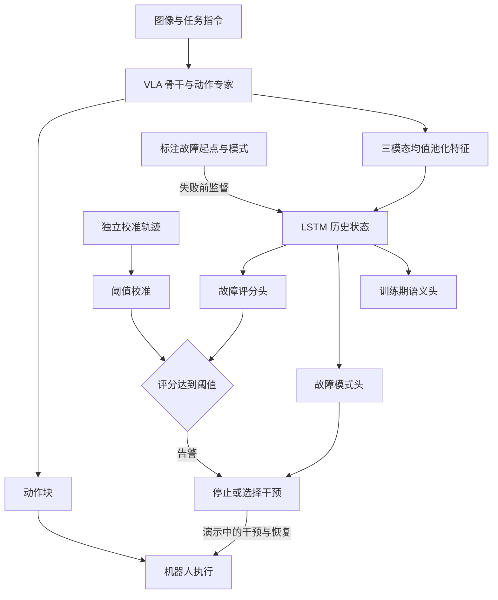
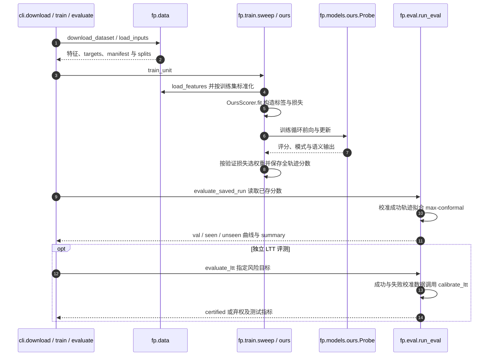

# VLA-Tug：通过校准潜变量探针预测与分类故障

## 一句话定义

VLA-Tug 从 VLA 内部表征预测故障何时将发生及其类别，并校准告警阈值，为停止、重试或接管提供信号。

## 英文缩写速查

| 缩写 | 英文全称 | 简要说明 |
|---|---|---|
| VLA | Vision-Language-Action | 视觉语言动作模型 |
| LSTM | Long Short-Term Memory | 读取历史特征的循环网络 |
| FPR | False Positive Rate | 成功轨迹被误报的比例 |
| TPR | True Positive Rate | 故障被检出的比例；early 版本要求不晚于故障起点 |
| LTT | Learn-then-Test | 同时校准多项风险的统计框架 |
| PPV | Positive Predictive Value | 告警中真正失败的比例 |

## 为什么重要

只有最终成功/失败标签不能判断告警是否来得及阻止错误。该工作把故障起点、故障模式和校准成功率分开评测，帮助把 VLA 风险信号接入[安全状态机](../concepts/robot-safety-state-machine.md)。

## 核心信息

| 项目 | 内容 |
|---|---|
| 正式标题 | Failure Prediction and Classification in Vision-Language-Action Models Via Calibrated Latent Probing |
| 机构 | 得克萨斯大学奥斯汀分校、塔夫茨大学、得克萨斯大学达拉斯分校 |
| 原文版本 | arXiv:2611.08425v1，2026-11-05，正文与附录 A–E 已通读 |
| 数据 | 3180 条仿真轨迹；另有未公开的 399 条真机轨迹 |
| 开放状态 | 匿名镜像代码与三个仿真 Hub 数据入口可公开获取；真机数据不发布 |

## 核心原理

1. **特征与时序：** agent 图像、wrist 图像、语言 token 各均值池化成 2048 维并拼接；单层 256 隐元 LSTM 接三个 MLP 头：故障评分、10 类模式和 CLIP 语义。主干读取 GR00T N1.7 第 16 层或 π0.5 第 18 层特征。
2. **失败前监督：** 失败轨迹从开始至 onset 都标正，onset 后排除损失；成功轨迹全负。对比全轨迹标正、仅 onset 窗口、含失败后片段，目的是学习预兆而非失败后的状态。
3. **校准：** 主检测表采用 max-conformal 的 FPR 控制；独立 LTT 实验同时约束 FPR 和 early miss rate。校准成功和失败轨迹均参与 LTT；无法认证目标则弃权。分数经 sigmoid 不意味着它已是校准的失败概率。
4. **语义用途：** 模式头提供抓取、目标错误、放置/插入等候选；CLIP 语义头只用于训练，推理不运行 CLIP。辅助头对检测没有一致增益，不能把贡献归结为语义对齐。

## 项目流程图

## 实验与评测

early AUROC 是 early TPR 对 FPR 在 0–0.4 区间的归一化面积，以下均为百分数，不是全区间 AUROC 或任务成功率。

| 设置 / 指标 | VLA-Tug | 对照与解释 |
|---|---|---|
| LIBERO-X unseen skill | 39.0 ± 7.0 | SAFE-LSTM 30.1 ± 8.5，相对约 +30%，约 +8.9 个百分点 |
| LIBERO-X unseen task | 40.2 ± 1.2 | SAFE-LSTM 40.4 ± 2.3，未领先 |
| 真机 unseen | 25.8 ± 11.6 | SAFE-LSTM 25.1 ± 18.8，优势小且方差大 |
| LIBERO-10 GR00T unseen | 47.4 ± 13.5 | SAFE-LSTM 51.2 ± 8.4，后者更好 |
| 探针新增延迟 | GPU 0.12 ms；CPU 0.94 ms | RTX 4090 / 四 CPU 线程；非 VLA 完整延迟 |

LTT 表 7 的 FPR 15% / early TPR 15% 目标只认证 7/14 runs；这些 certified runs 在 unseen 的 FPR、early TPR 分别有 86%、71% 达标，**不能写成两项联合达标 86%**。FPR 10% 的目标没有 run 获认证。new-task / new-signature 的多种子共用 unseen 任务，所以比例反映趋势而非精确概率。

## 结论

VLA-Tug 提供了轻量且带时间语义的故障监测方案，但它的统计认证、分布外鲁棒性和机器人纠错能力需分别判断。

- 优先收集 onset 与模式标注，分开验证 train、val、calibration、seen 和 unseen。
- 将 early AUROC 与固定阈值下的误报、漏检、可认证率一起报告。
- LTT 弃权意味着当前数据无法支持目标，不能自动退回并声称同样保证。
- 机器人干预只有概念演示；接入控制器前仍需独立评测闭环成功率。

## 源码运行时序图

以下对齐匿名镜像的离线复现入口，已阅读相关实现；它不是未经验证的真机部署调用图。

## 工程实践

- [源码归档](../../sources/repos/vla-tug.md)记录实际模块、匿名快照日期和数据 ID。安装 `pip install -e ".[dev]"`；下载后可用 `python -m cli.train --datasets liberox_groot --variants onset_pre --probes lstm_modes_clip` 缩小复现范围。
- `cli.evaluate` 默认读取已存分数，不运行机器人或 VLA；LTT 是另一个分支。三个公开仿真 Hub 数据集已核实 manifest 与 pooled 文件清单，未下载大数组或复跑训练。
- 项目页仍显示 Data link soon，源码配置已有公开数据 ID；真机 399 条不公开，3180 不含真机。匿名镜像有到期日，后续需跟踪正式仓库。
- 一次探针更新对应一次 VLA action chunk：LIBERO-X 为 8/20=0.4 s，真机为 6/50=0.12 s；不能把 0.12 ms 的探针延迟写成控制周期。

## 与其他工作对比

| 项目 | 定位区别 |
|---|---|
| [FARM](./paper-farm-failure-readout.md) | 读取冻结 VLA-JEPA 世界模型预测态，用约 34k 参数 readout 逐步打失败分；VLA-Tug 读取 VLA 骨干层特征，以 LSTM 同时输出故障评分与故障模式，并单独校准告警阈值 |
| [进度探针 P²](./paper-progress-probes-p2-vla-runtime-monitoring.md) | 只用成功演示，在 π0.5 激活上线性回归任务进度，以落后名义进度判定失败；VLA-Tug 需要失败轨迹的 onset 与模式标注，直接学习失败前预兆 |
| [Robot-WATCHDOG](./paper-robot-watchdog-object-graph-failure-detection.md) | 从 RGB 视频构建物体中心时空图，只需正常示范，不依赖策略内部表征；VLA-Tug 必须接入 VLA 骨干特征，换模型需重新训练与校准 |

## 局限与风险

- 正式校准保证依赖可交换性；分布外仅经验检验，PPV 还依赖失败基率。
- 标注主要由 Gemini 生成；onset 定义含“应接管”的判断，移动 onset 会改变 early 指标与真机排名。
- 未系统比较所有骨干层；换模型或任务需要重新标注、训练与校准。
- steering 是启发式演示，论文明确未系统评测，不能推断全面成功率提升。
- 真机数据不公开；本文完成源码阅读，未做训练或硬件复现。

## 关联页面

- [GazeVLA](./paper-gazevla.md) — 在动作生成前显式预测人类注视意图，与本页执行中的故障探测形成互补。

- [VLA 方法](../methods/vla.md)：本方法读取策略内部表征，不替代动作策略。
- [机器人安全状态机](../concepts/robot-safety-state-machine.md)：告警到停止/接管的执行边界。
- [Latent RL Priors](paper-latent-rl-priors.md)：同样利用潜在表征，但任务是控制先验复用。
- [机器人视觉感知栈选型闭环](../queries/robot-perception-stack-selection-loop.md)：本方法不另接检测/分割头，而是直接池化 VLA 骨干对 agent/wrist 图像的内部特征做失败预测，可与显式感知栈方案（如 Robot-WATCHDOG 的物体图）对照取舍。

## 参考来源

- [论文 v1 全文归档](../../sources/papers/vla-tug.md)
- [项目页开放状态](../../sources/sites/vla-tug.md)
- [匿名源码与仿真数据](../../sources/repos/vla-tug.md)

## 推荐继续阅读

- [论文全文与附录](https://arxiv.org/html/2611.08425v1)
- [官方项目页](https://vla-tug.github.io/)
