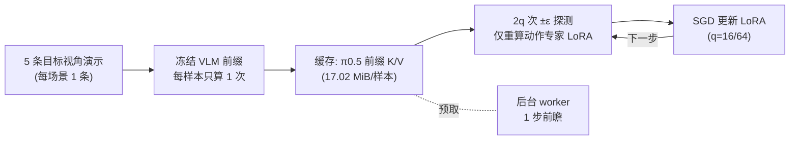

# VLA-ZO：VLA 的快速零阶适应

**VLA-ZO**（[arXiv:2610.06271](https://arxiv.org/abs/2610.06271)）解决的是「部署时相机换了视角，怎么在只有推理级显存的设备上把 VLA 适应过去」：零阶（只靠前向传播的有限差分）优化不需要反向传播，但需要大量扰动查询；VLA-ZO 只扰动动作侧、缓存冻结前缀的条件状态，使每次查询只重算很小的动作部分。

## 一句话定义

**冻结 VLM 前缀 + 只对动作专家 LoRA 做两点有限差分零阶更新，并把前缀 K/V（或隐藏状态）缓存复用、预取，让 ZO 适应快 25–33 倍。**

## 英文缩写速查

| 缩写 | 英文全称 | 简要说明 |
|------|----------|----------|
| ZO | Zeroth-Order | 仅用函数值（前向）估计梯度的优化 |
| VLA | Vision-Language-Action | 视觉语言动作模型 |
| LoRA | Low-Rank Adaptation | 低秩适配，被扰动的参数集合 |
| FLA | （视觉侧 LoRA 基线） | 对视觉编码器 FFN 做 ZO 的基线 |
| DART | （一次演示适应协议/基线） | 论文沿用其协议并重实现为基线 |
| MeZO | Memory-efficient Zeroth-Order | 论文估计器风格所参照的方法 |

## 为什么重要

- 机器人端设备往往只按推理显存配置；一阶微调在 π0.5 上 batch 16 就要 20.27 GiB、batch 64 要 54.69 GiB，前向式 ZO 为 12.74 / 27.71 GiB。
- 朴素 ZO 要上千次前向，q=64 时基础 ZO 需 153,220 s；VLA-ZO 降到 4,709 s，使更大查询预算可行。
- 动作侧适应（1.25M 参数）与视觉侧（4.71M）平均持平（约 56.6%），说明视角偏移的适应并不一定要动视觉编码器。

## 方法栈总览

## 方法

- **扰动对象：** π0.5 动作专家自注意力 q、v 投影的 LoRA（rank 16，1.25M）；OpenVLA-OFT L1 动作头三个线性层的 LoRA（0.79M）。VLM 前缀冻结。
- **估计器：** 两点随机有限差分，高斯方向，ε=1e-3，每次更新共享噪声/流时间采样与小批量；SGD 无动量；LoRA 用 PiSSA 初始化。
- **目标：** 监督式一次演示适应（非无监督）：每场景 1 条演示共 5 条，渲染于目标视觉条件；π0.5 用流匹配损失，OpenVLA-OFT 用 L1 损失。
- **三类加速：** (1) 步内复用：前缀每样本每次更新只算一次，由 2q 次探测共享；(2) 步间复用：缓存惰性填充并跨更新复用；(3) 预取：后台 worker 用 pinned 内存与专用 CUDA stream 提前搬运下一次更新的缓存。
- **缓存规格：** π0.5 缓存 18 层前缀 K/V，约 17.02 MiB/样本；OpenVLA-OFT 缓存动作 token 位置末层隐藏状态（56×4096），约 0.4375 MiB/样本。

## 实验与评测

LIBERO 相机视角偏移（40 任务，Small/Medium/Large 三档，1,600 回合/条件），π0.5：

| 方法 | q | 平均成功率 | 耗时（s） | 加速 |
|---|---|---|---|---|
| Zero-shot | – | 48.27% | – | – |
| FLA† | 16 | 56.56% | 42,782 | – |
| DART† | 16 | 54.21% | 43,794 | – |
| 基础 ZO | 16 | 57.63% | 38,487 | 1.00× |
| **VLA-ZO** | 16 | 58.17% | 1,504 | 25.59× |
| 基础 ZO | 64 | 63.77% | 153,220 | 1.00× |
| **VLA-ZO** | 64 | 63.58% | 4,709 | 32.54× |

- **加速分解：** q=16：步内复用 15.56×，+步间 17.00×，+预取 25.59×；q=64：26.72×、28.04×、32.54×。
- **复合偏移（π0.5）：** View+Noise 49.2%→51.1%（q=16）→55.8%（q=64）；View+Light 49.0%→58.4%→60.8%。
- **OpenVLA-OFT：** 相机视角 49.48% → 52.67%（q=4，109 s）；DART† 51.75% 但 28,482 s；FLA† 51.00% 但 18,283 s。
- 成功率在不同执行变体间波动 57.63–58.17%，作者归因于浮点/数值差异，而非缓存。

## 源码运行时序图

不适用：arXiv 页面与 HTML 均未给出官方代码或项目页，截至 2026-10-12 无仓库可对齐。

## 工程实践

- 先把前缀缓存做对：π0.5 每样本 17 MiB 级，5 条演示的缓存很小，但演示观测多时主机内存线性增长。
- q 是速度/精度旋钮：q=16 → 64 成功率 58.17%→63.58%，耗时 1,504 s→4,709 s。
- 预取必须只搬运已完整缓存的批，且不跑模型。
- 若设备是 Jetson 一类边缘平台，可参考 [Jetson 上的 π0.5 部署](./jetson-openpi-pi05-on-thor.md)；论文本身未在边缘硬件测试。
- 开源状态：未发布。

## 结论

**把 ZO 的瓶颈（重复算大前缀）通过缓存消除，使“只用推理显存做 VLA 视角适应”从理论变成小时级操作。**

1. 动作侧 LoRA 足够：参数少 3.8× 而精度持平。
2. 绝大部分加速来自前缀复用（15.56× / 26.72×），预取再加约 1.5× / 1.16×。
3. 更大的 q 带来更高精度（+5.4 点）。
4. 适应依赖目标视觉条件下的 5 条演示，并非零监督。
5. 评测仅 LIBERO 仿真、单种子，需真机和更多种子验证。

## 局限与风险

- 无专门局限小节；仅 LIBERO 仿真、seed 0、单一任务组合。
- Small 偏移增益不随 q 一致增加。
- 基线为作者重实现且无法使用冻结前缀缓存，速度比较偏向 VLA-ZO。
- 缓存主机内存随演示增长；复用与重算不逐位一致；未在边缘硬件验证。
- 开源：截至 2026-10-12 未发布。

## 与其他工作对比

| 对照 | 差异读法 |
|---|---|
| FLA† / DART† | 视觉侧扰动，改变前缀因而不能缓存，耗时 4 万秒量级 |
| MeZO 类 ZO | 同样两点估计，VLA-ZO 增加前缀缓存、跨步复用与预取 |
| [LoRA](../concepts/lora.md) 一阶微调 | 精度可能更高但显存 1.59–1.97× |
| [Jetson 上的 π0.5](./jetson-openpi-pi05-on-thor.md) | 关注推理部署；VLA-ZO 关注部署后的适应 |

## 关联页面

- [Manipulation 前沿周报 2026-10-05~10-09](../overview/frontier-manipulation-2026-10-05-10-09.md) — 本文所在汇总页
- [操作任务页](../tasks/manipulation.md)
- [VLA](../methods/vla.md) / [LoRA](../concepts/lora.md)
- [LIBERO](./libero-benchmark.md)

## 参考来源

- [vla_zo_arxiv_2610_06271.md](../../sources/papers/vla_zo_arxiv_2610_06271.md) — 论文摘录
- [周报来源归档](../../sources/blogs/frontier_manipulation_2026_10_05_10_09.md)
- [arXiv:2610.06271](https://arxiv.org/abs/2610.06271)

## 推荐继续阅读

- [arXiv HTML 全文](https://arxiv.org/html/2610.06271v1)
- [MeZO：Fine-Tuning Language Models with Just Forward Passes](https://arxiv.org/abs/2305.17333)
