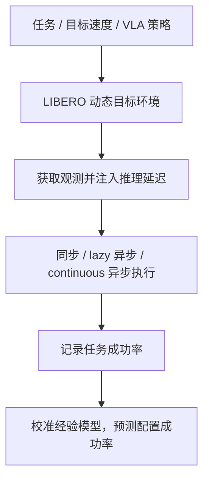

# VLALagBench：VLA 推理延迟何时及为何重要

> 草稿：核心评测方法已核对；全文及附录尚未通读完成，数值结论和适用边界待复核。

## 一句话定义

VLALagBench 通过控制动态目标速度、推理延迟和动作执行方式，研究 VLA 操作成功率对延迟的敏感性。

## 英文缩写速查

| 缩写 | 英文全称 | 简要说明 |
|---|---|---|
| VLA | Vision-Language-Action | 视觉语言动作模型 |
| LIBERO | Lifelong Benchmark for Robot Learning | 主要仿真任务基础 |
| RMS | Root Mean Square | 均方根，用于评估预测误差 |

## 流程总览

## 执行模式与评测

同步模式等待推理时保持当前位置；lazy 异步在旧动作执行期间请求下一块并跳过推理期间过时的动作；continuous 异步在推理完成后尽快发起下一次请求。异步可减少停顿，但更频繁推理与动作块切换也有成本。主实验使用 20 Hz 控制、0–250 ms 注入延迟，每个成功率点 200 次 rollout；覆盖释放、放置、抓取和关节物体操作。

## 与其他工作对比

- **[VLA-HWBench](./paper-vla-hwbench-edge-hardware-latency.md)**：两文有部分共同作者，本文 §4.1 引其作为 0–250 ms 延迟取值依据之一。HWBench 在端侧硬件上实测 VLA 分阶段推理耗时，不评任务成功率；本文在仿真中注入受控延迟，只研究延迟到成功率的映射，不测真实硬件耗时。两者可串联使用。
- **VLA-Perf**：以 10 Hz、100 Hz 作为可接受与高性能推理参考点，但未评估这些速率对应的任务成功率（§1）。
- **动态操作基准**：MoveBench 仿真不计推理延迟；DynamicVLA 的 DOM 延迟取决于所用策略和 GPU，缺少受控扫描；[ReflexBench](./paper-reflexvla.md) 在同步与异步下改变延迟，但只测 SmolVLA 一个策略、两个任务（§2.3）。本文在 LIBERO 四任务上评测 π0.5、GR00T N1.7、MolmoAct2 官方检查点，DOM 仅作 Isaac Sim 交叉验证（附录 E）。
- **异步推理方法**：[SmolVLA](./paper-smolvla.md) 异步推理栈、VLASH 等在各自方法内处理延迟（附录 H）；本文不提出新策略，而把同步、lazy 异步和 continuous 异步作为受控变量，执行步长 H 的定义沿用 [Real-Time Chunking](./paper-real-time-chunking.md) 论文（§2.1）。
- **数值口径**：成功率在 20 Hz、H=5、每点 200 次 rollout、每回合 600 步动作预算下测得，高于标准 LIBERO 的 220–300 步（§4.1）；目标初始位置沿路径采样后，近静止目标的成功率已低于原版布局（表 1，如 GR00T N1.7 set-down 为 56.0%）。不能与标准 LIBERO 或 ReflexBench 成功率直接横比。

## 结论

延迟影响必须结合任务、执行模式和目标运动评估。

- 将观测陈旧与等待期间机器人停顿分别考虑。
- 异步执行可能改善成功率，但收益随模型与任务变化。
- 经验模型需按任务与策略校准，不能当作跨任务保证。

## 源码运行时序图

不适用：论文给出的代码链接截至 2026-11-04 返回 404，作者声明代码将发布。

## 关联页面

- [VLA-HWBench](./paper-vla-hwbench-edge-hardware-latency.md)
- [视觉语言动作模型](../methods/vla.md)
- [具身评测基准选型闭环（知识链）](../overview/hub-embodied-eval-benchmark.md)

## 参考来源

- [论文归档及 v1 原文](../../sources/papers/vlalagbench_arxiv_2611_03103.md)
