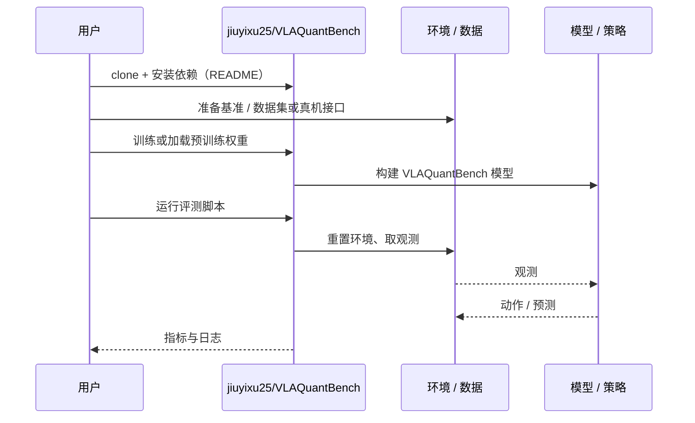

# VLAQuantBench（arXiv:2609.25376）

**VLAQuantBench**（*VLAQuantBench: Closed-Loop Evaluation of Post-Training Quantization for Vision-Language-Action Models*，[arXiv:2609.25376](https://arxiv.org/abs/2609.25376)，[代码](https://github.com/jiuyixu25/VLAQuantBench)）来自 [具身智能小站 2026-10-18 盘点](../../sources/blogs/wechat_embodied_station_26_papers_embodiedswe_2026-10-18.md)，属「VLA 评测与部署」组。

## 一句话定义

**统一量化格式与作用范围，在闭环任务上比较 VLA 的训练后量化（独立层组与联合量化），把成功率、校准条件与真实算子延迟一并检查。**

## 英文缩写速查

| 缩写 | 英文全称 | 简要说明 |
|------|----------|----------|
| VLA | Vision-Language-Action | 视觉–语言–动作策略 |
| PTQ | Post-Training Quantization | 训练后量化 |
| RTN | Round-To-Nearest | 最近舍入量化 |
| W8A8 | 8-bit Weight / 8-bit Activation | 权重与激活均 8 位 |

## 为什么重要

- 压低数值误差并不保证机器人完成任务；部署团队需要闭环成功率而不是逐层误差来决定量化方案。
- 开源结论：**已开源**（步骤 2.5，2026-10-18）。仓库可达（git ls-remote）；公众号称显存节省不等于推理加速，复现须自备 LIBERO 与模型权重。
- 同期同组工作见 [编程智能体造数据与 VLA 闭环评测：具身智能小站 10-18 期 26 篇阅读坐标](../overview/embodied-station-2026-10-18-26-papers-technology-map.md)。

## 核心机制

| 项 | 内容 |
|----|------|
| **arXiv** | [2609.25376](https://arxiv.org/abs/2609.25376) |
| **开源** | **已开源** |
| **要点** | 在统一 RTN 配方下统一量化格式与作用范围，比较独立层组与联合量化，并检查校准与真实算子延迟。 |
| **文内指标** | 公众号转述：OpenVLA-OFT 的 LIBERO-Goal 成功率由 BF16 的 96% 降至 W8A8 的 13%（每配置 200 轮）；强调格式、层范围与校准耦合，不能推广为所有 8 位量化都失效。 |

## 源码运行时序图

以下为按仓库入口（`jiuyixu25/VLAQuantBench`）推断的通用运行链路；入库日仅核实仓库可达，未逐文件阅读，具体脚本名以 README 为准。

## 实验与评测

- 公众号转述：OpenVLA-OFT 的 LIBERO-Goal 成功率由 BF16 的 96% 降至 W8A8 的 13%（每配置 200 轮）；强调格式、层范围与校准耦合，不能推广为所有 8 位量化都失效。
- **读法：** 本页为索引级摘要，依据公众号转述的官方摘要与仓库信息整理；逐项数字与 baseline 以原文 PDF 为准。

## 与其他工作对比

- 横向索引见 [编程智能体造数据与 VLA 闭环评测：具身智能小站 10-18 期 26 篇阅读坐标](../overview/embodied-station-2026-10-18-26-papers-technology-map.md)；同 arXiv 不重复造页。

## 结论

**VLA 量化应以闭环成功率为准：同一 8 位格式在不同层范围与校准下可从可用到几乎失效，选型前须成套检查。**

1. 开源边界：**已开源** — 仓库可达（git ls-remote）；公众号称显存节省不等于推理加速，复现须自备 LIBERO 与模型权重。
2. 核心机制：在统一 RTN 配方下统一量化格式与作用范围，比较独立层组与联合量化，并检查校准与真实算子延迟。
3. 复现与选型前核对任务协议、硬件与基准口径，勿直接横比公众号摘录数字。

## 关联页面

- [vla](../methods/vla.md)
- [simulation-evaluation-infrastructure](../concepts/simulation-evaluation-infrastructure.md)
- [paper-sa-2602-10098-vla-jepa-enhancing-vision-language-action-model](./paper-sa-2602-10098-vla-jepa-enhancing-vision-language-action-model.md)
- [embodied-station-2026-10-18-26-papers-technology-map](../overview/embodied-station-2026-10-18-26-papers-technology-map.md)
- [具身大模型评测基准选型闭环](../queries/embodied-eval-benchmark-selection-loop.md) — 本页可归入其 ③ 策略任务成功率评测层：在闭环任务成功率上比较 VLA 训练后量化方案，并同时检查延迟

## 参考来源

- [vlaquantbench_arxiv_2609_25376.md](../../sources/papers/vlaquantbench_arxiv_2609_25376.md)
- [wechat_embodied_station_26_papers_embodiedswe_2026-10-18.md](../../sources/blogs/wechat_embodied_station_26_papers_embodiedswe_2026-10-18.md)
- [arXiv:2609.25376](https://arxiv.org/abs/2609.25376)

## 推荐继续阅读

- [arXiv PDF](https://arxiv.org/pdf/2609.25376)
- [https://github.com/jiuyixu25/VLAQuantBench](https://github.com/jiuyixu25/VLAQuantBench)
