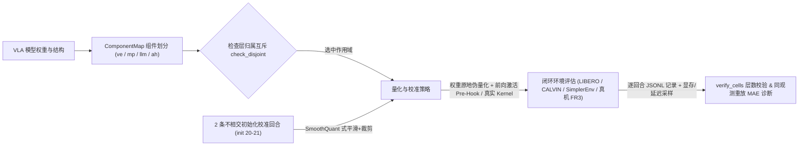
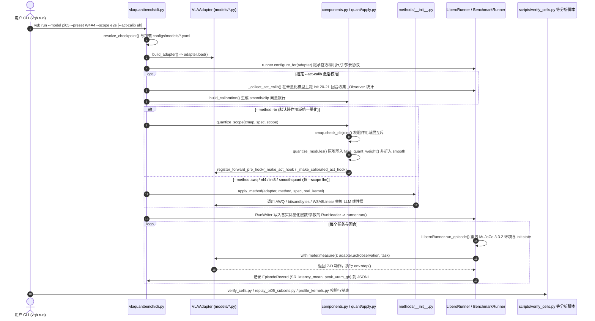

# VLAQuantBench: Closed-Loop Evaluation of Post-Training Quantization for Vision-Language-Action Models

## 一句话定义

**VLAQuantBench** 是一个针对 [VLA（Vision-Language-Action）](../methods/vla.md) 训练后量化（PTQ）的标准化闭环评测框架与实证研究（arXiv:2609.25376），通过跨 7 个模型与 4 个仿真套件的 **94,574 条闭环仿真回合**（开源库共 105,868 条）及 **1,200 条 Franka Research 3 真机回合**，拆解了组件作用域、单层敏感性、非单调误差耦合、激活校准与真实算子延迟对机器人任务成功率的决定性影响。

## 英文缩写速查

| 缩写 | 英文全称 | 简要说明 |
| --- | --- | --- |
| PTQ | Post-Training Quantization | 训练后量化；在无需重训全量参数的前提下压缩权重/激活位宽 |
| RTN | Round-to-Nearest | 最近邻均匀取整；VLAQuantBench 用统一 RTN 配方控制不同组件与位宽的可比性 |
| VE / MP / LLM / AH | Vision Encoder / Multimodal Projector / Large Language Model / Action Head | VLA 的四类可解耦量化作用域（视觉编码器、多模态投影层、语言骨干、动作头） |
| E2E | End-to-End | 端到端联合量化；同时对 VLA 内所有组件应用给定量化规格 |
| SR / CI | Success Rate / Confidence Interval | 任务闭环成功率与 95% Wilson 置信区间 |
| MAE | Mean Absolute Error | 动作误差均值；本文用于同观测重放（matched-observation replay）中诊断动作漂移 |

## 为什么重要

在真实机器人[操作（Manipulation）](../tasks/manipulation.md)任务中，策略与环境通过状态反馈闭环耦合：传统大语言模型 PTQ 常用的静态困惑度（PPL）、逐层权重均方误差或离线数据集上的单步动作均方根误差，**不能线性外推到多步[动作分块（Action Chunking）](../methods/action-chunking.md)闭环成功率**。同时，现有 VLA 量化研究常将量化格式（RTN/AWQ/SmoothQuant）、量化组件作用域（仅 LLM vs 全链路）、甚至是否排除 `lm_head` 与激活 hook 混淆在一起，导致同一量化位宽在不同论文中结论相反。VLAQuantBench 首次在同一控制实验框架下把这些混杂变量拆开，为 VLA 边缘端部署确立了从组件敏感性排查、校准风险验证到真实内核测速的工程验收范式。

## 核心原理

VLAQuantBench 将模型抽象为互斥的组件树（`ComponentMap`：`ve`、`mp`、`llm`、`ah`），通过统一的 RTN 伪量化基准控制位宽（`W2/W3/W4/W8` 与激活 `A4/A6/A8`），并在四项机制上突破了以往静态评估的盲区：

1. **作用域互斥与单层瓶颈分离（Component & Layer Isolation）：**
   通过独立量化各组件再组合为 `llm+ah` 或 `e2e`，定位究竟是感知编码器、语言骨干还是高频动作生成头引发崩溃；进一步支持 `--only` / `--exclude` 对动作头内具体子模块（如 `attention`、`adaRMS`、`down_proj` 或末层 `action_out_proj` / `fc2`）做精准消融。
2. **动作头内部的非单调误差相消（Non-Monotone Submodule Interaction）：**
   作者通过 20 条保留轨迹（219 次重规划、固定随机种子与初始观测序列）的同观测同噪声重放实验发现，模块误差在闭环动作头中**不满足线性可加性**：部分敏感投影层的量化偏差在特定联合配置下会相互放大（残差比例高达 `0.82`），而纳入前端条件/输入投影后却能形成部分抵消，使执行动作 MAE 与闭环成功率不降反升。
3. **跨模型分化的闭环平滑与裁剪校准（Closed-Loop Smooth+Clip Calibration）：**
   直接对闭环 rollout 中采集的激活通道最大值与高分位数做平滑因子折叠（$\alpha=0.5/0.75$）和范围裁剪，能显著抑制异常通道峰值；但实验证明平滑并非通用解——它对异常值集中且残差流稳定的扩散/流匹配动作头极为有效，却可能破坏未做等价归一化的权重分布平衡。
4. **“伪量化省显存”与“真实 Kernel 延迟”解耦：**
   `fake_quant` 仅模拟数值舍入而不改变矩阵存储类型和计算路径；论文将 `AWQ`、`bitsandbytes NF4`、`LLM.int8()` 与 `SmoothQuant W8A8` 接入真实底层 kernel（bs=1）后发现，低位宽带来的字节数压缩在单批实时机器人推理中常被在线反量化（dequantization）、激活重排或离群值拆分同步开销抵消。

## 评测与对比

### 1. 跨模型与组件精度下限（Table 1 & Table 27–28，LIBERO，200 ep/suite；X-VLA 190 ep）

| 模型 | 套件基线 SR (%) | E2E `W4` (Spatial/Obj/Goal/Long) | E2E `W3` (Spatial/Obj/Goal/Long) | E2E `W4A8` | E2E `W8A8` | E2E `W4A4` | 核心敏感域（5 pp 容忍下限） |
| --- | --- | --- | --- | --- | --- | --- | --- |
| **$\pi_{0.5}$** | `99.0 / 99.0 / 96.5 / 94.0` | `97.5 / 99.0 / 95.5 / 95.0` | `99.0 / 99.0 / 96.0 / 93.5` | `99.0 / 97.5 / 96.5 / 94.5` | `98.5 / 98.5 / 97.0 / 93.5` | `0.0 / 1.0 / 1.5 / 0.0` | 整体鲁棒；仅 `A4` 需校准 |
| **$\pi_0$** | `76.5 / 80.5 / 72.5 / 54.0` | `75.5 / 77.5 / 72.5 / 55.0` | `69.5 / 75.0 / 61.5 / 37.5` | `69.5 / 75.5 / 67.5 / 47.0` | `64.0 / 78.5 / 70.5 / 55.5` | `0.0 / 0.0 / 0.0 / 0.0` | 视觉 `A4`、LLM/AH `A8` |
| **OpenVLA-OFT** | `100.0 / 97.5 / 96.0 / 92.5` | `98.5 / 98.0 / 95.5 / 86.0` | `94.5 / 88.5 / 88.0 / 8.0` | `3.5 / 2.0 / 2.0 / 3.0` | `2.0 / 1.0 / 13.0 / 3.5` | `0.0 / 0.0 / 0.0 / 0.0` | 极度受限：动作头输出层 **`fc2`** 拒绝任何 `A8/W3` 量化 |
| **X-VLA** | `95.8 / 98.4 / 97.4 / 92.6` | `95.3 / 98.4 / 95.3 / 92.1` | `94.2 / 97.9 / 94.2 / 86.8` | `92.6 / 98.4 / 95.8 / 88.4` | `94.2 / 97.9 / 97.4 / 92.1` | `0.0 / 0.0 / 0.0 / 0.0` | 动作头必须保留全精度激活（`W4A8` 仅掉点） |

- **单层精准保护效应（Table 4–5）：** `OpenVLA-OFT` 共 442 个线性层中，仅排除动作头末层 `fc2`（28,672 参数）保留全精度，即可将 `W3` Long 从 `8.0%` 挽救回 `92.0%`（3 种子 `93.5 / 91.5 / 91.0%`），同时将 `W4A8` 与 `W8A8` 四套件分别恢复到 `94.0–98.0%` 与 `93.5–99.0%`。
- **$\pi_{0.5}$ 动作头 `W4A4` 非单调交互（Table 3, 29–34）：** LIBERO-Spatial 上，仅量化 `attention`（72 层）得 `98.0%`、仅量化 `adaRMS`（36 层）得 `93.5%`；二者联合（108 层）断崖暴跌至 `1.5%`，追加 `down_proj`（126 层）仅 `7.0%`；然而将全动作头 167 层全部量化反而回升至 `70.5%`（经排查主要来自追加的 5 个输入/条件/输出线性层使 131 层组跳升至 `84.5%`）。219 个 chunk 的同观测重放证明全头 167 层的归一化 chunk MAE（`0.390`）在 **99.1%** 的样本上优于 126 层的 `0.514`。
- **校准效果分化（Table 6–7）：** 2 条 episode 激活校准令 $\pi_{0.5}$ `ah` `W4A4` 从 `70.5%` 升至 `98.5%`、`108` 层联合从 `1.5%` 升至 `97.5%`、`e2e`（$\alpha=0.75$）达 `91.5%`；**同一配方在 $\pi_0$ 上却全线崩坏**（`e2e` 从 `61.0%` 暴跌至 `10.5%`，`llm` 从 `72.0%` 跌至 `11.0%`），而 `OpenVLA-OFT` 仅部分恢复（`llm` `33.0%`、`ah` `38.5%`、`e2e` `9.5%`）。
- **跨域基准补充（Table 8–9）：** 在 CALVIN ABC$\to$D 上，$\pi_{0.5}$ 从 `BF16`（平均完成子任务 `3.79`）在 `W4`（`3.76`）与 `W4A8`（`3.71`）保持稳健，而 `W3` 退化至 `2.70`、`W4A4` 归 `0.00`；在 SimplerEnv WidowX 上，`CogACT` 基线 `50.0%` 在 `W4` 降至 `45.8%`、`W3` 降至 `20.8%`。

### 2. 真实 Kernel 显存与延迟 vs. 真机表现（Table 10 & Table 11）

| 评估维度 | 配置（模型 / 硬件 / 场景） | 基线 (`BF16`) | 量化方案表现 | 核心结论 |
| --- | --- | --- | --- | --- |
| **真实 GPU 显存与延迟（Table 10, bs=1）** | OpenVLA-OFT LLM @ RTX 4090 | `15.0 GiB` · 控制 `18.8 ms` · 推理 `139.9 ms` | `AWQ`: `6.1 GiB` (`20.2 / 152.6 ms`) `bnb NF4`: `6.3 GiB` (`22.6 / 172.8 ms`) `SmoothQuant`: `9.0 GiB` (`26.9 / 212.1 ms`) `LLM.int8()`: `9.0 GiB` (`48.3 / 379.5 ms`) | **显存压缩 $\neq$ 推理加速**：bs=1 控制环路上四类真实 kernel 均比 BF16 更慢 |
| **Franka Research 3 真机测试（Table 11, 1,200 轮）** | $\pi_{0.5}$ & OFT LoRA (Pick / P&P, 50 ep) | $\pi_{0.5}$: `64% / 58%` OFT: `68% / 44%` | `W8` 与 `W8A8` 均在基线 `6 pp` 内；`W3` Pick 崩塌至 `12%`（$\pi_{0.5}$）与 `10%`（OFT）；`W4A8` 相对 `W4` 再降 `18–40 pp` | 真机对极限低比特与激活压缩的敏感度比 LIBERO 更高 |

## 工程实践

1. **优先保护末端线性映射（如 `fc2` / `action_out_proj`）而非盲目放弃低比特：** 对仅数万参数的输出层保留 `BF16`，可让其余 99% 参数（甚至整个动作头 + LLM）以接近无损状态运行在 `W3/W4A8/W8A8`。
2. **禁止仅用 LLM 校准惯例或单模型规律外推 VLA 动作头：** 部署激活校准（`--act-calib`）必须在目标模型与目标作用域上直接做闭环回归测试，防止在像 $\pi_0$ 这样缺乏兼容性特征分布的模型上越校准越差。
3. **区分“模拟省位宽”与“真实低延迟部署”：** 边缘端显存充足时，在 `RTX 4090`、`bs=1` 场景中直接保留 `BF16` 往往比 `AWQ`/`NF4`/`LLM.int8()` 拥有更低控制延迟；仅在明确触发显存上限或使用经过针对 `M=1` GEMV 优化的定制 kernel 后再切换真量化算子。
4. **严格锁定仿真环境、Chunk 执行长度与 Hook 覆盖率：** LIBERO 评测必须固定 `mujoco==3.3.2`（`>=3.4.0` 会改变物体碰撞结算并暗扣 3–9 pp）；同时核对 `NUM_ACTIONS_CHUNK` 与重规划间隔，并使用 `scripts/verify_cells.py` 对实际被挂接激活 hook 的层数与声明作用域执行自动一致性校验。

## 局限与风险

1. **伪量化与真实加速算子覆盖不对称：** 全链路（含视觉编码器、投影层与动作头）消融采用原地伪量化以精确分离数值误差；真机与真实 kernel 测试目前主要集中在 `OpenVLA-OFT` 与 $\pi_{0.5}$ 的 LLM 骨干与 `bs=1` 桌面 GPU，尚未覆盖 TensorRT-LLM / 嵌入式 Orin 端上的定制 INT4 融合算子。
2. **多任务汇总未揭示每任务最坏退化：** 论文中的 `10-pp / 5-pp` 精度底线主要基于套件点估计均值与单调聚合（App. J），部分靠近边界的配置仍存在特定长程任务退化的风险，上线前需按逐任务置信区间复检。
3. **非单调相互作用机制仍偏向经验表征：** 同观测重放（App. L）虽然在数字层面验证了 `167` 层全头量化相比 `126` 层子集降低了动作误差（绝对值峰度由 `315.0` 压至 `170.9` 等），但跨层的精确解析补偿机理仍未完全理论化，无法在未知新架构上零测试预测“哪组子模块会互相抵消”。

## 结论

**在闭环机器人控制中，VLA 的量化耐受度由具体作用域耦合、关键小层异常值以及真实算子执行路径共同决定，静态逐层指标与假定“越少层量化越安全”的直觉均会在多步反馈下失效。**

- **默认基线策略：** 通用场景优先评估 `W4`/`W8` 仅权重量化与 `W4A8`，并在发现崩溃时优先对仅占极少参数的动作输出层（如 `fc2`）开启全精度白名单保护。
- **警惕非单调组件交互：** 若对流匹配/扩散动作头做子模块混合精度切分，必须做全组合闭环回归或基于相同初始化观测做重放（`replay_pi05_subsets.py`），避免切入类似 `attention + adaRMS` 的相长干涉死区。
- **校准因模型而异：** 平滑+裁剪激活校准在 $\pi_{0.5}$ 上能把 `W4A4` 动作头从 `70.5%` 拉回 `98.5%`，但会摧毁 $\pi_0$ 的全部性能（`61% -> 10.5%`），严禁跨模型直接沿用校准超参。
- **用真机与真实 Kernel 验收部署：** 伪量化测精度、真算子测时延（RTX 4090 `bs=1` 下 `AWQ/NF4/LLM.int8()` 显存减半但延迟全线变慢），最终应与物理机器人 rollouts 一并作为上线门禁。
- **守住评测工程底线：** 复现与基准对比时固定 `mujoco==3.3.2`、显式记录并校验 `chunk` 预测/执行长度，并自动核查激活前向 hook 是否真正落在了目标线性层上。

## 源码运行时序图

以下时序严格对齐官方仓库 `jiuyixu25/VLAQuantBench`（MIT License）实际代码入口 `vqb run`（`vlaquantbench/cli.py`）与各核心模块（`vlaquantbench/components.py`、`vlaquantbench/quant/apply.py`、`vlaquantbench/methods/__init__.py`、`vlaquantbench/benchmarks/libero.py`）：

## 关联页面

- [Vision-Language-Action (VLA)](../methods/vla.md) — 本基准所评测的通用视觉-语言-动作端到端策略范式
- [Action Chunking](../methods/action-chunking.md) — 解释为何执行步长（如 50 vs 10 步重规划）与块内噪声重放对量化误差极度敏感
- [Manipulation](../tasks/manipulation.md) — 本基准仿真套件（LIBERO / CALVIN / SimplerEnv）与 Franka Research 3 真机验证聚焦的操作任务域
- [仿真评测基础设施](../concepts/simulation-evaluation-infrastructure.md) — 探讨物理版本锁定（如 `mujoco==3.3.2`）、协议一致性与闭环可复现性
- [VLA-JEPA](./paper-sa-2602-10098-vla-jepa-enhancing-vision-language-action-model.md) — 同期从潜在表征预训练角度探讨 VLA 鲁棒性与控制表达的研究节点
- [具身智能 2026-10-18 26 篇技术图谱](../overview/embodied-station-2026-10-18-26-papers-technology-map.md) — 本页面最初收录时的主题总览
- [具身大模型评测基准选型闭环](../queries/embodied-eval-benchmark-selection-loop.md) — 可作为该闭环第 ③ 层策略闭环可靠性与推理开销联合验收的参考基准

## 参考来源

- [VLAQuantBench 论文来源归档](../../sources/papers/vlaquantbench_arxiv_2609_25376.md)（arXiv:2609.25376v1 全文与附录核查）
- [VLAQuantBench 官方仓库归档](../../sources/repos/vlaquantbench.md)（`jiuyixu25/VLAQuantBench` MIT 开源实现与 417 cells 结果存档）
- [公众号 26 篇论文速览归档](../../sources/blogs/wechat_embodied_station_26_papers_embodiedswe_2026-10-18.md)（早期线索来源）

## 推荐继续阅读

- [arXiv 论文原文 (2609.25376)](https://arxiv.org/abs/2609.25376) / [PDF 全文](https://arxiv.org/pdf/2609.25376)
- [官方开源仓库 jiuyixu25/VLAQuantBench](https://github.com/jiuyixu25/VLAQuantBench)
