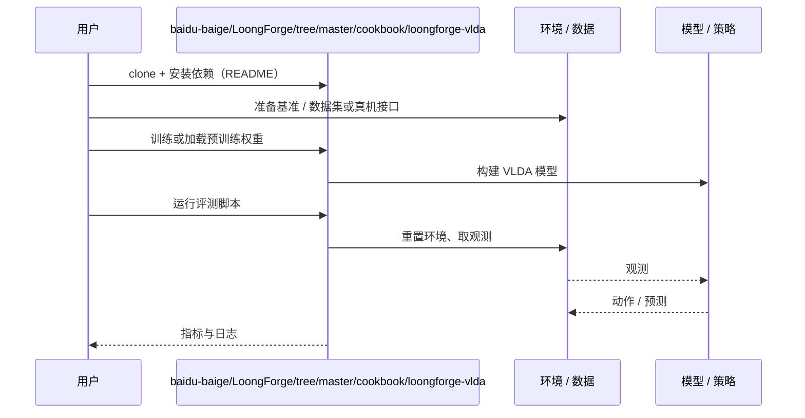

# VLDA（arXiv:2610.25874）

**VLDA**（*Vision-Language-Delta-Action: Learning Compact Deltas as Actionable Transition Interfaces for Robotic Manipulation*，[arXiv:2610.25874](https://arxiv.org/abs/2610.25874)，[项目页](https://baidu-baige.github.io/LoongForge/projects/vlda.html)，[代码](https://github.com/baidu-baige/LoongForge/tree/master/cookbook/loongforge-vlda)）来自 [具身智能小站 2026-10-31 盘点](../../sources/blogs/wechat_embodied_station_50_papers_scenerig_photo_to_sim_2026-10-31.md)，属「策略学习与 VLA」组。

## 一句话定义

**VLDA以紧凑Delta表示任务相关变化，结合局部过滤、全局锚定与动作去噪；多仿真基准和双臂真机测试支持这条路线，减少完整未来预测的负担。**

## 英文缩写速查

| 缩写 | 英文全称 | 简要说明 |
|------|----------|----------|
| VLDA | Vision-Language-Delta-Action: Learning Compact Deltas as Actionable Transition Interfaces for Robotic Manipulation | 本文方法 / 基准的简称 |

## 为什么重要

- 预测真正影响动作的状态变化。
- 开源结论：**已开源**（步骤 2.5，2026-10-31）。仓库可达（git ls-remote）。项目页 HTTP 200。
- 同期同组工作见 [单图重建仿真、VLA 适配评测与跨形态世界模型：具身智能小站 10-31 期 50 篇阅读坐标](../overview/embodied-station-2026-10-31-50-papers-technology-map.md)。

## 核心机制

| 项 | 内容 |
|----|------|
| **arXiv** | [2610.25874](https://arxiv.org/abs/2610.25874) |
| **开源** | **已开源** |
| **要点** | VLDA以紧凑Delta表示任务相关变化，结合局部过滤、全局锚定与动作去噪；多仿真基准和双臂真机测试支持这条路线，减少完整未来预测的负担。 |
| **文内指标** | 公众号未给具体数字，本页不引用。 |

## 源码运行时序图

以下为按仓库入口（`baidu-baige/LoongForge/tree/master/cookbook/loongforge-vlda`）推断的通用运行链路；入库日仅核实仓库可达，未逐文件阅读，具体脚本名以 README 为准。

## 实验与评测

- 公众号未给具体数字，本页不引用。
- **读法：** 本页为索引级摘要，依据公众号转述的官方摘要与仓库信息整理；逐项数字与 baseline 以原文 PDF 为准。

## 与其他工作对比

- 横向索引见 [单图重建仿真、VLA 适配评测与跨形态世界模型：具身智能小站 10-31 期 50 篇阅读坐标](../overview/embodied-station-2026-10-31-50-papers-technology-map.md)；同 arXiv 不重复造页。

## 结论

**预测真正影响动作的状态变化：VLDA以紧凑Delta表示任务相关变化，结合局部过滤、全局锚定与动作去噪；多仿真基准和双臂真机测试支持这条路线，减少完整未来预测的负担。**

1. 开源边界：**已开源** — 仓库可达（git ls-remote）。项目页 HTTP 200。
2. 核心机制：VLDA以紧凑Delta表示任务相关变化，结合局部过滤、全局锚定与动作去噪；多仿真基准和双臂真机测试支持这条路线，减少完整未来预测的负担。
3. 复现与选型前核对任务协议、硬件与基准口径，勿直接横比公众号摘录数字。

## 关联页面

- [vla](../methods/vla.md)
- [imitation-learning](../methods/imitation-learning.md)
- [reinforcement-learning](../methods/reinforcement-learning.md)
- [embodied-station-2026-10-31-50-papers-technology-map](../overview/embodied-station-2026-10-31-50-papers-technology-map.md)

## 参考来源

- [vlda_arxiv_2610_25874.md](../../sources/papers/vlda_arxiv_2610_25874.md)
- [wechat_embodied_station_50_papers_scenerig_photo_to_sim_2026-10-31.md](../../sources/blogs/wechat_embodied_station_50_papers_scenerig_photo_to_sim_2026-10-31.md)
- [arXiv:2610.25874](https://arxiv.org/abs/2610.25874)

## 推荐继续阅读

- [arXiv PDF](https://arxiv.org/pdf/2610.25874)
- [项目页](https://baidu-baige.github.io/LoongForge/projects/vlda.html)
- [https://github.com/baidu-baige/LoongForge/tree/master/cookbook/loongforge-vlda](https://github.com/baidu-baige/LoongForge/tree/master/cookbook/loongforge-vlda)
