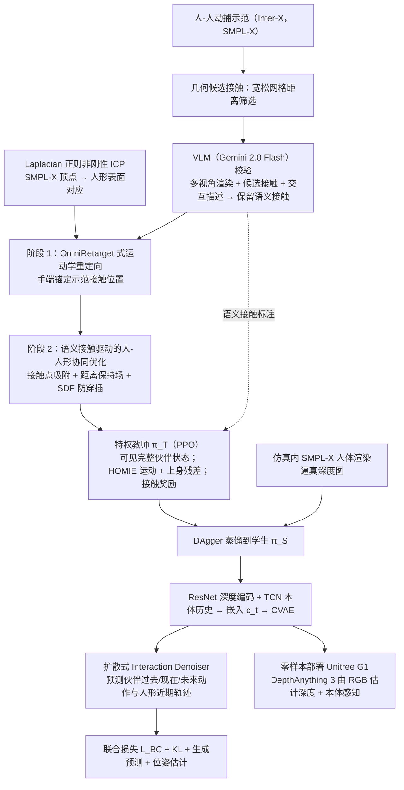

# 面向人形—人交互的 VLM 引导接触重定向与生成式伙伴建模

**VLM 接触重定向**（*VLM-Guided Contact Retargeting and Generative Partner Modeling for Humanoid-Human Interaction*，[arXiv:2610.28523](https://arxiv.org/abs/2610.28523)）收录于 senlanke「具身运控lab」10-19–10-23 前沿论文动态（人形/四足）。本页依据**周报条目 + arXiv 摘要页**整理，未逐页核对正文 PDF；指标与结论以论文为准。

## 一句话定义

**面向人形—人交互的 VLM 引导接触重定向与生成式伙伴建模——先由 VLM 识别语义接触并进行接触保持重定向，再将可访问伙伴真值的特权教师蒸馏为仅使用机载深度的学生；通过生成式伙伴状态预测处理视野外和遮挡人体。**

## 英文缩写速查

| 缩写 | 英文全称 | 简要说明 |
|------|----------|----------|
| RL | Reinforcement Learning | 强化学习 |
| WBC | Whole-Body Control | 全身控制 |

## 为什么重要

- 周报所述待解决的问题：近距离人机接触会造成严重遮挡，使人体姿态估计失效；人类示范数据本身也可能因互相遮挡而产生错误。

## 流程总览

图依据：论文 §3.1、§3.2.1–3.2.2 / Fig.2、§4.4 真机部署。

## 核心机制

| 项 | 内容 |
|----|------|
| **arXiv** | [2610.28523](https://arxiv.org/abs/2610.28523) · [PDF](https://arxiv.org/pdf/2610.28523) |
| **作者（arXiv）** | Yuto Shibata, Kotaro Amaya, Kashu Yamazaki, Lalit Jayanti, Yoshimitsu Aoki, Mariko Isogawa, Katerina Fragkiadaki |
| **机构（周报所述，未逐条核实）** | 卡内基梅隆大学、庆应义塾大学、Keio AI Research Center |
| **arXiv 评论栏** | CoRL2026, project page: this https URL |
| **开源** | arXiv 摘要页/评论给出项目页或外链（https://yutoshibata07.github.io/REACT/）；未发现代码仓库链接（2026-10-26） |
| **周报所述创新点** | 先由 VLM 识别语义接触并进行接触保持重定向，再将可访问伙伴真值的特权教师蒸馏为仅使用机载深度的学生；通过生成式伙伴状态预测处理视野外和遮挡人体。 |

### arXiv 摘要节选（英文原文）

> Humanoid-human interaction requires robots to operate under severe partial observability: during close physical contact, the human partner is occluded, truncated, or outside the robot's field of view, causing pose estimation to fail and often necessitating external tracking or privileged human state. At the same time, heavy mutual occlusions introduce errors into the human-human motion-capture data used for learning.

## 源码运行时序图

**不适用**：arXiv 摘要页/评论给出项目页或外链（https://yutoshibata07.github.io/REACT/）；未发现代码仓库链接，无可对齐的官方代码流程。

## 实验与评测

- 周报与摘要给出的数字/场景已写入上表「创新点」与摘要节选；其余实验细节、基线与成功率定义请回到论文正文。
- 读法：先对齐任务设定、传感器与成功定义（仿真/真机），再解读 headline 数字，勿跨论文直接比较。

## 与其他工作对比

| 维度 | 读法 |
|------|------|
| **同周对照** | 见 [人形/四足周报技术地图](../overview/senlanke-weekly-2026-10-19-23-humanoid-quadruped-technology-map.md)，按方向浏览同期论文 |
| **开源状态** | arXiv 摘要页/评论给出项目页或外链（https://yutoshibata07.github.io/REACT/）；未发现代码仓库链接 |

## 结论

**面向人形—人交互的 VLM 引导接触重定向与生成式伙伴建模。**

1. 本页是入库级摘要，复现前请核对论文正文、附录与代码仓库。
2. 指标须连同实验条件解读。
3. 关注 arXiv 版本更新与代码发布。

## 关联页面

- [senlanke-weekly-2026-10-19-23-humanoid-quadruped-technology-map](../overview/senlanke-weekly-2026-10-19-23-humanoid-quadruped-technology-map.md)
- [humanoid-locomotion](../tasks/humanoid-locomotion.md)
- [reinforcement-learning](../methods/reinforcement-learning.md)

## 参考来源

- [vlm-contact-retargeting-partner-modeling_arxiv_2610_28523.md](../../sources/papers/vlm-contact-retargeting-partner-modeling_arxiv_2610_28523.md)
- [wechat_senlanke_weekly_humanoid_quadruped_2026-10-19_23.md](../../sources/blogs/wechat_senlanke_weekly_humanoid_quadruped_2026-10-19_23.md)
- [arXiv:2610.28523](https://arxiv.org/abs/2610.28523)
- [arXiv PDF](https://arxiv.org/pdf/2610.28523)：已通读全文：语义接触建模与重定向（§3.1）、教师与学生（§3.2）、真机部署（§4.4）

## 推荐继续阅读

- [arXiv PDF](https://arxiv.org/pdf/2610.28523)
