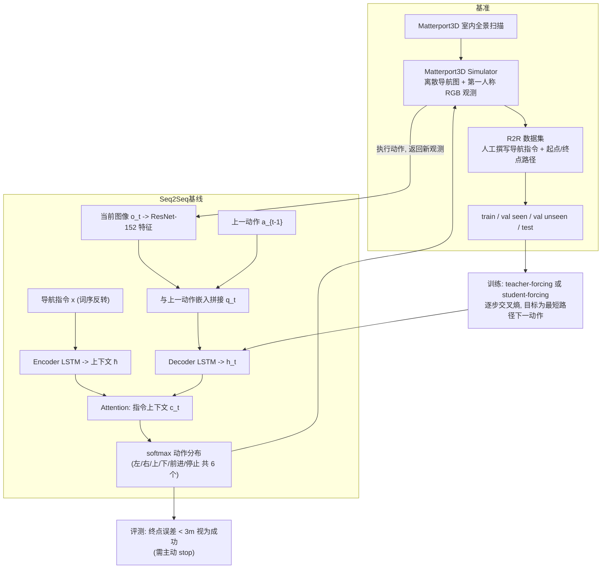

---

type: entity
tags: [paper, vln, vln-survey, navigation, embodied-ai, anu, adelaide]
status: complete
updated: 2026-09-15
arxiv: "1711.07280"
summary: "提出 R2R 数据集、Matterport3D 导航图仿真与 VLN 评测基准，将任务形式化为「全景序列 + 语言指令 → 逐步动作」。"
related:
  - ../overview/vln-10-papers-technology-map.md
  - ../overview/vln-category-01-datasets-platforms.md
  - ../tasks/vision-language-navigation.md
sources:
  - ../../sources/papers/vln_survey_01_r2r.md
  - ../../sources/blogs/wechat_shenlan_vln_10_papers_survey.md
  - ../../sources/papers/vln_10_papers_catalog.md
---

# R2R

**R2R** 收录于 [深蓝具身智能 · VLN 10 项代表性研究](https://mp.weixin.qq.com/s/2_dYaN6IeWn_vvS_jmGqRQ) **第 01/10** 篇，归类为 **01 数据集与仿真平台**。

## 一句话定义

提出 R2R 数据集、Matterport3D 导航图仿真与 VLN 评测基准，将任务形式化为「全景序列 + 语言指令 → 逐步动作」。

## 英文缩写速查

| 缩写 | 英文全称 | 简要说明 |
|------|----------|----------|
| VLN | Vision-and-Language Navigation | 依据自然语言指令在环境中导航的具身任务 |
| R2R | Room-to-Room | Matterport3D 上经典逐步导航指令数据集 |
| VLM | Vision-Language Model | 视觉-语言多模态大模型，NaVid 等路线的骨干 |

## 为什么重要

- VLN 领域奠基工作：离散导航图 + Seq2Seq 基线，成为后续几乎所有 benchmark 的基础设施。
- 提出 R2R 数据集、Matterport3D 导航图仿真与 VLN 评测基准，将任务形式化为「全景序列 + 语言指令 → 逐步动作」。

## 流程总览

图依据：论文 §3 Matterport3D Simulator / §4 R2R 数据集与评测 / §5.1–5.2 Sequence-to-Sequence 模型与训练

## 核心信息

| 字段 | 内容 |
|------|------|
| 编号 | 01/10 |
| 分组 | 01 数据集与仿真平台 |
| 出处 | CVPR 2018 · arXiv:1711.07280 |
| 机构 | 澳大利亚国立大学、阿德莱德大学等 |

## 核心机制（归纳）

### 1）策展导读要点

**任务形式：** 提出 R2R 数据集、Matterport3D 导航图仿真与 VLN 评测基准，将任务形式化为「全景序列 + 语言指令 → 逐步动作」。

### 2）策展导读要点

**机构/出处：** 澳大利亚国立大学、阿德莱德大学等 · CVPR 2018

### 3）策展导读要点

**在 VLN 地图中的位置：** 01 数据集与仿真平台（#01/10）。

## 结论

**R2R 的价值在于把 VLN 从一个模糊愿景变成可评测的任务：数据集、Matterport3D 导航图仿真与评测基准三件套一起给出，后续 benchmark 大多长在这套基础设施上。**

- 真正被继承下来的不是它的 Seq2Seq 基线，而是 **任务形式化**——「全景序列 + 语言指令 → 逐步动作」与配套的离散导航图。
- 边界要记住：它是 **离散图** 设定，与连续环境 VLN-CE 不可直接混比，benchmark 数字提升也不等于真机可部署。
- 本页是 VLN 10 篇策展的 **清单索引** 条目（#01/10，01 数据集与仿真平台），量化指标以原文 PDF 为准。

## 常见误区

1. VLN benchmark 提升不等于真机部署；连续环境 (VLN-CE) 与离散图设定不可直接混比。

## 实验与评测

- 本页在公众号/survey **策展编译**基础上补充机制归纳；**量化 benchmark、消融与实机指标以原文 PDF / 项目页为准**（链接见 [参考来源](#参考来源)）。
- 与同栈姊妹篇对照时，请回到对应 **技术地图 / 42 篇栈 / BFM 地图 / VLN 地图** 总览中的实验段落。

## 与其他页面的关系

- 技术地图：[vln-10-papers-technology-map.md](../overview/vln-10-papers-technology-map.md)
- 分类 hub：[vln-category-01-datasets-platforms.md](../overview/vln-category-01-datasets-platforms.md)
- 任务页：[vision-language-navigation.md](../tasks/vision-language-navigation.md)
- 原始 source：[vln_survey_01_r2r.md](../../sources/papers/vln_survey_01_r2r.md)

## 参考来源

- [vln_survey_01_r2r.md](../../sources/papers/vln_survey_01_r2r.md) — VLN 10 篇策展摘录
- [vln_10_papers_catalog.md](../../sources/papers/vln_10_papers_catalog.md)
- [wechat_shenlan_vln_10_papers_survey.md](../../sources/blogs/wechat_shenlan_vln_10_papers_survey.md)
- 论文：<https://arxiv.org/abs/1711.07280>
- [arXiv PDF](https://arxiv.org/pdf/1711.07280)：已通读方法部分（实验与附录以略读为准）：§3 模拟器、§4 R2R 数据集与评测协议、§5.1–5.2 Seq2Seq 基线与训练；§5.3 之后的实验结果略读

## 推荐继续阅读

- [VLN 10 篇技术地图](../overview/vln-10-papers-technology-map.md)
- [视觉–语言导航（VLN）](../tasks/vision-language-navigation.md)
