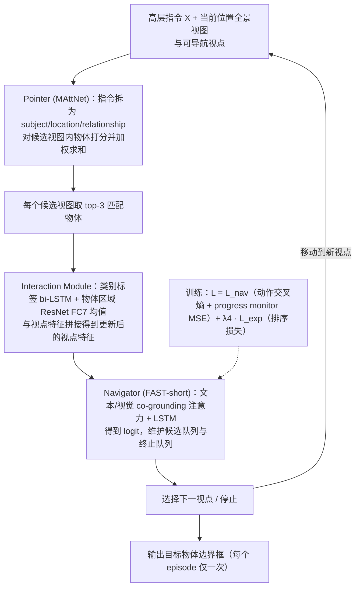

---

type: entity
tags: [paper, vln, vln-survey, navigation, embodied-ai, adelaide, georgia-tech]
status: complete
updated: 2026-09-15
arxiv: "1904.10151"
summary: "高层指令（目标物体 + 大致位置）下的远程导航与目标定位；结合路径标注与物体边界框。"
related:
  - ../overview/vln-10-papers-technology-map.md
  - ../overview/vln-category-01-datasets-platforms.md
  - ../tasks/vision-language-navigation.md
  - ../entities/paper-realm-last-3-meter-vln-grounding.md
sources:
  - ../../sources/papers/vln_survey_03_reverie.md
  - ../../sources/blogs/wechat_shenlan_vln_10_papers_survey.md
  - ../../sources/papers/vln_10_papers_catalog.md
  - ../../sources/papers/realm_last_3_meter_vln_arxiv_2607_03792.md
---

# REVERIE

**REVERIE** 收录于 [深蓝具身智能 · VLN 10 项代表性研究](https://mp.weixin.qq.com/s/2_dYaN6IeWn_vvS_jmGqRQ) **第 03/10** 篇，归类为 **01 数据集与仿真平台**。

## 一句话定义

高层指令（目标物体 + 大致位置）下的远程导航与目标定位；结合路径标注与物体边界框。

## 英文缩写速查

| 缩写 | 英文全称 | 简要说明 |
|------|----------|----------|
| VLN | Vision-and-Language Navigation | 依据自然语言指令在环境中导航的具身任务 |
| R2R | Room-to-Room | Matterport3D 上经典逐步导航指令数据集 |
| VLM | Vision-Language Model | 视觉-语言多模态大模型，NaVid 等路线的骨干 |

## 为什么重要

- 把 VLN 从「逐步指路」推进到「找到并指认目标」，与视觉 referring 任务深度耦合。
- 高层指令（目标物体 + 大致位置）下的远程导航与目标定位；结合路径标注与物体边界框。

## 流程总览

图依据：论文 §3.1 REVERIE 任务、§4 Interactive Navigator-Pointer Model（Fig. 5、§4.1–4.4）；“输出边界框”一步的衔接为按任务定义的简化画法。

## 核心信息

| 字段 | 内容 |
|------|------|
| 编号 | 03/10 |
| 分组 | 01 数据集与仿真平台 |
| 出处 | CVPR 2020 · arXiv:1904.10151 |
| 机构 | Yuankai Qi, Qi Wu, Peter Anderson, Xin Wang 等 |

## 核心机制（归纳）

### 1）策展导读要点

**任务形式：** 高层指令（目标物体 + 大致位置）下的远程导航与目标定位；结合路径标注与物体边界框。

### 2）策展导读要点

**机构/出处：** Yuankai Qi, Qi Wu, Peter Anderson, Xin Wang 等 · CVPR 2020

### 3）策展导读要点

**在 VLN 地图中的位置：** 01 数据集与仿真平台（#03/10）。

## 结论

**REVERIE 把 VLN 的成功判据从「按步走对路」改成「找到并指认目标」，代价是此后的评测必须区分「到达区域」与「看清实例」。**

- 任务形式的关键是高层指令（目标物体 + 大致位置）配上 **路径标注 + 物体边界框**，把远程导航与视觉 referring 深度耦合。
- 本页定位是 **01 数据集与仿真平台**（#03/10），影响力体现在后续方法与指标围绕它演化，而非某个模型分数。
- 最需警惕的评测陷阱：[REALM](../entities/paper-realm-last-3-meter-vln-grounding.md) 表明 REVERIE-CE 的 3 m SR 高不等于看清目标实例，多数高 SR 轨迹在 ONS@0.1m / OracleGS 下仍失败，REVERIE-AIM 为此补上实例中心终点与末段训练样本。
- 离散图设定与连续环境（VLN-CE）不可直接混比，benchmark 提升也不等于真机部署。

## 常见误区

1. VLN benchmark 提升不等于真机部署；连续环境 (VLN-CE) 与离散图设定不可直接混比。
2. **REVERIE-CE 的 3 m SR 不等于看清目标实例：** [REALM](../entities/paper-realm-last-3-meter-vln-grounding.md) 表明多数高 SR 轨迹在 **ONS@0.1m / OracleGS** 下仍失败；评测应区分 **区域 waypoint 到达** 与 **实例可见接地**（REVERIE-AIM 数据集为此提供实例中心终点与末段训练样本）。

## 实验与评测

- 本页在公众号/survey **策展编译**基础上补充机制归纳；**量化 benchmark、消融与实机指标以原文 PDF / 项目页为准**（链接见 [参考来源](#参考来源)）。
- 与同栈姊妹篇对照时，请回到对应 **技术地图 / 42 篇栈 / BFM 地图 / VLN 地图** 总览中的实验段落。

## 与其他页面的关系

- 技术地图：[vln-10-papers-technology-map.md](../overview/vln-10-papers-technology-map.md)
- 分类 hub：[vln-category-01-datasets-platforms.md](../overview/vln-category-01-datasets-platforms.md)
- 任务页：[vision-language-navigation.md](../tasks/vision-language-navigation.md)
- **末段接地延伸：** [REALM · Last-3-Meter VLN 实例接地](../entities/paper-realm-last-3-meter-vln-grounding.md) — REVERIE-AIM 与 ONS/GS/OracleGS 指标（arXiv:2607.03792）
- 原始 source：[vln_survey_03_reverie.md](../../sources/papers/vln_survey_03_reverie.md)

## 参考来源

- [vln_survey_03_reverie.md](../../sources/papers/vln_survey_03_reverie.md) — VLN 10 篇策展摘录
- [vln_10_papers_catalog.md](../../sources/papers/vln_10_papers_catalog.md)
- [wechat_shenlan_vln_10_papers_survey.md](../../sources/blogs/wechat_shenlan_vln_10_papers_survey.md)
- 论文：<https://arxiv.org/abs/1904.10151>
- [arXiv PDF](https://arxiv.org/pdf/1904.10151)：已通读方法部分（实验与附录以略读为准）：§3.1 任务定义、§3.4 数据采集、§4 Interactive Navigator-Pointer Model、§5.1 实现细节（§5.2 实验结果略读）

## 推荐继续阅读

- [VLN 10 篇技术地图](../overview/vln-10-papers-technology-map.md)
- [视觉–语言导航（VLN）](../tasks/vision-language-navigation.md)
