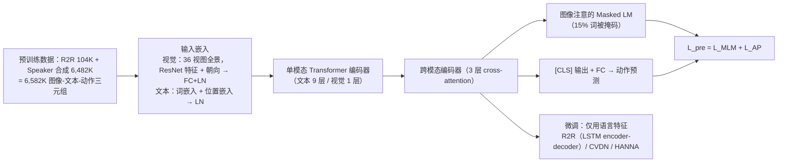

---

type: entity
tags: [paper, vln, vln-survey, navigation, embodied-ai, duke]
status: complete
updated: 2026-09-15
arxiv: "2002.10638"
summary: "首次在 VLN 引入预训练-微调：图像-文本-动作三元组上 Masked LM + 动作预测自监督，再下游微调。"
related:
  - ../overview/vln-10-papers-technology-map.md
  - ../overview/vln-category-02-algorithm-frameworks.md
  - ../tasks/vision-language-navigation.md
sources:
  - ../../sources/papers/vln_survey_04_prevalent.md
  - ../../sources/blogs/wechat_shenlan_vln_10_papers_survey.md
  - ../../sources/papers/vln_10_papers_catalog.md
---

# PREVALENT

**PREVALENT** 收录于 [深蓝具身智能 · VLN 10 项代表性研究](https://mp.weixin.qq.com/s/2_dYaN6IeWn_vvS_jmGqRQ) **第 04/10** 篇，归类为 **02 算法框架**。

## 一句话定义

首次在 VLN 引入预训练-微调：图像-文本-动作三元组上 Masked LM + 动作预测自监督，再下游微调。

## 英文缩写速查

| 缩写 | 英文全称 | 简要说明 |
|------|----------|----------|
| VLN | Vision-and-Language Navigation | 依据自然语言指令在环境中导航的具身任务 |
| R2R | Room-to-Room | Matterport3D 上经典逐步导航指令数据集 |
| VLM | Vision-Language Model | 视觉-语言多模态大模型，NaVid 等路线的骨干 |

## 为什么重要

- 开创 VLN 预训练范式，为 VLN↻BERT、HAMT 等后续工作奠定方法论基础。
- 首次在 VLN 引入预训练-微调：图像-文本-动作三元组上 Masked LM + 动作预测自监督，再下游微调。

## 流程总览

图依据：论文 §4 Pre-training Models（Fig. 3）、§5 Adapting to new tasks。

## 核心信息

| 字段 | 内容 |
|------|------|
| 编号 | 04/10 |
| 分组 | 02 算法框架 |
| 出处 | CVPR 2020 · arXiv:2002.10638 |
| 机构 | 杜克大学、微软研究院 |

## 核心机制（归纳）

### 1）策展导读要点

**任务形式：** 首次在 VLN 引入预训练-微调：图像-文本-动作三元组上 Masked LM + 动作预测自监督，再下游微调。

### 2）策展导读要点

**机构/出处：** 杜克大学、微软研究院 · CVPR 2020

### 3）策展导读要点

**在 VLN 地图中的位置：** 02 算法框架（#04/10）。

## 结论

**PREVALENT 的历史位置，是把「预训练-微调」这一范式第一次搬进 VLN：让指令、视觉与动作的对齐先在自监督阶段学好，下游任务只负责微调。**

- 真正起作用的机制是 **图像-文本-动作三元组上的 Masked LM + 动作预测自监督**——动作被纳入预训练目标本身，而不只是把图文对齐后再外挂一个策略头。
- 它的影响主要在方法论层面：VLN↻BERT、HAMT 等后续工作都建立在这条预训练路线上，因此本页在 VLN 地图中被归入 **02 算法框架** 而非某个具体 benchmark 的 SOTA。
- 本页为清单索引（CVPR 2020，杜克大学与微软研究院）：**量化 benchmark 与消融以原文为准**；且 VLN benchmark 提升不等于真机部署，连续环境（VLN-CE）与离散图设定不可直接混比。

## 常见误区

1. VLN benchmark 提升不等于真机部署；连续环境 (VLN-CE) 与离散图设定不可直接混比。

## 实验与评测

- 本页在公众号/survey **策展编译**基础上补充机制归纳；**量化 benchmark、消融与实机指标以原文 PDF / 项目页为准**（链接见 [参考来源](#参考来源)）。
- 与同栈姊妹篇对照时，请回到对应 **技术地图 / 42 篇栈 / BFM 地图 / VLN 地图** 总览中的实验段落。

## 与其他页面的关系

- 技术地图：[vln-10-papers-technology-map.md](../overview/vln-10-papers-technology-map.md)
- 分类 hub：[vln-category-02-algorithm-frameworks.md](../overview/vln-category-02-algorithm-frameworks.md)
- 任务页：[vision-language-navigation.md](../tasks/vision-language-navigation.md)
- 原始 source：[vln_survey_04_prevalent.md](../../sources/papers/vln_survey_04_prevalent.md)

## 参考来源

- [vln_survey_04_prevalent.md](../../sources/papers/vln_survey_04_prevalent.md) — VLN 10 篇策展摘录
- [vln_10_papers_catalog.md](../../sources/papers/vln_10_papers_catalog.md)
- [wechat_shenlan_vln_10_papers_survey.md](../../sources/blogs/wechat_shenlan_vln_10_papers_survey.md)
- 论文：<https://arxiv.org/abs/2002.10638>
- [arXiv PDF](https://arxiv.org/pdf/2002.10638)：已通读方法部分（实验与附录以略读为准）：§3 Background、§4 Pre-training Models、§5 Adapting to new tasks、§6.1 训练细节（§6 其余实验结果略读）

## 推荐继续阅读

- [VLN 10 篇技术地图](../overview/vln-10-papers-technology-map.md)
- [视觉–语言导航（VLN）](../tasks/vision-language-navigation.md)
