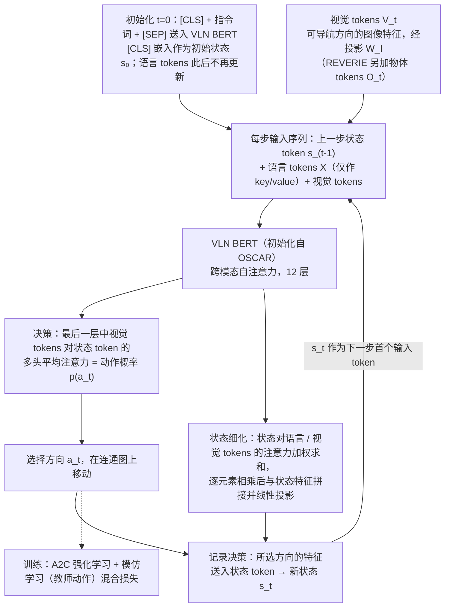

---

type: entity
tags: [paper, vln, vln-survey, navigation, embodied-ai, anu, adelaide]
status: complete
updated: 2026-09-15
arxiv: "2011.13922"
summary: "在 Transformer 中引入循环状态 token，将历史压缩后与当前可导航方向的视图 tokens、指令联合编码以输出下一步动作。"
related:
  - ../overview/vln-10-papers-technology-map.md
  - ../overview/vln-category-02-algorithm-frameworks.md
  - ../tasks/vision-language-navigation.md
sources:
  - ../../sources/papers/vln_survey_05_vln_bert.md
  - ../../sources/blogs/wechat_shenlan_vln_10_papers_survey.md
  - ../../sources/papers/vln_10_papers_catalog.md
---

# VLN↻BERT

**VLN↻BERT** 收录于 [深蓝具身智能 · VLN 10 项代表性研究](https://mp.weixin.qq.com/s/2_dYaN6IeWn_vvS_jmGqRQ) **第 05/10** 篇，归类为 **02 算法框架**。

## 一句话定义

在 Transformer 中引入循环状态 token，将历史压缩后与当前可导航方向的视图 tokens、指令联合编码以输出下一步动作。

## 英文缩写速查

| 缩写 | 英文全称 | 简要说明 |
|------|----------|----------|
| VLN | Vision-and-Language Navigation | 依据自然语言指令在环境中导航的具身任务 |
| R2R | Room-to-Room | Matterport3D 上经典逐步导航指令数据集 |
| VLM | Vision-Language Model | 视觉-语言多模态大模型，NaVid 等路线的骨干 |

## 为什么重要

- 使 BERT 类模型能处理部分可观测的时序导航输入，成为当时多 benchmark SOTA 基线架构。
- 在 Transformer 中引入循环状态 token，将历史压缩后与当前可导航方向的视图 tokens、指令联合编码以输出下一步动作。

## 流程总览

图依据：论文 §3 Proposed Model（§3.1 VLN 背景、§3.3 Recurrent VLN BERT：语言/视觉处理、状态表示与细化、决策）、§3.4 Training、Fig.2。

## 核心信息

| 字段 | 内容 |
|------|------|
| 编号 | 05/10 |
| 分组 | 02 算法框架 |
| 出处 | CVPR 2021 · arXiv:2011.13922 |
| 机构 | 澳大利亚国立大学、阿德莱德大学 |

## 核心机制（归纳）

### 1）策展导读要点

**任务形式：** 在 Transformer 中引入循环状态 token，将历史压缩后与当前可导航方向的视图 tokens、指令联合编码以输出下一步动作。

### 2）策展导读要点

**机构/出处：** 澳大利亚国立大学、阿德莱德大学 · CVPR 2021

### 3）策展导读要点

**在 VLN 地图中的位置：** 02 算法框架（#05/10）。

## 结论

**VLN↻BERT 解决的是「预训练 Transformer 天然处理不了部分可观测的时序决策」这个错配：加一个循环状态 token，把历史压成定长状态，BERT 类模型就能接进逐步导航。**

- 真正起作用的就是那个 **recurrent state token**：历史压缩后与当前可导航方向的视图 tokens、指令联合编码输出下一步动作（输入不是整个 360° 全景，依据论文 §3.3 Vision Processing 与 §4 Scene Features），无需显式维护完整历史序列。
- 它的定位是 **02 算法框架**（#05/10）：价值在于被后续工作继承的架构骨架——当时多 benchmark 的 SOTA 基线——而不是某一组具体数字。
- 同受 VLN 的通用边界约束：离散图设定下的 benchmark 提升不等于真机部署，与 VLN-CE 结果不可直接混比；量化指标以原文 PDF 为准。

## 常见误区

1. VLN benchmark 提升不等于真机部署；连续环境 (VLN-CE) 与离散图设定不可直接混比。

## 实验与评测

- 本页在公众号/survey **策展编译**基础上补充机制归纳；**量化 benchmark、消融与实机指标以原文 PDF / 项目页为准**（链接见 [参考来源](#参考来源)）。
- 与同栈姊妹篇对照时，请回到对应 **技术地图 / 42 篇栈 / BFM 地图 / VLN 地图** 总览中的实验段落。

## 与其他页面的关系

- 技术地图：[vln-10-papers-technology-map.md](../overview/vln-10-papers-technology-map.md)
- 分类 hub：[vln-category-02-algorithm-frameworks.md](../overview/vln-category-02-algorithm-frameworks.md)
- 任务页：[vision-language-navigation.md](../tasks/vision-language-navigation.md)
- 原始 source：[vln_survey_05_vln_bert.md](../../sources/papers/vln_survey_05_vln_bert.md)

## 参考来源

- [vln_survey_05_vln_bert.md](../../sources/papers/vln_survey_05_vln_bert.md) — VLN 10 篇策展摘录
- [vln_10_papers_catalog.md](../../sources/papers/vln_10_papers_catalog.md)
- [wechat_shenlan_vln_10_papers_survey.md](../../sources/blogs/wechat_shenlan_vln_10_papers_survey.md)
- 论文：<https://arxiv.org/abs/2011.13922>
- 核对（2026-11-02）：对照 arXiv:2011.13922 §3.3 与 §4，视觉输入为「可导航方向的图像特征」而非整个全景，已把页内「当前全景」改为「可导航方向的视图 tokens」；流程图原已如此，未改。
- [arXiv PDF](https://arxiv.org/pdf/2011.13922)：已通读方法部分（实验与附录以略读为准）：§3 Proposed Model（VLN 背景、BERT 回顾、Recurrent VLN BERT、训练与适配）、§4 实验设定

## 推荐继续阅读

- [VLN 10 篇技术地图](../overview/vln-10-papers-technology-map.md)
- [视觉–语言导航（VLN）](../tasks/vision-language-navigation.md)
