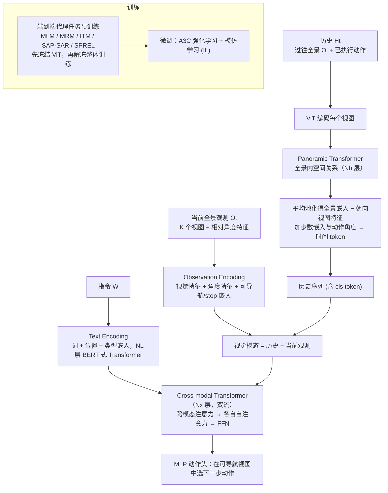

---

type: entity
tags: [paper, vln, vln-survey, navigation, embodied-ai, inria]
status: complete
updated: 2026-09-15
arxiv: "2110.13309"
summary: "层次化 ViT 编码完整历史全景序列，与历史动作、当前观测一同输入跨模态 Transformer。"
related:
  - ../overview/vln-10-papers-technology-map.md
  - ../overview/vln-category-02-algorithm-frameworks.md
  - ../tasks/vision-language-navigation.md
sources:
  - ../../sources/papers/vln_survey_06_hamt.md
  - ../../sources/blogs/wechat_shenlan_vln_10_papers_survey.md
  - ../../sources/papers/vln_10_papers_catalog.md
---

# HAMT

**HAMT** 收录于 [深蓝具身智能 · VLN 10 项代表性研究](https://mp.weixin.qq.com/s/2_dYaN6IeWn_vvS_jmGqRQ) **第 06/10** 篇，归类为 **02 算法框架**。

## 一句话定义

层次化 ViT 编码完整历史全景序列，与历史动作、当前观测一同输入跨模态 Transformer。

## 英文缩写速查

| 缩写 | 英文全称 | 简要说明 |
|------|----------|----------|
| VLN | Vision-and-Language Navigation | 依据自然语言指令在环境中导航的具身任务 |
| R2R | Room-to-Room | Matterport3D 上经典逐步导航指令数据集 |
| VLM | Vision-Language Model | 视觉-语言多模态大模型，NaVid 等路线的骨干 |

## 为什么重要

- 相对单状态 token 压缩，保留完整历史视觉信息，成为历史感知 VLN 的重要参考。
- 层次化 ViT 编码完整历史全景序列，与历史动作、当前观测一同输入跨模态 Transformer。

## 流程总览

图依据：论文 §3.1 / Fig.1、Fig.2a，§3.2–3.3（训练部分为论文文字描述）

## 核心信息

| 字段 | 内容 |
|------|------|
| 编号 | 06/10 |
| 分组 | 02 算法框架 |
| 出处 | NeurIPS 2021 · arXiv:2110.13309 |
| 机构 | 法国国家信息与自动化研究所等 |

## 核心机制（归纳）

### 1）策展导读要点

**任务形式：** 层次化 ViT 编码完整历史全景序列，与历史动作、当前观测一同输入跨模态 Transformer。

### 2）策展导读要点

**机构/出处：** 法国国家信息与自动化研究所等 · NeurIPS 2021

### 3）策展导读要点

**在 VLN 地图中的位置：** 02 算法框架（#06/10）。

## 结论

**HAMT 的取舍是「不压缩历史」：用层次化 ViT 编码完整历史全景序列，以更重的表示换取历史感知能力，而不是更轻的单状态 token。**

- 关键机制是把 **完整历史全景 + 历史动作 + 当前观测** 一并送入跨模态 Transformer，相对单状态压缩保留了更多历史视觉信息。
- 它因此成为历史建模这一支的重要参考点，在 VLN 地图中归入 [02 算法框架](../overview/vln-category-02-algorithm-frameworks.md)（#06/10）。
- 使用边界：本页为清单索引（NeurIPS 2021），量化 benchmark 与消融以原文为准；离散图设定下的提升不能直接推广到连续环境或真机部署。

## 常见误区

1. VLN benchmark 提升不等于真机部署；连续环境 (VLN-CE) 与离散图设定不可直接混比。

## 实验与评测

- 本页在公众号/survey **策展编译**基础上补充机制归纳；**量化 benchmark、消融与实机指标以原文 PDF / 项目页为准**（链接见 [参考来源](#参考来源)）。
- 与同栈姊妹篇对照时，请回到对应 **技术地图 / 42 篇栈 / BFM 地图 / VLN 地图** 总览中的实验段落。

## 与其他页面的关系

- 技术地图：[vln-10-papers-technology-map.md](../overview/vln-10-papers-technology-map.md)
- 分类 hub：[vln-category-02-algorithm-frameworks.md](../overview/vln-category-02-algorithm-frameworks.md)
- 任务页：[vision-language-navigation.md](../tasks/vision-language-navigation.md)
- 原始 source：[vln_survey_06_hamt.md](../../sources/papers/vln_survey_06_hamt.md)

## 参考来源

- [vln_survey_06_hamt.md](../../sources/papers/vln_survey_06_hamt.md) — VLN 10 篇策展摘录
- [vln_10_papers_catalog.md](../../sources/papers/vln_10_papers_catalog.md)
- [wechat_shenlan_vln_10_papers_survey.md](../../sources/blogs/wechat_shenlan_vln_10_papers_survey.md)
- 论文：<https://arxiv.org/abs/2110.13309>
- [arXiv PDF](https://arxiv.org/pdf/2110.13309)：已通读方法部分（实验与附录以略读为准）：§3 Method（3.1 HAMT、3.2 端到端代理任务训练、3.3 RL+IL 微调）

## 推荐继续阅读

- [VLN 10 篇技术地图](../overview/vln-10-papers-technology-map.md)
- [视觉–语言导航（VLN）](../tasks/vision-language-navigation.md)
