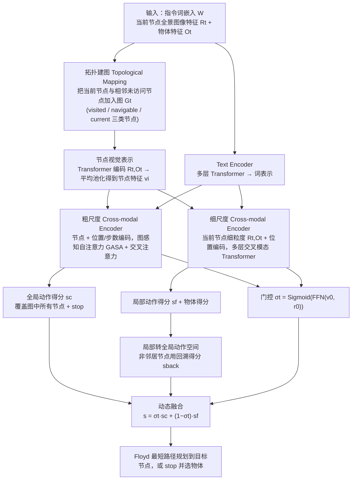

---

type: entity
tags: [paper, vln, vln-survey, navigation, embodied-ai, inria]
status: complete
updated: 2026-09-15
arxiv: "2202.11742"
summary: "在线拓扑建图 + 粗粒度全局规划与细粒度局部动作编码动态融合，双尺度图 Transformer 输出决策。"
related:
  - ../overview/vln-10-papers-technology-map.md
  - ../overview/vln-category-02-algorithm-frameworks.md
  - ../tasks/vision-language-navigation.md
sources:
  - ../../sources/papers/vln_survey_07_duet.md
  - ../../sources/blogs/wechat_shenlan_vln_10_papers_survey.md
  - ../../sources/papers/vln_10_papers_catalog.md
---

# DUET

**DUET** 收录于 [深蓝具身智能 · VLN 10 项代表性研究](https://mp.weixin.qq.com/s/2_dYaN6IeWn_vvS_jmGqRQ) **第 07/10** 篇，归类为 **02 算法框架**。

## 一句话定义

在线拓扑建图 + 粗粒度全局规划与细粒度局部动作编码动态融合，双尺度图 Transformer 输出决策。

## 英文缩写速查

| 缩写 | 英文全称 | 简要说明 |
|------|----------|----------|
| VLN | Vision-and-Language Navigation | 依据自然语言指令在环境中导航的具身任务 |
| R2R | Room-to-Room | Matterport3D 上经典逐步导航指令数据集 |
| VLM | Vision-Language Model | 视觉-语言多模态大模型，NaVid 等路线的骨干 |

## 为什么重要

- 拓扑建图路线的代表性工作，在 R2R、REVERIE、SOON 等多 benchmark 达到当时 SOTA。
- 在线拓扑建图 + 粗粒度全局规划与细粒度局部动作编码动态融合，双尺度图 Transformer 输出决策。

## 流程总览

图依据：论文 §3.1–3.3 / Fig.4（训练：行为克隆预训练 + 伪交互示教器 PID，见 §3.3）

## 核心信息

| 字段 | 内容 |
|------|------|
| 编号 | 07/10 |
| 分组 | 02 算法框架 |
| 出处 | CVPR 2022 · arXiv:2202.11742 |
| 机构 | 法国国家信息与自动化研究所等 |

## 核心机制（归纳）

### 1）策展导读要点

**任务形式：** 在线拓扑建图 + 粗粒度全局规划与细粒度局部动作编码动态融合，双尺度图 Transformer 输出决策。

### 2）策展导读要点

**机构/出处：** 法国国家信息与自动化研究所等 · CVPR 2022

### 3）策展导读要点

**在 VLN 地图中的位置：** 02 算法框架（#07/10）。

## 结论

**DUET 代表 VLN 的拓扑建图路线：把「全局去哪」和「局部怎么走」拆成两个尺度，再由同一个图 Transformer 动态融合，而不是单尺度序列决策。**

- 起作用的机制是 **在线拓扑建图** + 粗粒度全局规划与细粒度局部动作编码的动态融合——全局图提供回退与重规划能力，局部编码保留细粒度动作分辨率。
- 有效性证据是横跨 R2R、REVERIE、SOON 多 benchmark 的当时 SOTA，说明双尺度结构对不同指令粒度都适用。
- 本页为 **02 算法框架**（#07/10）的清单索引条目；量化 benchmark、消融与实机指标以原文 PDF / 项目页为准。
- 成绩取自离散图设定，不能直接迁移到连续环境（VLN-CE），benchmark 提升也不等于真机部署。

## 常见误区

1. VLN benchmark 提升不等于真机部署；连续环境 (VLN-CE) 与离散图设定不可直接混比。

## 实验与评测

- 本页在公众号/survey **策展编译**基础上补充机制归纳；**量化 benchmark、消融与实机指标以原文 PDF / 项目页为准**（链接见 [参考来源](#参考来源)）。
- 与同栈姊妹篇对照时，请回到对应 **技术地图 / 42 篇栈 / BFM 地图 / VLN 地图** 总览中的实验段落。

## 与其他页面的关系

- 技术地图：[vln-10-papers-technology-map.md](../overview/vln-10-papers-technology-map.md)
- 分类 hub：[vln-category-02-algorithm-frameworks.md](../overview/vln-category-02-algorithm-frameworks.md)
- 任务页：[vision-language-navigation.md](../tasks/vision-language-navigation.md)
- 原始 source：[vln_survey_07_duet.md](../../sources/papers/vln_survey_07_duet.md)

## 参考来源

- [vln_survey_07_duet.md](../../sources/papers/vln_survey_07_duet.md) — VLN 10 篇策展摘录
- [vln_10_papers_catalog.md](../../sources/papers/vln_10_papers_catalog.md)
- [wechat_shenlan_vln_10_papers_survey.md](../../sources/blogs/wechat_shenlan_vln_10_papers_survey.md)
- 论文：<https://arxiv.org/abs/2202.11742>
- [arXiv PDF](https://arxiv.org/pdf/2202.11742)：已通读方法部分（实验与附录以略读为准）：§3 Method（3.1 Topological Mapping、3.2 Global Action Planning、3.3 Training and Inference）

## 推荐继续阅读

- [VLN 10 篇技术地图](../overview/vln-10-papers-technology-map.md)
- [视觉–语言导航（VLN）](../tasks/vision-language-navigation.md)
