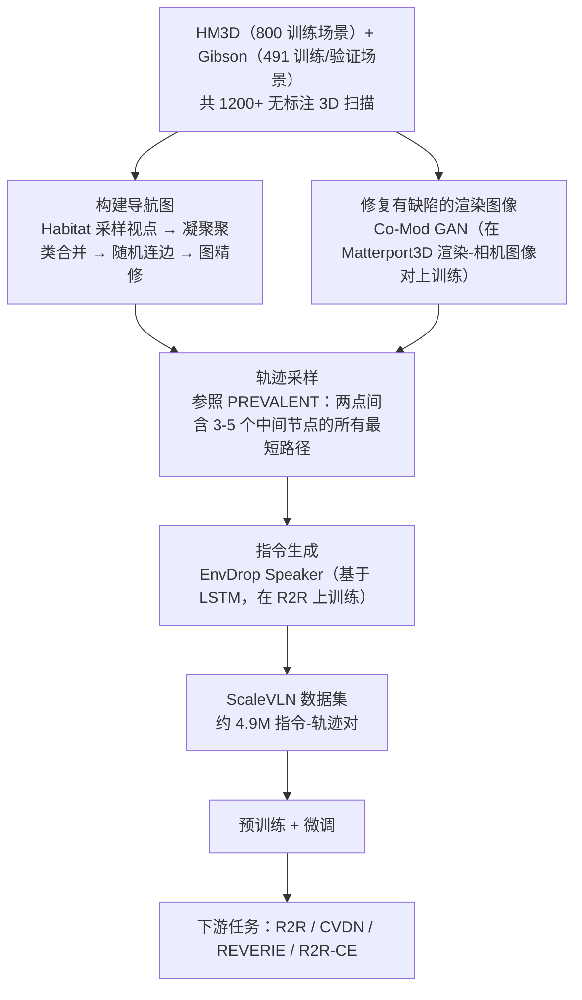

---

type: entity
tags: [paper, vln, vln-survey, navigation, embodied-ai, anu]
status: complete
updated: 2026-09-15
arxiv: "2307.15644"
summary: "从 HM3D/Gibson 1200+ 场景自动构建导航图、用 Co-Mod GAN 修复渲染图像、采样轨迹并用 EnvDrop Speaker 生成指令（依据 arXiv:2307.15644 §3.2，无风格迁移步骤），构建 490 万指令-轨迹对预训练数据。"
related:
  - ../overview/vln-10-papers-technology-map.md
  - ../overview/vln-category-02-algorithm-frameworks.md
  - ../tasks/vision-language-navigation.md
sources:
  - ../../sources/papers/vln_survey_08_scalevln.md
  - ../../sources/blogs/wechat_shenlan_vln_10_papers_survey.md
  - ../../sources/papers/vln_10_papers_catalog.md
---

# ScaleVLN

**ScaleVLN** 收录于 [深蓝具身智能 · VLN 10 项代表性研究](https://mp.weixin.qq.com/s/2_dYaN6IeWn_vvS_jmGqRQ) **第 08/10** 篇，归类为 **02 算法框架**。

## 一句话定义

从 HM3D/Gibson 1200+ 场景自动构建导航图、用 Co-Mod GAN 修复渲染图像、采样轨迹并用 EnvDrop Speaker 生成指令（依据 arXiv:2307.15644 §3.2，无风格迁移步骤），构建 490 万指令-轨迹对预训练数据。

## 英文缩写速查

| 缩写 | 英文全称 | 简要说明 |
|------|----------|----------|
| VLN | Vision-and-Language Navigation | 依据自然语言指令在环境中导航的具身任务 |
| R2R | Room-to-Room | Matterport3D 上经典逐步导航指令数据集 |
| VLM | Vision-Language Model | 视觉-语言多模态大模型，NaVid 等路线的骨干 |

## 为什么重要

- 证明数据规模扩展可显著抬升 R2R 等 benchmark 上限（R2R test 单次运行 SR：表 9 中 DUET 69% → DUET*+ScaleVLN 80%，后者另用 EnvEdit 图像增广与 CLIP ViT-H/14；摘要称相对此前 SoTA +11 个百分点，依据 arXiv:2307.15644 摘要与表 9）。
- 从 HM3D/Gibson 1200+ 场景自动构建导航图、用 Co-Mod GAN 修复渲染图像、采样轨迹并用 EnvDrop Speaker 生成指令（依据 arXiv:2307.15644 §3.2，无风格迁移步骤），构建 490 万指令-轨迹对预训练数据。

## 流程总览

图依据：论文 §3.1–3.2、Fig. 2；预训练/微调的具体训练配方在 §4.3 之后，本图未展开。

## 核心信息

| 字段 | 内容 |
|------|------|
| 编号 | 08/10 |
| 分组 | 02 算法框架 |
| 出处 | ICCV 2023 · arXiv:2307.15644 |
| 机构 | 澳大利亚国立大学、上海 AI Lab |

## 核心机制（归纳）

### 1）策展导读要点

**任务形式：** 从 HM3D/Gibson 1200+ 场景自动构建导航图、用 Co-Mod GAN 修复渲染图像、采样轨迹并用 EnvDrop Speaker 生成指令（依据 arXiv:2307.15644 §3.2，无风格迁移步骤），构建 490 万指令-轨迹对预训练数据。

### 2）策展导读要点

**机构/出处：** 澳大利亚国立大学、上海 AI Lab · ICCV 2023

### 3）策展导读要点

**在 VLN 地图中的位置：** 02 算法框架（#08/10）。

## 结论

**ScaleVLN 给出的是 VLN 的数据规模答案：与其改模型，不如把 HM3D/Gibson 的 1200+ 场景自动变成 490 万条指令-轨迹对，R2R test 单次 SR 因此从 DUET 的 69% 抬到 80%（80% 的配置另含 EnvEdit 与 CLIP ViT-H/14，见表 9）。**

- 真正起作用的是 **全自动数据管线**（导航图构建 → Co-Mod GAN 修复渲染图像 → 轨迹采样 → EnvDrop Speaker 指令生成，依据 §3.2），它把「场景多」转化成「可用监督多」；规模本身不自动等于收益，管线质量才是前提。
- 收益口径必须绑定设定：抬升发生在 **R2R 等离散图 benchmark** 上，而 benchmark 提升不等于真机部署，连续环境（VLN-CE）与离散图设定不可直接混比。
- 本页为清单索引（ICCV 2023，澳大利亚国立大学 + 上海 AI Lab，归入 **02 算法框架**）：**完整指标与消融以原文 PDF / 项目页为准**。

## 常见误区

1. VLN benchmark 提升不等于真机部署；连续环境 (VLN-CE) 与离散图设定不可直接混比。

## 实验与评测

- 本页在公众号/survey **策展编译**基础上补充机制归纳；**量化 benchmark、消融与实机指标以原文 PDF / 项目页为准**（链接见 [参考来源](#参考来源)）。
- 与同栈姊妹篇对照时，请回到对应 **技术地图 / 42 篇栈 / BFM 地图 / VLN 地图** 总览中的实验段落。

## 与其他页面的关系

- 技术地图：[vln-10-papers-technology-map.md](../overview/vln-10-papers-technology-map.md)
- 分类 hub：[vln-category-02-algorithm-frameworks.md](../overview/vln-category-02-algorithm-frameworks.md)
- 任务页：[vision-language-navigation.md](../tasks/vision-language-navigation.md)
- 原始 source：[vln_survey_08_scalevln.md](../../sources/papers/vln_survey_08_scalevln.md)

## 参考来源

- [vln_survey_08_scalevln.md](../../sources/papers/vln_survey_08_scalevln.md) — VLN 10 篇策展摘录
- [vln_10_papers_catalog.md](../../sources/papers/vln_10_papers_catalog.md)
- [wechat_shenlan_vln_10_papers_survey.md](../../sources/blogs/wechat_shenlan_vln_10_papers_survey.md)
- 论文：<https://arxiv.org/abs/2307.15644>
- [arXiv PDF](https://arxiv.org/pdf/2307.15644)：已通读方法部分（实验与附录以略读为准）：§3.1 VLN 训练资源、§3.2 增广数据生成（环境、导航图、图像修复、轨迹采样、指令生成）；§4 实验仅略读
- 核对（2026-11-02）：对照 arXiv:2307.15644 摘要、§3.2、表 9；管线去掉「风格迁移」改为论文的四步；R2R 69%→80% 经核为 test 单次 SR（DUET→DUET*+ScaleVLN），补注配置。

## 推荐继续阅读

- [VLN 10 篇技术地图](../overview/vln-10-papers-technology-map.md)
- [视觉–语言导航（VLN）](../tasks/vision-language-navigation.md)
